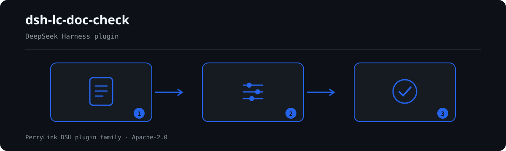

# dsh-lc-doc-check — साख-पत्र प्रस्तुति सूची की पूर्णता और उसकी तिथियों की आंतरिक संगति की जाँच

[English](README.md) · [简体中文](README-zh.md) · [Español](README-es.md) · [Português](README-pt.md) · [हिन्दी](README-hi.md)

[](https://dsh.market/)
[](https://dshfind.com/en/plugins/PerryLink/dsh-lc-doc-check?ref=badge)

`dsh-lc-doc-check` साख-पत्र (letter of credit) की एक प्रस्तुति सूची पढ़ता है — क्रेडिट हेडर और प्रत्येक शर्त की एक पंक्ति — और उसी सूची की पूर्णता तथा आंतरिक संगति जाँचता है: क्या प्रत्येक शर्त में दस्तावेज़ का प्रकार और क्रेडिट की अपेक्षा दर्ज है, क्या प्रस्तुति दर्ज है, क्या प्रस्तुति की तिथि समाप्ति से बाद की नहीं है, क्या अंतिम नौभरण तिथि समाप्ति से बाद की नहीं है, क्या असंगति का चिह्न आपकी निर्धारित शब्दावली से लिया गया है, क्या क्रेडिट क्रमांक और लाभार्थी घोषित हैं, क्या मुद्रा तीन अक्षरों के कोड में लिखी है, और क्या कोई दस्तावेज़ प्रकार दोहराया नहीं गया।

## Install

```sh
dsh plugin --profile <name> add dsh-lc-doc-check
dsh --profile <name> --dump-config | grep 'dsh-lc-doc-check'
```

## आउटपुट कैसा दिखता है



*कार्यप्रवाह: दस्तावेज़ → नियम → निष्कर्ष। नीचे के उदाहरण वास्तविक कमांड सतह का उपयोग करते हैं।*


इस प्लगइन का अपने ही `LC-001` टेस्ट फ़िक्स्चर पर वास्तविक आउटपुट — कोई नकली चित्र नहीं। नियम-पैक उद्धरण नहीं गढ़ता, इसलिए हर निष्कर्ष लागू किए गए खंड का नाम और यह भी बताता है कि उसका मूल पाठ इस बार प्राप्त नहीं हुआ।

## यह किन सवालों का जवाब देता है

### उदाहरण

नीचे दी गई तालिका उदाहरण-समुच्चय है: पहली पंक्ति विस्तृत केस है, बाकी संक्षिप्त केस हैं।


| आपका सवाल | इसका जवाब |
|---|---|
| एक शर्त में दस्तावेज़ का प्रकार और क्रेडिट की अपेक्षा दोनों खाली हैं। क्या यह दर्ज होता है? | हाँ। `LC-001` उस शर्त को दर्ज करता है, क्योंकि जिस शर्त में `docType` या `requirement` कॉलम में से कोई एक भी हो, उसमें दोनों में से कम से कम एक भरा होना चाहिए। यह देखता है कि कुछ लिखा है या नहीं, यह नहीं कि शर्त का अर्थ क्या है: यह क्रेडिट की शर्तें नहीं पढ़ता, इसलिए गलत लिखी अपेक्षा भी पास हो जाती है। |
| अपेक्षा लिखी है, पर प्रस्तुति का कॉलम खाली है। | `LC-002` हर उस शर्त में `presented` भरा होने की अपेक्षा करता है जिसमें यह कॉलम है, और खाली होने पर उस पंक्ति को दर्ज करता है। यह देखता है कि प्रस्तुति दर्ज है या नहीं, यह नहीं कि उसमें क्या लिखा है: यह उस सेल की तुलना अपेक्षा वाले सेल से नहीं करता, क्योंकि तुलना के लिए शर्तें और दस्तावेज़ दोनों पढ़ने पड़ते हैं। |
| यह वास्तव में कौन-सी तिथियाँ तुलना करता है, और जो तिथि पढ़ी न जाए उसका क्या होता है? | केवल दो जोड़े: `LC-003` `presentedAt` की तुलना `expiryAt` से करता है, और `LC-004` `latestShipment` की तुलना `expiryAt` से; समाप्ति तिथि हेडर में भी हो सकती है, क्योंकि पढ़ने वाला पहले पंक्ति में और फिर हेडर में देखता है, और एक ही दिन «बाद का नहीं» माना जाता है। जो तिथि नियम पढ़ नहीं सकता, वह छोड़े जाने के बजाय उसकी पंक्ति के साथ दर्ज होती है। `LC-004` वास्तविक नौभरण तिथि नहीं पढ़ता, और नौभरण के बाद कुछ दिनों के भीतर प्रस्तुति की अपेक्षा करने वाला नियम जाँचा नहीं जाता: पैक स्वयं कहता है कि उसे वह पाठ नहीं मिला। |
| `LC-005` कभी कुछ दर्ज ही नहीं करता। क्या यह खराब है? | `LC-005` खराब नहीं है: उसकी `values` सूची खाली आती है, यानी अनकॉन्फ़िगर, और तब यह नियम चुपचाप पास होने के बजाय `skipped` में अपना कारण बताता है। `values` में अपनी संस्था की असंगति-शब्दावली भरें, तो यह हर उस पंक्ति को दर्ज करेगा जिसका `discrepancy` मान सूची में न हो। यह केवल देखता है कि चिह्न आपकी पहचान वाला है; वास्तव में असंगति है या नहीं, यह कभी नहीं तय करता। |
| हेडर में क्रेडिट क्रमांक नहीं है, या मुद्रा `usd` लिखी है। | `LC-006` हेडर को तब दर्ज करता है जब `lcNo` या `beneficiary` घोषित न हों, ताकि प्रस्तुति किसी एक क्रेडिट से जोड़ी जा सके। `LC-007` हर ऐसे `currency` मान को दर्ज करता है जो तीन बड़े अक्षरों (पैक का मूल pattern) के अनुरूप न हो, चाहे मुद्रा हेडर में हो या पंक्ति में; यह केवल रूप देखता है, यह नहीं कि वह मुद्रा इस क्रेडिट के लिए सही है। |
| एक ही दस्तावेज़ प्रकार दो पंक्तियों में आया है। | `LC-008` बाद वाली पंक्ति को पहली की दोहराई हुई बताता है, और तुलना करते समय खाली जगह नज़रअंदाज़ करता है। यह हिट मानवीय पुष्टि माँगती है: एक ही दस्तावेज़ प्रकार पर क्रेडिट की कई अपेक्षाएँ होना सामान्य है, इसलिए एक पंक्ति हटाने के बजाय शर्त-क्रमांक कॉलम में उन्हें अलग दिखाएँ — या इस नियम को बंद कर दें। |

## यह किन मानकों पर आधारित है

| दस्तावेज़ | संख्यांक | इन्हें उद्धृत करने वाले नियम |
|---|---|---|
| 《跟单信用证统一惯例》（UCP600） | 国际商会第 600 号出版物（本次未取得条文） | LC-001, LC-002, LC-003, LC-004, LC-005, LC-006, LC-008 |
| 《表示货币的代码》 | GB/T 12406—2022（表示货币的代码；2022-12-30 发布并实施；全部代替 GB/T 12406—2008（该版名称为「表示货币和资金的代码」）——注意旧版名称含"资金"；修改采用 ISO 4217:2015，非等同采用；条号本次未取得） | LC-007 |

**Boundary:** this plugin checks a **信用证交单核对表** for the mechanical side of documentary compliance — that
each term records the document type and the credit's requirement, that the presentation is recorded, that the
presentation date is not later than the expiry, that the latest shipment date is not later than the expiry,
that the discrepancy marker comes from your vocabulary, that the credit number and beneficiary are declared,
that the currency follows its format, and that document types are unique. It does **not** decide whether a
presentation is discrepant, whether a bank must pay, or whether the documents meet the credit's terms.

> ### ⚠️ It reads a checklist, not the credit and not the documents
>
> **The plugin does not interpret credit terms.** It checks that the requirement column and the presentation
> column are both filled — it does **not** compare them, because comparing them means reading the terms and the
> documents, which is the bank's examination under UCP 600 and ISBP. So a term that the documents plainly fail
> passes this plugin as long as both columns carry text.
>
> **The 不符点 column is your declaration.** The plugin checks only that its value is one you recognise; it
> **never judges whether a discrepancy exists**. That judgement belongs to the bank.
>
> Two date checks are included, and only two: presentation ≤ expiry, and latest shipment ≤ expiry. **The
> UCP 600 rule requiring presentation within a number of days after shipment is not checked**, because the
> rule pack could not obtain the text and the register usually has no separate actual-shipment column. The
> note on that rule says so, and explains how to add the check if your register has the column.
>
> **Every `excerpt` in the rule pack says, in so many words, that the clause text was not obtained** — the
> ICC's UCP 600 and ISBP are publications the verification pass could not retrieve verbatim. The pack states
> the gap in the `excerpt` field itself and keeps every rule at `warn` or `info`. **When the texts are in
> hand, replace each `excerpt` with the real clause and raise `kind` to `direct`.**

## Compatibility

| सतह | स्थिति |
|---|---|
| Harness | peer रेंज `>=0.1.2-rc.1 <0.2.0 \|\| >=0.2.0-0 <0.3.0` — `0.2.0-rc.2` और `0.2.1-rc.2` दोनों को स्वीकार करने के लिए सत्यापित। **`engines.dsh` `>=0.2.1-0 <0.3.0` के रूप में घोषित है** और 0.2.1 से होस्ट इसे लागू करता है |
| Node | `^22.19.0 || >=24.0.0` |
| प्लेटफ़ॉर्म | सभी (शुद्ध ESM; कोई नेटिव कोड नहीं, कोई नेटवर्क नहीं, कोई मॉडल कॉल नहीं) |
| टूल मोड | `native` और `ptc` में काम करता है; पूरे फ़ोल्डर के लिए `ptc` चुनें |

## What it does

नियम-सूची, फ़ील्ड और विस्तृत व्यवहार [README.md](README.md#what-it-does) (अंग्रेज़ी मुख्य संस्करण) में हैं। यह प्लगइन केवल उद्धृत धाराओं के सामने शाब्दिक अंतर सूचीबद्ध करता है और हर न चल पाई जाँच को `skipped` में बताता है।

## Configuration

सभी समायोज्य पैरामीटर `src/config.ts` की Schemastery स्कीमा में हैं, इसलिए कोड बदले बिना `cordis.yml` से बदले जा सकते हैं; प्रति-नियम सीमाएँ `rules/` के नियम-पैक में हैं।

| कुंजी | प्रकार | डिफ़ॉल्ट | विवरण |
|---|---|---|---|
| `rulesFile` | string | `rules/lc-doc-check.yaml` | नियम-पैक का पथ, पैकेज रूट के सापेक्ष |
| `disabledRules` | string[] | `[]` | बंद करने वाले नियम id; प्रत्येक `skipped` में दिखता है |
| `onlyRules` | string[] | `[]` | केवल ये नियम चलाएँ; खाली होने पर सभी नियम चलते हैं |
| `skipNotes` | string | `""` | हर `skipped` कारण के आगे जोड़ी जाने वाली टिप्पणी |
| `timeoutMs` | number | `120000` | उपकरण का सहकारी समय-सीमा बजट |

## Material format

JSON या YAML स्वीकार्य है। पूरा फ़ील्ड उदाहरण [README.md](README.md#material-format) (अंग्रेज़ी मुख्य संस्करण) में है। पढ़ने की परत में फ़ील्ड वैकल्पिक हैं और जाँच इंजन उन्हें सत्यापित करता है, इसलिए आंशिक निर्यात पर क्रैश के बजाय "अनुपस्थित" श्रेणी के निष्कर्ष मिलते हैं।

## Rule sources

नियम-डेटा कोड से अलग है: प्रत्येक नियम में दस्तावेज़, संख्या, स्रोत की अपनी क्रमांकन-प्रणाली के अनुसार धारा, शब्दशः उद्धरण और स्रोत URL होता है। लोडर लागू करता है कि उद्धरण कम से कम आठ अक्षरों का वास्तविक उद्धरण हो, और जिस जाँच का आधार केवल सामान्य सिद्धांत (`kind: derived-from-principle`, अधिकतम `warn`) या स्थानीय नीति (`kind: institutional-configuration`, अधिकतम `info`) हो, उसे कभी `error` घोषित न किया जाए।

सत्यापित सीमाएँ और जान-बूझकर **न** कहे गए निष्कर्ष [README.md](README.md#rule-sources) (अंग्रेज़ी मुख्य संस्करण) और `rules/evidence/` में हैं।

## Troubleshooting

- **प्लगइन इंस्टॉल हो गया पर टूल दिखता नहीं**: जाँचें कि `main` `lib/index.mjs` पर जाता है और `pnpm run build` ने उसे बनाया है।
- **`dsh plugin add` असंगत बताकर मना करता है**: peer range `0.1.x` और `0.2.x` दोनों को कवर करती है; बाहर होने पर स्पष्ट छूट दें: `dsh plugin --profile <name> allow-version <pkg@ver> --dsh-version <runtime> --accept-risk`।
- **कोई नियम नहीं चला**: `skipped` सरणी देखें।
- **`check` में `manifest-peers` विफल दिखता है**: यह `dsh-plugin-dev` की ज्ञात अपस्ट्रीम समस्या है; रनटाइम इंस्टॉल के समय अनुकूलता लागू करता है।
- **समय खिसका हुआ लगता है**: सारी गणना दिए गए स्ट्रिंग पर वॉल-क्लॉक है।

## Development

```sh
pnpm install
pnpm run typecheck
pnpm test
pnpm run build
node ../scripts/sync-shared.mjs dsh-lc-doc-check
```

अंतिम कमांड `../_shared` का साझा किट `src/shared/` में कॉपी करता है; हर साझा बदलाव के बाद इसे दोबारा चलाएँ।

## PerryLink DSH Plugin Family

यह प्रोजेक्ट [PerryLink](https://github.com/PerryLink) के DeepSeek Harness प्लगइन परिवार का हिस्सा है। पूरी सूची नीचे संक्षिप्त रखी गई है ताकि हर README की पहली स्क्रीन छोटी रहे; हर पंक्ति और उसकी स्थिति देखने के लिए इसे खोलें।

<details>
<summary>सभी प्लगइन खोलें</summary>

| प्लगइन | स्थिति |
|---|---|
| **[dsh-aqua-input-check](https://github.com/PerryLink/dsh-aqua-input-check)** |  |
| **[dsh-archive-check](https://github.com/PerryLink/dsh-archive-check)** |  |
| **[dsh-auto-review](https://github.com/PerryLink/dsh-auto-review)** |  |
| **[dsh-autotier](https://github.com/PerryLink/dsh-autotier)** |  |
| **[dsh-bid-ca-precheck](https://github.com/PerryLink/dsh-bid-ca-precheck)** |  |
| **[dsh-bid-qual-check](https://github.com/PerryLink/dsh-bid-qual-check)** |  |
| **[dsh-cert-mcp](https://github.com/PerryLink/dsh-cert-mcp)** |  |
| **[dsh-checkpoint-rewind](https://github.com/PerryLink/dsh-checkpoint-rewind)** |  |
| **[dsh-click](https://github.com/PerryLink/dsh-click)** |  |
| **[dsh-composer-history](https://github.com/PerryLink/dsh-composer-history)** |  |
| **[dsh-contract-stance](https://github.com/PerryLink/dsh-contract-stance)** |  |
| **[dsh-customs-doc-check](https://github.com/PerryLink/dsh-customs-doc-check)** |  |
| **[dsh-data-quality](https://github.com/PerryLink/dsh-data-quality)** |  |
| **[dsh-demurrage-ledger](https://github.com/PerryLink/dsh-demurrage-ledger)** |  |
| **[dsh-doublecheck](https://github.com/PerryLink/dsh-doublecheck)** |  |
| **[dsh-drill-script-check](https://github.com/PerryLink/dsh-drill-script-check)** |  |
| **[dsh-eia-guide-check](https://github.com/PerryLink/dsh-eia-guide-check)** |  |
| **[dsh-emergency-plan](https://github.com/PerryLink/dsh-emergency-plan)** |  |
| **[dsh-essay-rubric-check](https://github.com/PerryLink/dsh-essay-rubric-check)** |  |
| **[dsh-evidence-check](https://github.com/PerryLink/dsh-evidence-check)** |  |
| **[dsh-export-ctl-check](https://github.com/PerryLink/dsh-export-ctl-check)** |  |
| **[dsh-fast](https://github.com/PerryLink/dsh-fast)** |  |
| **[dsh-fmea-table-check](https://github.com/PerryLink/dsh-fmea-table-check)** |  |
| **[dsh-forecast-penalty](https://github.com/PerryLink/dsh-forecast-penalty)** |  |
| **[dsh-fund-research](https://github.com/PerryLink/dsh-fund-research)** |  |
| **[dsh-github](https://github.com/PerryLink/dsh-github)** |  |
| **[dsh-gongwen-flow-check](https://github.com/PerryLink/dsh-gongwen-flow-check)** |  |
| **[dsh-gongwen-word-check](https://github.com/PerryLink/dsh-gongwen-word-check)** |  |
| **[dsh-guard-plan-qc](https://github.com/PerryLink/dsh-guard-plan-qc)** |  |
| **[dsh-hazchem-check](https://github.com/PerryLink/dsh-hazchem-check)** |  |
| **[dsh-hazplan-check](https://github.com/PerryLink/dsh-hazplan-check)** |  |
| **[dsh-hidden-risk-map](https://github.com/PerryLink/dsh-hidden-risk-map)** |  |
| **[dsh-hs-classify](https://github.com/PerryLink/dsh-hs-classify)** |  |
| **[dsh-icd-rule-check](https://github.com/PerryLink/dsh-icd-rule-check)** |  |
| **[dsh-industry-research](https://github.com/PerryLink/dsh-industry-research)** |  |
| **[dsh-lawcite-adapter](https://github.com/PerryLink/dsh-lawcite-adapter)** |  |
| **[dsh-laya](https://github.com/PerryLink/dsh-laya)** |  |
| **[dsh-lc-doc-check](https://github.com/PerryLink/dsh-lc-doc-check)** |  |
| **[dsh-learning-gap-check](https://github.com/PerryLink/dsh-learning-gap-check)** |  |
| **[dsh-library](https://github.com/PerryLink/dsh-library)** |  |
| **[dsh-local-ai](https://github.com/PerryLink/dsh-local-ai)** |  |
| **[dsh-lsp-actions](https://github.com/PerryLink/dsh-lsp-actions)** |  |
| **[dsh-mask](https://github.com/PerryLink/dsh-mask)** |  |
| **[dsh-mcp-panel](https://github.com/PerryLink/dsh-mcp-panel)** |  |
| **[dsh-medrec-qc](https://github.com/PerryLink/dsh-medrec-qc)** |  |
| **[dsh-memento](https://github.com/PerryLink/dsh-memento)** |  |
| **[dsh-nsfc-form-check](https://github.com/PerryLink/dsh-nsfc-form-check)** |  |
| **[dsh-nurse-record-check](https://github.com/PerryLink/dsh-nurse-record-check)** |  |
| **[dsh-observe](https://github.com/PerryLink/dsh-observe)** |  |
| **[dsh-origin-rvc-check](https://github.com/PerryLink/dsh-origin-rvc-check)** |  |
| **[dsh-ota-review-check](https://github.com/PerryLink/dsh-ota-review-check)** |  |
| **[dsh-output-styles](https://github.com/PerryLink/dsh-output-styles)** |  |
| **[dsh-paper-doc-adapter](https://github.com/PerryLink/dsh-paper-doc-adapter)** |  |
| **[dsh-permission-rules](https://github.com/PerryLink/dsh-permission-rules)** |  |
| **[dsh-permit-report-check](https://github.com/PerryLink/dsh-permit-report-check)** |  |
| **[dsh-pipeline-check](https://github.com/PerryLink/dsh-pipeline-check)** |  |
| **[dsh-pleading-draft](https://github.com/PerryLink/dsh-pleading-draft)** |  |
| **[dsh-plugin-doctor](https://github.com/PerryLink/dsh-plugin-doctor)** |  |
| **[dsh-plugin-guide](https://github.com/PerryLink/dsh-plugin-guide)** |  |
| **[dsh-plugin-kit](https://github.com/PerryLink/dsh-plugin-kit)** |  |
| **[dsh-plugin-upgrade](https://github.com/PerryLink/dsh-plugin-upgrade)** |  |
| **[dsh-policy-brief-draft](https://github.com/PerryLink/dsh-policy-brief-draft)** |  |
| **[dsh-power-loss-split](https://github.com/PerryLink/dsh-power-loss-split)** |  |
| **[dsh-power-ticket-check](https://github.com/PerryLink/dsh-power-ticket-check)** |  |
| **[dsh-ppap-check](https://github.com/PerryLink/dsh-ppap-check)** |  |
| **[dsh-protest-deadline](https://github.com/PerryLink/dsh-protest-deadline)** |  |
| **[dsh-railway-window](https://github.com/PerryLink/dsh-railway-window)** |  |
| **[dsh-repair-order-qc](https://github.com/PerryLink/dsh-repair-order-qc)** |  |
| **[dsh-research-report](https://github.com/PerryLink/dsh-research-report)** |  |
| **[dsh-review-reply-check](https://github.com/PerryLink/dsh-review-reply-check)** |  |
| **[dsh-rulefile-check](https://github.com/PerryLink/dsh-rulefile-check)** |  |
| **[dsh-safety-brief-check](https://github.com/PerryLink/dsh-safety-brief-check)** |  |
| **[dsh-score](https://github.com/PerryLink/dsh-score)** |  |
| **[dsh-session-sync](https://github.com/PerryLink/dsh-session-sync)** |  |
| **[dsh-site-log-check](https://github.com/PerryLink/dsh-site-log-check)** |  |
| **[dsh-skill-pack-security](https://github.com/PerryLink/dsh-skill-pack-security)** |  |
| **[dsh-soe-decision-check](https://github.com/PerryLink/dsh-soe-decision-check)** |  |
| **[dsh-soilwater-check](https://github.com/PerryLink/dsh-soilwater-check)** |  |
| **[dsh-sop-sync-check](https://github.com/PerryLink/dsh-sop-sync-check)** |  |
| **[dsh-spc-gbt-adapter](https://github.com/PerryLink/dsh-spc-gbt-adapter)** |  |
| **[dsh-talk](https://github.com/PerryLink/dsh-talk)** |  |
| **[dsh-tender-extract](https://github.com/PerryLink/dsh-tender-extract)** |  |
| **[dsh-tender-matrix](https://github.com/PerryLink/dsh-tender-matrix)** |  |
| **[dsh-test-drive](https://github.com/PerryLink/dsh-test-drive)** |  |
| **[dsh-ticktick](https://github.com/PerryLink/dsh-ticktick)** |  |
| **[dsh-translate](https://github.com/PerryLink/dsh-translate)** |  |
| **[dsh-warranty-calc](https://github.com/PerryLink/dsh-warranty-calc)** |  |
| **[dsh-budget](https://github.com/PerryLink/dsh-budget)** | 🧊 फ़्रोज़न — रिपॉज़िटरी README देखें |
| **[dsh-claude-move](https://github.com/PerryLink/dsh-claude-move)** | 🧊 फ़्रोज़न — रिपॉज़िटरी README देखें |
| **[dsh-defend](https://github.com/PerryLink/dsh-defend)** | 🧊 फ़्रोज़न — रिपॉज़िटरी README देखें |
| **[dsh-draw](https://github.com/PerryLink/dsh-draw)** | 🧊 फ़्रोज़न — रिपॉज़िटरी README देखें |
| **[dsh-reach](https://github.com/PerryLink/dsh-reach)** | 🧊 फ़्रोज़न — रिपॉज़िटरी README देखें |
| **[dsh-background-agents](https://github.com/PerryLink/dsh-background-agents)** | 🚫 सेवानिवृत्त — रिपॉज़िटरी README देखें |
| **[dsh-session-pin](https://github.com/PerryLink/dsh-session-pin)** | 🚫 सेवानिवृत्त — रिपॉज़िटरी README देखें |
| **[dsh-team-rooms](https://github.com/PerryLink/dsh-team-rooms)** | 🚫 सेवानिवृत्त — रिपॉज़िटरी README देखें |

</details>

## License

[Apache License 2.0](LICENSE) © 2026 dsh-lc-doc-check contributors.
