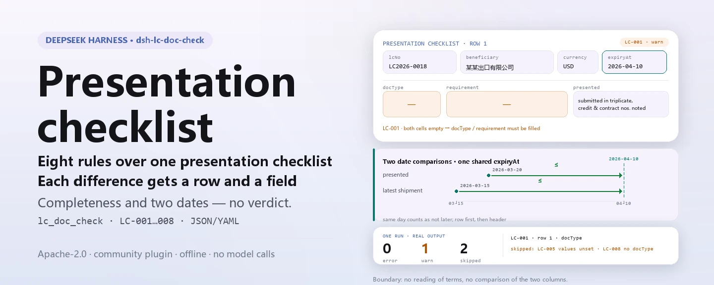

<div align="center">

<picture>
  <source media="(prefers-color-scheme: dark)" srcset="docs/assets/dsh-lc-doc-check-hero-en-dark.webp">
  
</picture>

# dsh-lc-doc-check

**Turn one letter-of-credit presentation checklist into a row-by-row list of what is missing, where, and what to fix.**

A pure host-side checker for letter-of-credit examiners: it reads the credit header plus one row per term, runs a versioned rule pack over the checklist's completeness and internal date consistency, and lists differences only — no compliance verdict, no liability finding.

[Install](#three-step-setup) · [Configuration](#configuration) · [FAQ](#faq) · [简体中文](README.md) · [English](README.en.md) · [Español](README.es.md) · [Português](README.pt.md) · [हिन्दी](README.hi.md)

[](LICENSE)
[](#compatibility)
[](https://www.npmjs.com/package/dsh-lc-doc-check)
[](https://github.com/PerryLink/dsh-lc-doc-check/actions/workflows/ci.yml)
[](#compatibility)

[](https://github.com/PerryLink/dsh-lc-doc-check/stargazers)
[](https://www.npmjs.com/package/dsh-lc-doc-check)
[](https://dshfind.com/plugins/PerryLink/dsh-lc-doc-check?ref=badge)
[](https://securityscorecards.dev/viewer/?uri=github.com/PerryLink/dsh-lc-doc-check)
[](https://dsh.market/)
[](https://gitee.com/perrylink/dsh-lc-doc-check)

```sh
dsh plugin --profile <name> add dsh-lc-doc-check
```

</div>

<sub>Community plugin, not affiliated with DeepSeek. Canonical repository: <https://github.com/PerryLink/dsh-lc-doc-check> (Gitee is a mirror).</sub>

## What it is

`dsh-lc-doc-check` reads one letter-of-credit presentation checklist — the credit header plus one row per term — and checks that checklist's own completeness and internal consistency: that each term records the document type and the credit's requirement, that the presentation is recorded, that the presentation date is not later than the expiry, that the latest shipment date is not later than the expiry, that the discrepancy marker comes from the vocabulary you configure, that the credit number and beneficiary are declared, that the currency is written as a three-letter code, and that no document type is repeated.

It only does the mechanical side: it does not interpret credit terms, does not compare the requirement column with the presentation column, does not decide whether a presentation is discrepant or whether a bank must pay, and is no replacement for the reviewer. Every check that could not run is listed in `skipped`; an empty issue list is never read as "nothing is wrong".

Once installed, you call `lc_doc_check` from the chat; no command line is needed for the check itself.

<picture>
  <source media="(prefers-color-scheme: dark)" srcset="docs/assets/dsh-lc-doc-check-flow-v5-dark.svg">
  
</picture>

## Three-step setup

1. **Install** (pick one channel):

   ```sh
   # npm channel (published releases)
   dsh plugin --profile web add dsh-lc-doc-check
   # git channel (latest main; install runs prepare to build lib/)
   dsh plugin --profile web add github:PerryLink/dsh-lc-doc-check
   # tarball channel: pnpm pack in this repo, then
   dsh plugin --profile web add ./dsh-lc-doc-check-<version>.tgz
   ```

2. **Minimal config** (every key has a default; tailor the rule pack or disable rules as needed):

   ```yaml
   - insert:
       - id: dsh-lc-doc-check
         name: dsh-lc-doc-check
         config:
           rulesFile: rules/lc-doc-check.yaml
           disabledRules: []
   ```

3. **Verify it mounts**:

   ```sh
   dsh --profile web --dump-config | grep -A2 'id: dsh-lc-doc-check'
   ```

   One-minute quickstart inside the repo (build `lib/` first; the npm package ships it):

   ```sh
   pnpm install && pnpm run build
   node samples/quickstart/run.mjs --json
   ```

   ```json
   {
     "tool": "lc_doc_check",
     "issueCount": 1,
     "summary": { "error": 0, "warn": 1, "info": 0 },
     "skippedCount": 2
   }
   ```

   The expected summary matches `samples/quickstart/expected/result.json`; the sample input is under `samples/quickstart/input/`, and a run screenshot is in `docs/assets/quickstart.png`.

**Uninstall**: `dsh plugin --profile web remove dsh-lc-doc-check` (or remove the row from the profile patch).

<details>
<summary>Enter from WorkBuddy / Coze</summary>

Search "Customs Compliance Suite" in WorkBuddy / Coze (this check is one part of it; availability as listed in the store).

</details>

## Core capabilities

- **One tool, eight rules** — `lc_doc_check` takes `file` or `material` (JSON/YAML), loads `rules/lc-doc-check.yaml`, and returns a report carrying `ruleId`, `locator`, `found`, and `expected`.
- **It checks that something is written, not what it means** — any term carrying a column must fill that column; a requirement that is filled in but wrong passes. It does not compare the requirement column with the presentation column.
- **Two date comparisons, and only two** — presentation ≤ expiry and latest shipment ≤ expiry; the expiry may live in the header (the reader looks in the row first, then the header), the same day counts as not later, and a date that cannot be parsed is reported with its row instead of being passed over.
- **Unconfigured checks are never silent** — `LC-005` ships with an empty vocabulary, so the rule reports itself in `skipped` with that reason rather than passing silently; rules disabled through `disabledRules` also appear one by one in `skipped`.
- **The rule pack is data** — replacing `rules/*.yaml` switches the rule set without code changes; the loader validates `document` / `number` / `clause` / `excerpt` / `source`, caps a principle-only basis (`derived-from-principle`) at `warn` and an institutional configuration (`institutional-configuration`) at `info`, and no rule may invent a quotation.
- **Read-only and offline** — plain ESM, no network requests, no model calls, no file writes; the original material is never modified, and date arithmetic is wall-clock over the input strings.

### Tool surface

| Parameter | Meaning |
|---|---|
| `file` | Absolute path to the material file (JSON or YAML); use it or `material` |
| `material` | Inline material text; use it or `file` |
| `rulesFile` | Override the configured rule-pack path (package-relative or absolute) |
| `only` | Run only these rule ids; empty runs every rule |

### Rule pack

| Rule | Check | Severity | Basis kind |
|---|---|---|---|
| `LC-001` | Each term records the document type and the credit's requirement | warn | derived-from-principle |
| `LC-002` | Each term records the presentation | warn | derived-from-principle |
| `LC-003` | The presentation date is not later than the expiry | warn | derived-from-principle |
| `LC-004` | The latest shipment date is not later than the expiry | warn | derived-from-principle |
| `LC-005` | The discrepancy marker comes from your configured vocabulary (unconfigured by default) | info | institutional-configuration |
| `LC-006` | The credit number and beneficiary are declared in the header | warn | derived-from-principle |
| `LC-007` | The currency is a three-letter code | warn | derived-from-principle |
| `LC-008` | Document types are unique | warn | derived-from-principle |

### Examples

The table below covers the common questions; the detailed output follows it.

| You ask | What it answers |
|---|---|
| One term leaves both the document type and the credit's requirement blank. Is that reported? | Yes. `LC-001` reports that term, because every term carrying the `docType` or `requirement` column must have at least one of the two filled. It checks that something is written, not what the term means: it does not interpret the credit's terms, so a requirement that is filled in but wrong passes. |
| The requirement is written down, but the presentation column is empty. | `LC-002` requires `presented` on every term that carries the column and reports the row where it is blank. It checks that the presentation is recorded, not what it says — it does not compare that cell with the requirement cell, because comparing them means reading the terms and the documents. |
| Which dates does it actually compare, and what happens to a date that will not parse? | Two pairs, and only two: `LC-003` compares `presentedAt` with `expiryAt`, and `LC-004` compares `latestShipment` with `expiryAt`; the expiry may sit in the header, because the reader looks in the row first and then in the header, and the same day counts as not later. A date neither rule can parse is reported with its row instead of being passed over. `LC-004` reads no actual shipment date, and the requirement to present within a number of days after shipment is not checked, because the pack states that it could not obtain that text. |
| `LC-005` never reports anything. Is it broken? | `LC-005` is not broken: its `values` list ships empty, which means unconfigured, and the rule then reports itself in `skipped` with that reason rather than passing silently. Fill `values` with your institution's discrepancy wording and it reports every row whose `discrepancy` value is not on the list. It checks only that the marker is one you recognise; it never judges whether a discrepancy exists. |
| The header carries no credit number, or the currency is written as `usd`. | `LC-006` reports the header when `lcNo` or `beneficiary` is not declared, so that a presentation can be tied to one credit. `LC-007` reports any `currency` value that is not three upper-case letters (the pack's default pattern), whether the currency sits in the header or on the row; it checks the shape only, not whether that currency is the right one for the credit. |
| The same document type appears in two rows. | `LC-008` reports the later row as a duplicate of the earlier one, ignoring spaces in the value. The hit needs human confirmation: a credit often raises several requirements against one document type, so distinguish the rows in the term-number column instead of deleting one — or disable the rule. |

**Detailed output** — tool `lc_doc_check`, input:

~~~json
{"lcNo":"LC2026-0018","rows":[{"单据种类":"","信用证要求":"","提交情况":"已提交一式三份，已注明信用证号与合同号"}]}
~~~

Output:

~~~json
{
  "id": "dsh-lc-doc-check.LC-001.de09b5a6",
  "ruleId": "LC-001",
  "severity": "warn",
  "locator": {
    "row": 1,
    "field": "docType"
  },
  "found": "第 1 行 docType、requirement 都为空",
  "expected": "docType、requirement 至少应填写一项"
}
~~~

*Observed from `dsh-lc-doc-check/tests/fixtures/LC-001/LC-001-unsafe.json`*

### Standards it follows

| Document | Number | Cited by rules |
|---|---|---|
| Uniform Customs and Practice for Documentary Credits (UCP 600) | ICC Publication No. 600 (clause text not obtained in this pass) | LC-001, LC-002, LC-003, LC-004, LC-005, LC-006, LC-008 |
| Codes for the representation of currencies | GB/T 12406—2022 (issued and effective 2022-12-30; fully replaces GB/T 12406—2008, whose title was "Codes for the representation of currencies and funds"; modified adoption of ISO 4217:2015, not identical; clause number not obtained) | LC-007 |

## Configuration

Every tunable lives in the Schemastery schema in `src/config.ts`, so it changes from `cordis.yml` without editing code; per-rule thresholds live in the rule pack under `rules/`.

| Key | Type | Default | Meaning |
|---|---|---|---|
| `rulesFile` | string | `rules/lc-doc-check.yaml` | Rule-pack path, relative to the package root |
| `disabledRules` | string[] | `[]` | Rule ids to stop running; each appears in `skipped` |
| `onlyRules` | string[] | `[]` | Run only these rule ids; empty runs every rule |
| `skipNotes` | string | `""` | Note appended to every `skipped` reason |
| `timeoutMs` | number | `120000` | Cooperative tool timeout budget (milliseconds) |

<details>
<summary>Full configuration table (5 keys)</summary>

| Key | Type | Default | Meaning |
|---|---|---|---|
| `rulesFile` | string | `rules/lc-doc-check.yaml` | Rule-pack path, relative to the package root |
| `disabledRules` | string[] | `[]` | Rule ids to stop running; each appears in `skipped` |
| `onlyRules` | string[] | `[]` | Run only these rule ids; empty runs every rule |
| `skipNotes` | string | `""` | Note appended to every `skipped` reason |
| `timeoutMs` | number | `120000` | Cooperative tool timeout budget (milliseconds) |

</details>

Rule-level parameters worth knowing:

- `LC-003` / `LC-004` `field` / `notAfterField` — the date pair to compare. The expiry may live in the header; the reader looks in the row first and then the header, so a credit-wide expiry is found.
- `LC-005` `values` — your discrepancy vocabulary, e.g. `[no discrepancy, discrepancy, accepted, refused]`; empty means no check.
- `LC-007` `pattern` — the currency shape, three upper-case letters by default.
- `LC-008` — document types must be unique. If your credit raises several requirements against one document type, distinguish the rows in the term-number column or disable the rule.
- `LC-004` — if your register has a separate actual-shipment column, add a rule with `field` pointing at that column and `notAfterField` set to `latestShipment`.

Example override in your profile patch:

```yaml
- insert:
    - id: dsh-lc-doc-check
      name: dsh-lc-doc-check
      config:
        rulesFile: rules/lc-doc-check.yaml
        disabledRules: [LC-008]
        timeoutMs: 120000
```

### Material format

The tool accepts JSON or YAML:

```yaml
lcNo: LC2026-0018
lcType: 不可撤销即期信用证
applicant: 某某进口商
beneficiary: 某某出口有限公司
issuingBank: 某某银行
currency: USD
expiryAt: 2026-04-10
rows:
  - { 序号: '1', 单据种类: 商业发票,
      信用证要求: 商业发票一式三份，注明信用证号与合同号,
      提交情况: 已提交一式三份，已注明信用证号与合同号, 份数: '3',
      交单日期: 2026-03-20, 最迟装运日: 2026-03-15, 有效期: 2026-04-10,
      不符点: 无不符点, 处理状态: 已审单 }
```

Column names are matched case-insensitively and ignoring spaces, underscores and hyphens; the checklist's own column names are kept, so a finding names the column it read. Dates may be `2026-03-20` or `2026-03-20 14:00`. Fields are optional at the reader layer and validated by the check engine, so a partial export produces "missing" findings rather than a crash; Excel can be converted to JSON/YAML first, in chat if the platform supports it.

### Rule sources

Rule data lives in `rules/lc-doc-check.yaml`, separate from code. The pack's header states what the plugin checks and what it leaves to the bank, and each rule's `note` repeats the part that matters for that rule. The load-time guard still requires a document, clause, excerpt (at least eight characters) and source per rule, and still forbids a locally configured check from being `error`; a rule pack that overstates its basis fails at load instead of producing a confident-looking report. `scripts/check-citations.mjs` holds the citation surface to `rules/citations-baseline.json`.

## FAQ

<details>
<summary>It passed a presentation I know is discrepant. Is that a miss?</summary>

It is a design boundary, not a miss. The plugin only checks that the requirement column and the presentation column are both filled; it does not compare them, so a term that is filled in but wrong passes. Whether a discrepancy exists, and whether a bank must pay, is the bank's examination under UCP 600 and ISBP.

</details>

<details>
<summary>Does the material leave my machine? Does the plugin write files?</summary>

No. It is plain ESM with no network requests and no model calls; it only reads the `file` path or the `material` text you pass, writes no files of its own, and never modifies the original. The report is returned to the host as a tool result; its `target` field only records where the material came from.

</details>

<details>
<summary>The tool never appears, or the install is refused. What do I check first?</summary>

Tool missing: confirm `main` resolves to `lib/index.mjs` and `pnpm run build` produced it; a wrong `main` makes the loader skip the entry silently. Install refused: the peer range covers `0.1.x` and `0.2.x`; if your runtime sits outside it, grant an explicit exemption: `dsh plugin --profile <name> allow-version dsh-lc-doc-check@<version> --dsh-version <runtime> --accept-risk`. Separately, `dsh-plugin-dev`'s static checker reporting `manifest-peers` as failed is a known upstream issue; the runtime's install-time peer check is authoritative.

</details>

<details>
<summary>A rule did not run, or the report is empty. What now?</summary>

Read the `skipped` array first: every check that could not run names its rule id and the reason (for example, `LC-005` has an empty vocabulary, a rule was disabled through `disabledRules`, or the material lacks a column the rule needs). An empty issue list is not "nothing is wrong"; if the tool returned nothing at all, check the install and `main` as above.

</details>

<details>
<summary>How big is the performance overhead?</summary>

The rules are a pure table scan: eight rules, no network, no model call; `timeoutMs` defaults to `120000` and is a cooperative cancellation budget. For a whole directory, use the `ptc` tool mode so the schema cost is paid once.

</details>

## Security boundaries

**Boundary:** this plugin checks a **letter-of-credit presentation checklist** for the mechanical side of documentary compliance — that each term records the document type and the credit's requirement, that the presentation is recorded, that the presentation date is not later than the expiry, that the latest shipment date is not later than the expiry, that the discrepancy marker comes from your vocabulary, that the credit number and beneficiary are declared, that the currency follows its format, and that document types are unique. It does **not** decide whether a presentation is discrepant, whether a bank must pay, or whether the documents meet the credit's terms.

> ### ⚠️ It reads a checklist, not the credit and not the documents
>
> **The plugin does not interpret credit terms.** It checks that the requirement column and the presentation column are both filled — it does **not** compare them, because comparing them means reading the terms and the documents, which is the bank's examination under UCP 600 and ISBP. So a term that the documents plainly fail passes this plugin as long as both columns carry text.
>
> **The discrepancy column is your declaration.** The plugin checks only that its value is one you recognise; it **never judges whether a discrepancy exists**. That judgement belongs to the bank.
>
> Two date checks are included, and only two: presentation ≤ expiry, and latest shipment ≤ expiry. **The UCP 600 rule requiring presentation within a number of days after shipment is not checked**, because the rule pack could not obtain the text and the register usually has no separate actual-shipment column. The note on that rule says so, and explains how to add the check if your register has the column.
>
> **Every `excerpt` in the rule pack says, in so many words, that the clause text was not obtained** — the ICC's UCP 600 and ISBP are publications the verification pass could not retrieve verbatim. The pack states the gap in the `excerpt` field itself and keeps every rule at `warn` or `info`. **When the texts are in hand, replace each `excerpt` with the real clause and raise `kind` to `direct`.**

## Permissions & data

- **Permissions**: `package.json#dsh.capabilities` declares only `tools:register`; the plugin reads the material file you point it at plus its own packaged rule pack, and does not write files, use the network, or read credentials.
- **Data**: the original material is never modified; the report is returned to the host as a tool result and the plugin persists nothing. `reportJson` is the same report as a JSON string; whether to store it is the caller's decision.
- **Session log**: tool results are handled by the host under its session policy; this plugin writes no extra audit event and adds no business data beyond the material to the report.

## Known limitations

- **It checks the checklist itself only.** It does not cover credit terms, document contents, or the bank's examination; it covers only what can be pointed at inside the checklist — written fields and internal consistency.
- **Two date checks, and only two.** Presentation ≤ expiry and latest shipment ≤ expiry; UCP 600's presentation-within-days-after-shipment rule is not checked, and no actual shipment date is read.
- **Citation gap.** Every `excerpt` in the rule pack states that the clause text was not obtained, so the basis can only be a principle and severity is capped at `warn` (`LC-005` is institutional configuration, capped at `info`). Once the texts are in hand, replace the `excerpt` and raise `kind` to `direct`.
- **`LC-005` ships unconfigured.** With an empty `values` list the rule goes to `skipped` rather than passing silently; each institution must supply its own vocabulary.
- **`LC-008` needs human confirmation.** Several rows for one document type may simply be a credit splitting one document's requirements; distinguish them in the term-number column instead of deleting a row.
- **Dates are wall-clock.** Every date comparison is wall-clock arithmetic over the input strings with no time-zone conversion, so "today" in a different time zone does not change the result.
- **`manifest-peers` is a static-check false alarm.** `dsh-plugin-dev`'s static checker compares against a hard-coded peer range that predates the 0.2 line; the runtime enforces peer compatibility at install time, so the declared range is the correct one. This is a known upstream issue.

## Interoperability with other DSH plugins

This plugin registers one tool and no shared event listener, so it cannot contend with other plugins over commands, events, or slots:

- **No tool-name collision.** The single tool name, `lc_doc_check`, is specific to this plugin; it takes no bare name owned by a built-in tool or another plugin.
- **No service-key collision.** It provides no service key at all.
- **No slot collision.** It registers no client slot key, so it cannot contend for a `shadows-shipped-ui` seat.
- **No HTTP route collision.** It registers no `webServer` prefix.
- **No global mutation.** It does not patch prototypes, rewrite `process.env`, or replace the global fetch dispatcher.
- **No shared events.** It installs no `agent/pre-step` or `tools/post-execute` listener, so there is no waterfall short-circuit and no listener can starve another.
- **The shared kit is a copy.** `src/shared/` is copied in from the family `_shared`, not imported as a runtime dependency, so it cannot bring a version conflict to co-installed plugins.

## Compatibility

| Surface | Status |
|---|---|
| Harness | Peer range `>=0.1.2-rc.1 <0.2.0 \|\| >=0.2.0-0 <0.3.0` — verified to accept both `0.2.0-rc.2` and `0.2.1-rc.2`; `engines.dsh` is declared as `>=0.2.1-0 <0.3.0` and is enforced by the host since 0.2.1 |
| Node | `^22.19.0 \|\| >=24.0.0` |
| Platforms | All (plain ESM; no native code, no network, no model call) |
| Tool mode | Works in `native` and `ptc`; for a full directory use `ptc` so the schema cost is paid once |

## Ecosystem & quality

- [Gitee mirror](https://gitee.com/perrylink/dsh-lc-doc-check) (sync mirror; GitHub is canonical)
- [dshfind plugin page](https://dshfind.com/plugins/PerryLink/dsh-lc-doc-check) (installs and ranking)
- [OpenSSF Scorecard report](https://securityscorecards.dev/viewer/?uri=github.com/PerryLink/dsh-lc-doc-check) (driven by [.github/workflows/scorecard.yml](.github/workflows/scorecard.yml))
- [DSH Market](https://dsh.market/) (listed)
- [Choose a checker by material](https://perrylink.github.io/zh/checkers/choose/): the family's checker-selection and measured-data knowledge base
- **WorkBuddy / Coze**: search "Customs Compliance Suite" (this check is one part of it; availability as listed in the store)

## Development

```sh
pnpm install
pnpm run typecheck          # tsc --noEmit
pnpm test                   # vitest; 33 cases (ACCEPTANCE.csv records 33/33)
pnpm run build              # tsdown -> lib/index.mjs + lib/index.d.mts
pnpm run verify:self-contained   # dependency specs resolve from the registry
pnpm run check:lockfile          # lockfile drift
pnpm run check:readmes           # five-language README consistency
pnpm run check:citations         # rule-pack citation check
node ../scripts/sync-shared.mjs dsh-lc-doc-check   # refresh src/shared from ../_shared
pnpm pack                        # the published tarball
```

`lib/` is a build artifact (gitignored) and ships inside the npm package; run `pnpm run build` before the in-repo `samples/quickstart`. The README images are generated by [`scripts/gen-readme-assets.py`](scripts/gen-readme-assets.py) (Python + Pillow, with a CJK font probe that aborts when no font is found); it emits four hero WebPs (zh/en × light/dark) and the two 1100x660 flow SVGs, and is safe to re-run:

```sh
python scripts/gen-readme-assets.py
```

| Path | Purpose |
|---|---|
| `src/index.ts` | Function-plugin contract (`name` / `inject` / `Config` / `apply`); registers `lc_doc_check` and resolves the rule pack |
| `src/config.ts` | Schemastery schema; every tunable lives here, no hard-coded threshold |
| `src/model.ts` | Table shape and material contract; column aliases and header fields are declared here |
| `src/view.ts` | Model-facing report projection; `output.schema` mirrors it |
| `src/shared/` | Family shared kit (ruleset loader, report shape, YAML subset, date arithmetic, wording guard) — copied in so the package stays self-contained |
| `rules/lc-doc-check.yaml` | The rule pack, eight rules |
| `rules/citations-baseline.json` | Citation baseline used by `check:citations` |
| `tests/` | Vitest; a compliant/violating fixture pair per rule, plus boundary-semantics tests |
| `samples/quickstart/` | One-minute quickstart input, expected summary, and runner |
| `scripts/` | Build, self-contained, lockfile, citation and README-sync gates, plus the asset generator |

Topics: `deepseek-harness`, `dsh`, `dsh-plugin`, `cordis`, `doc`

## Family & thanks

This project is part of the DeepSeek Harness plugin family from [PerryLink](https://github.com/PerryLink) (all Apache-2.0). If it is useful, **a star helps the next person find it** — nothing is gated behind it.

- [@PerryLink](https://github.com/PerryLink) — creator and maintainer: the rule pack, the shared check engine, and the five-language docs.
- The family shared kit (`src/shared/`) — copied in from `_shared` so this package is self-contained; the citation-verification record and citation discipline are maintained once for the family.

<details>
<summary>Expand all plugins</summary>

| Plugin | Status |
|---|---|
| **[dsh-aqua-input-check](https://github.com/PerryLink/dsh-aqua-input-check)** |  |
| **[dsh-archive-check](https://github.com/PerryLink/dsh-archive-check)** |  |
| **[dsh-auto-review](https://github.com/PerryLink/dsh-auto-review)** |  |
| **[dsh-autotier](https://github.com/PerryLink/dsh-autotier)** | 🧊 FROZEN — see the repo README |
| **[dsh-bid-ca-precheck](https://github.com/PerryLink/dsh-bid-ca-precheck)** |  |
| **[dsh-bid-qual-check](https://github.com/PerryLink/dsh-bid-qual-check)** |  |
| **[dsh-cert-mcp](https://github.com/PerryLink/dsh-cert-mcp)** | 🧊 FROZEN — see the repo README |
| **[dsh-checkpoint-rewind](https://github.com/PerryLink/dsh-checkpoint-rewind)** |  |
| **[dsh-click](https://github.com/PerryLink/dsh-click)** |  |
| **[dsh-composer-history](https://github.com/PerryLink/dsh-composer-history)** |  |
| **[dsh-contract-stance](https://github.com/PerryLink/dsh-contract-stance)** |  |
| **[dsh-customs-doc-check](https://github.com/PerryLink/dsh-customs-doc-check)** |  |
| **[dsh-data-quality](https://github.com/PerryLink/dsh-data-quality)** | 🧊 FROZEN — see the repo README |
| **[dsh-demurrage-ledger](https://github.com/PerryLink/dsh-demurrage-ledger)** |  |
| **[dsh-doublecheck](https://github.com/PerryLink/dsh-doublecheck)** |  |
| **[dsh-drill-script-check](https://github.com/PerryLink/dsh-drill-script-check)** |  |
| **[dsh-eia-guide-check](https://github.com/PerryLink/dsh-eia-guide-check)** |  |
| **[dsh-emergency-plan](https://github.com/PerryLink/dsh-emergency-plan)** |  |
| **[dsh-essay-rubric-check](https://github.com/PerryLink/dsh-essay-rubric-check)** |  |
| **[dsh-evidence-check](https://github.com/PerryLink/dsh-evidence-check)** |  |
| **[dsh-export-ctl-check](https://github.com/PerryLink/dsh-export-ctl-check)** |  |
| **[dsh-fast](https://github.com/PerryLink/dsh-fast)** |  |
| **[dsh-fmea-table-check](https://github.com/PerryLink/dsh-fmea-table-check)** |  |
| **[dsh-forecast-penalty](https://github.com/PerryLink/dsh-forecast-penalty)** |  |
| **[dsh-fund-research](https://github.com/PerryLink/dsh-fund-research)** |  |
| **[dsh-github](https://github.com/PerryLink/dsh-github)** |  |
| **[dsh-gongwen-flow-check](https://github.com/PerryLink/dsh-gongwen-flow-check)** |  |
| **[dsh-gongwen-word-check](https://github.com/PerryLink/dsh-gongwen-word-check)** |  |
| **[dsh-guard-plan-qc](https://github.com/PerryLink/dsh-guard-plan-qc)** |  |
| **[dsh-hazchem-check](https://github.com/PerryLink/dsh-hazchem-check)** |  |
| **[dsh-hazplan-check](https://github.com/PerryLink/dsh-hazplan-check)** |  |
| **[dsh-hidden-risk-map](https://github.com/PerryLink/dsh-hidden-risk-map)** |  |
| **[dsh-hs-classify](https://github.com/PerryLink/dsh-hs-classify)** |  |
| **[dsh-icd-rule-check](https://github.com/PerryLink/dsh-icd-rule-check)** |  |
| **[dsh-industry-research](https://github.com/PerryLink/dsh-industry-research)** |  |
| **[dsh-lawcite-adapter](https://github.com/PerryLink/dsh-lawcite-adapter)** |  |
| **[dsh-laya](https://github.com/PerryLink/dsh-laya)** |  |
| **[dsh-lc-doc-check](https://github.com/PerryLink/dsh-lc-doc-check)** |  |
| **[dsh-learning-gap-check](https://github.com/PerryLink/dsh-learning-gap-check)** |  |
| **[dsh-library](https://github.com/PerryLink/dsh-library)** |  |
| **[dsh-local-ai](https://github.com/PerryLink/dsh-local-ai)** |  |
| **[dsh-lsp-actions](https://github.com/PerryLink/dsh-lsp-actions)** |  |
| **[dsh-mask](https://github.com/PerryLink/dsh-mask)** |  |
| **[dsh-mcp-panel](https://github.com/PerryLink/dsh-mcp-panel)** |  |
| **[dsh-medrec-qc](https://github.com/PerryLink/dsh-medrec-qc)** |  |
| **[dsh-memento](https://github.com/PerryLink/dsh-memento)** | 🧊 FROZEN — see the repo README |
| **[dsh-nsfc-form-check](https://github.com/PerryLink/dsh-nsfc-form-check)** |  |
| **[dsh-nurse-record-check](https://github.com/PerryLink/dsh-nurse-record-check)** |  |
| **[dsh-observe](https://github.com/PerryLink/dsh-observe)** |  |
| **[dsh-origin-rvc-check](https://github.com/PerryLink/dsh-origin-rvc-check)** |  |
| **[dsh-ota-review-check](https://github.com/PerryLink/dsh-ota-review-check)** |  |
| **[dsh-output-styles](https://github.com/PerryLink/dsh-output-styles)** |  |
| **[dsh-paper-doc-adapter](https://github.com/PerryLink/dsh-paper-doc-adapter)** |  |
| **[dsh-permission-rules](https://github.com/PerryLink/dsh-permission-rules)** |  |
| **[dsh-permit-report-check](https://github.com/PerryLink/dsh-permit-report-check)** |  |
| **[dsh-pipeline-check](https://github.com/PerryLink/dsh-pipeline-check)** |  |
| **[dsh-pleading-draft](https://github.com/PerryLink/dsh-pleading-draft)** |  |
| **[dsh-plugin-doctor](https://github.com/PerryLink/dsh-plugin-doctor)** | 🚫 RETIRED (repo archived) |
| **[dsh-plugin-guide](https://github.com/PerryLink/dsh-plugin-guide)** |  |
| **[dsh-plugin-kit](https://github.com/PerryLink/dsh-plugin-kit)** | 🚫 RETIRED (repo archived) |
| **[dsh-plugin-upgrade](https://github.com/PerryLink/dsh-plugin-upgrade)** | 🚫 RETIRED (repo archived) |
| **[dsh-policy-brief-draft](https://github.com/PerryLink/dsh-policy-brief-draft)** |  |
| **[dsh-power-loss-split](https://github.com/PerryLink/dsh-power-loss-split)** |  |
| **[dsh-power-ticket-check](https://github.com/PerryLink/dsh-power-ticket-check)** |  |
| **[dsh-ppap-check](https://github.com/PerryLink/dsh-ppap-check)** |  |
| **[dsh-protest-deadline](https://github.com/PerryLink/dsh-protest-deadline)** |  |
| **[dsh-railway-window](https://github.com/PerryLink/dsh-railway-window)** |  |
| **[dsh-repair-order-qc](https://github.com/PerryLink/dsh-repair-order-qc)** |  |
| **[dsh-research-report](https://github.com/PerryLink/dsh-research-report)** |  |
| **[dsh-review-reply-check](https://github.com/PerryLink/dsh-review-reply-check)** |  |
| **[dsh-rulefile-check](https://github.com/PerryLink/dsh-rulefile-check)** |  |
| **[dsh-safety-brief-check](https://github.com/PerryLink/dsh-safety-brief-check)** |  |
| **[dsh-score](https://github.com/PerryLink/dsh-score)** | 🧊 FROZEN — see the repo README |
| **[dsh-session-sync](https://github.com/PerryLink/dsh-session-sync)** |  |
| **[dsh-site-log-check](https://github.com/PerryLink/dsh-site-log-check)** |  |
| **[dsh-skill-pack-security](https://github.com/PerryLink/dsh-skill-pack-security)** |  |
| **[dsh-soe-decision-check](https://github.com/PerryLink/dsh-soe-decision-check)** |  |
| **[dsh-soilwater-check](https://github.com/PerryLink/dsh-soilwater-check)** |  |
| **[dsh-sop-sync-check](https://github.com/PerryLink/dsh-sop-sync-check)** |  |
| **[dsh-spc-gbt-adapter](https://github.com/PerryLink/dsh-spc-gbt-adapter)** |  |
| **[dsh-talk](https://github.com/PerryLink/dsh-talk)** |  |
| **[dsh-tender-extract](https://github.com/PerryLink/dsh-tender-extract)** |  |
| **[dsh-tender-matrix](https://github.com/PerryLink/dsh-tender-matrix)** |  |
| **[dsh-test-drive](https://github.com/PerryLink/dsh-test-drive)** |  |
| **[dsh-ticktick](https://github.com/PerryLink/dsh-ticktick)** | 🚫 RETIRED (repo archived) |
| **[dsh-translate](https://github.com/PerryLink/dsh-translate)** |  |
| **[dsh-warranty-calc](https://github.com/PerryLink/dsh-warranty-calc)** |  |
| **[dsh-budget](https://github.com/PerryLink/dsh-budget)** | 🧊 FROZEN — see the repo README |
| **[dsh-claude-move](https://github.com/PerryLink/dsh-claude-move)** | 🧊 FROZEN — see the repo README |
| **[dsh-defend](https://github.com/PerryLink/dsh-defend)** | 🧊 FROZEN — see the repo README |
| **[dsh-draw](https://github.com/PerryLink/dsh-draw)** | 🧊 FROZEN — see the repo README |
| **[dsh-reach](https://github.com/PerryLink/dsh-reach)** | 🧊 FROZEN — see the repo README |
| **[dsh-background-agents](https://github.com/PerryLink/dsh-background-agents)** | 🚫 RETIRED (repo archived) |
| **[dsh-session-pin](https://github.com/PerryLink/dsh-session-pin)** | 🚫 RETIRED (repo archived) |
| **[dsh-team-rooms](https://github.com/PerryLink/dsh-team-rooms)** | 🚫 RETIRED (repo archived) |

</details>

## License

[LICENSE](LICENSE) (Apache License 2.0) © 2026 dsh-lc-doc-check contributors

<p align="center"><sub>Apache-2.0 · Community plugin, not affiliated with DeepSeek.</sub></p>
