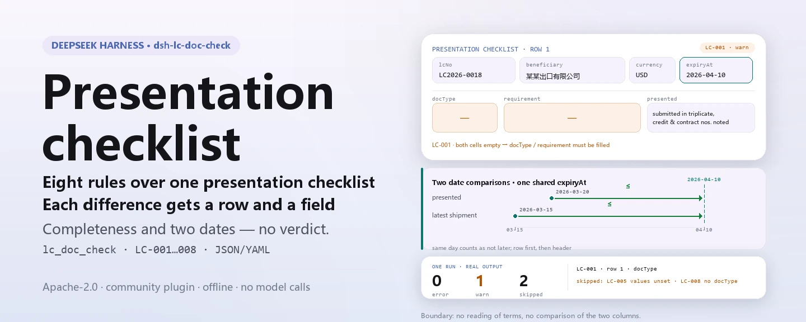

<div align="center">

<picture>
  <source media="(prefers-color-scheme: dark)" srcset="docs/assets/dsh-lc-doc-check-hero-en-dark.webp">
  
</picture>

# dsh-lc-doc-check

**Convierta una lista de presentación de un crédito documentario en una lista, fila por fila, de lo que falta, dónde y qué corregir.**

Un verificador de host puro para examinadores de créditos documentarios: lee la cabecera del crédito más una fila por cláusula, aplica un paquete de reglas versionado a la completitud y la coherencia interna de fechas de esa lista y solo enumera diferencias — sin dictamen de cumplimiento ni atribución de responsabilidad.

[Instalar](#instalación-en-tres-pasos) · [Configuración](#configuración) · [FAQ](#faq) · [简体中文](README.md) · [English](README.en.md) · [Español](README.es.md) · [Português](README.pt.md) · [हिन्दी](README.hi.md)

[](LICENSE)
[](#compatibilidad)
[](https://www.npmjs.com/package/dsh-lc-doc-check)
[](https://github.com/PerryLink/dsh-lc-doc-check/actions/workflows/ci.yml)
[](#compatibilidad)

[](https://github.com/PerryLink/dsh-lc-doc-check/stargazers)
[](https://www.npmjs.com/package/dsh-lc-doc-check)
[](https://dshfind.com/plugins/PerryLink/dsh-lc-doc-check?ref=badge)
[](https://securityscorecards.dev/viewer/?uri=github.com/PerryLink/dsh-lc-doc-check)
[](https://dsh.market/)
[](https://gitee.com/perrylink/dsh-lc-doc-check)

```sh
dsh plugin --profile <name> add dsh-lc-doc-check
```

</div>

<sub>Plugin de la comunidad, sin relación con DeepSeek. Repositorio canónico: <https://github.com/PerryLink/dsh-lc-doc-check> (Gitee es un espejo).</sub>

## Qué es

`dsh-lc-doc-check` lee una lista de presentación de documentos de un crédito documentario —la cabecera del crédito más una fila por cláusula— y comprueba la completitud y la coherencia interna de esa lista: que cada cláusula registre el tipo de documento y la exigencia del crédito, que la presentación esté registrada, que la fecha de presentación no sea posterior al vencimiento, que la fecha límite de embarque no sea posterior al vencimiento, que la marca de discrepancia proceda del vocabulario que usted configure, que se declaren el número de crédito y el beneficiario, que la moneda se escriba como código de tres letras y que no se repita ningún tipo de documento.

Solo cubre la parte mecánica: no interpreta las cláusulas del crédito, no compara la columna de la exigencia con la de la presentación, no decide si una presentación es discrepante ni si un banco debe pagar, y no sustituye al revisor. Toda comprobación que no pudo ejecutarse se enumera en `skipped`; una lista de problemas vacía nunca se lee como «no hay nada mal».

Una vez instalado, llame a `lc_doc_check` desde el chat; para la comprobación en sí no hace falta escribir comandos.

<picture>
  <source media="(prefers-color-scheme: dark)" srcset="docs/assets/dsh-lc-doc-check-flow-v5-dark.svg">
  
</picture>

## Instalación en tres pasos

1. **Instalar** (elija un canal):

   ```sh
   # canal npm (versiones publicadas)
   dsh plugin --profile web add dsh-lc-doc-check
   # canal git (último main; la instalación ejecuta prepare para construir lib/)
   dsh plugin --profile web add github:PerryLink/dsh-lc-doc-check
   # canal tarball: tras pnpm pack en este repositorio
   dsh plugin --profile web add ./dsh-lc-doc-check-<version>.tgz
   ```

2. **Configuración mínima** (todas las claves tienen valor por defecto; ajuste el paquete de reglas o desactive reglas según necesidad):

   ```yaml
   - insert:
       - id: dsh-lc-doc-check
         name: dsh-lc-doc-check
         config:
           rulesFile: rules/lc-doc-check.yaml
           disabledRules: []
   ```

3. **Comprobar que se monta**:

   ```sh
   dsh --profile web --dump-config | grep -A2 'id: dsh-lc-doc-check'
   ```

   Prueba de un minuto dentro del repositorio (construya `lib/` antes; el paquete npm ya lo incluye):

   ```sh
   pnpm install && pnpm run build
   node samples/quickstart/run.mjs --json
   ```

   ```json
   {
     "tool": "lc_doc_check",
     "issueCount": 1,
     "summary": { "error": 0, "warn": 1, "info": 0 },
     "skippedCount": 2
   }
   ```

   El resumen esperado coincide con `samples/quickstart/expected/result.json`; la entrada del ejemplo está en `samples/quickstart/input/` y la captura de ejecución en `docs/assets/quickstart.png`.

**Desinstalar**: `dsh plugin --profile web remove dsh-lc-doc-check` (o quite la fila del patch del perfil).

<details>
<summary>Entrar desde WorkBuddy / Coze</summary>

Busque «Customs Compliance Suite» en WorkBuddy / Coze (esta comprobación es una parte; disponibilidad según la tienda).

</details>

## Capacidades principales

- **Una herramienta, ocho reglas** — `lc_doc_check` recibe `file` o `material` (JSON/YAML), carga `rules/lc-doc-check.yaml` y devuelve un informe con `ruleId`, `locator`, `found` y `expected`.
- **Comprueba que algo esté escrito, no lo que significa** — toda cláusula que traiga una columna debe rellenarla; una exigencia mal escrita pasa. No compara la columna de la exigencia con la de la presentación.
- **Dos comparaciones de fechas, y solo dos** — presentación ≤ vencimiento y último embarque ≤ vencimiento; el vencimiento puede estar en la cabecera (el lector mira primero la fila y luego la cabecera), el mismo día cuenta como no posterior y una fecha que no se puede analizar se informa con su fila en lugar de omitirse.
- **Las comprobaciones no configuradas nunca callan** — `LC-005` sale con el vocabulario vacío, así que la regla se informa a sí misma en `skipped` con ese motivo en lugar de pasar en silencio; las reglas desactivadas con `disabledRules` también aparecen una a una en `skipped`.
- **El paquete de reglas es datos** — sustituir `rules/*.yaml` cambia el conjunto de reglas sin tocar código; el cargador valida `document` / `number` / `clause` / `excerpt` / `source`, limita a `warn` una base solo de principio (`derived-from-principle`) y a `info` una configuración institucional (`institutional-configuration`), y ninguna regla puede inventar una cita.
- **Solo lectura y sin conexión** — ESM puro, sin peticiones de red, sin llamadas al modelo, sin escritura de archivos; el material original nunca se modifica y la aritmética de fechas es de hora local sobre las cadenas de entrada.

### Superficie de la herramienta

| Parámetro | Significado |
|---|---|
| `file` | Ruta absoluta del archivo de material (JSON o YAML); úselo con `material` o sin él |
| `material` | Texto de material en línea; úselo con `file` o sin él |
| `rulesFile` | Sustituye la ruta configurada del paquete de reglas (relativa al paquete o absoluta) |
| `only` | Ejecutar solo estas reglas; vacío ejecuta todas |

### Paquete de reglas

| Regla | Comprobación | Gravedad | Tipo de base |
|---|---|---|---|
| `LC-001` | Cada cláusula registra el tipo de documento y la exigencia del crédito | warn | derived-from-principle |
| `LC-002` | Cada cláusula registra la presentación | warn | derived-from-principle |
| `LC-003` | La fecha de presentación no es posterior al vencimiento | warn | derived-from-principle |
| `LC-004` | La fecha límite de embarque no es posterior al vencimiento | warn | derived-from-principle |
| `LC-005` | La marca de discrepancia procede del vocabulario configurado (sin configurar por defecto) | info | institutional-configuration |
| `LC-006` | La cabecera declara el número de crédito y el beneficiario | warn | derived-from-principle |
| `LC-007` | La moneda es un código de tres letras | warn | derived-from-principle |
| `LC-008` | Los tipos de documento son únicos | warn | derived-from-principle |

### Ejemplos

La tabla siguiente cubre las preguntas habituales; la salida detallada va después.

| Usted pregunta | Qué responde |
|---|---|
| Una cláusula deja vacíos el tipo de documento y la exigencia del crédito. ¿Se informa de eso? | Sí. `LC-001` informa de esa cláusula, porque toda cláusula que traiga la columna `docType` o `requirement` debe tener al menos una de las dos rellena. Comprueba que haya texto, no lo que la cláusula significa: no interpreta las condiciones del crédito, así que una exigencia mal escrita pasa. |
| La exigencia está escrita, pero la columna de la presentación está vacía. | `LC-002` exige `presented` en toda cláusula que traiga la columna e informa de la fila en que está vacía. Comprueba que la presentación quede registrada, no lo que dice: no compara esa celda con la celda de la exigencia, porque compararlas obliga a leer las cláusulas y los documentos. |
| ¿Qué fechas compara realmente y qué ocurre con una fecha que no se puede analizar? | Dos pares, y solo dos: `LC-003` compara `presentedAt` con `expiryAt`, y `LC-004` compara `latestShipment` con `expiryAt`; el vencimiento puede estar en la cabecera, porque el lector mira primero en la fila y luego en la cabecera, y el mismo día cuenta como no posterior. Una fecha que la regla no puede analizar se informa con su fila en lugar de omitirse. `LC-004` no lee ninguna fecha real de embarque, y la exigencia de presentar dentro de un cierto número de días tras el embarque no se comprueba: el paquete declara que no obtuvo ese texto. |
| `LC-005` no informa nunca de nada. ¿Está averiado? | `LC-005` no está averiado: su lista `values` viene vacía, es decir, sin configurar, y entonces la regla se informa a sí misma en `skipped` con ese motivo en lugar de pasar en silencio. Rellene `values` con la terminología de su institución y señalará toda fila cuyo valor de `discrepancy` no esté en la lista. Solo comprueba que la marca sea una que usted reconozca; nunca juzga si existe realmente una discrepancia. |
| La cabecera no trae número de crédito, o la moneda figura como `usd`. | `LC-006` informa de la cabecera cuando no se declaran `lcNo` o `beneficiary`, para que la presentación pueda ligarse a un crédito concreto. `LC-007` informa de todo valor de `currency` que no sean tres letras mayúsculas (el patrón por defecto del paquete), esté la moneda en la cabecera o en la fila; solo comprueba la forma, no si esa moneda es la correcta para el crédito. |
| El mismo tipo de documento aparece en dos filas. | `LC-008` informa de la fila posterior como duplicada de la anterior, ignorando los espacios del valor. El hallazgo necesita confirmación humana: es habitual que un crédito plantee varias exigencias sobre un mismo tipo de documento, así que distinga las filas en la columna del número de cláusula en vez de borrar una, o desactive la regla. |

**Salida detallada** — herramienta `lc_doc_check`, entrada:

~~~json
{"lcNo":"LC2026-0018","rows":[{"单据种类":"","信用证要求":"","提交情况":"已提交一式三份，已注明信用证号与合同号"}]}
~~~

Salida:

~~~json
{
  "id": "dsh-lc-doc-check.LC-001.de09b5a6",
  "ruleId": "LC-001",
  "severity": "warn",
  "locator": {
    "row": 1,
    "field": "docType"
  },
  "found": "第 1 行 docType、requirement 都为空",
  "expected": "docType、requirement 至少应填写一项"
}
~~~

*Observed from `dsh-lc-doc-check/tests/fixtures/LC-001/LC-001-unsafe.json`*

### Normas que sigue

| Documento | Número | Reglas que lo citan |
|---|---|---|
| Convenio de la Cámara de Comercio Internacional sobre créditos documentarios (UCP 600) | Publicación n.º 600 de la ICC (texto de la cláusula no obtenido en esta pasada) | LC-001, LC-002, LC-003, LC-004, LC-005, LC-006, LC-008 |
| Códigos para la representación de monedas | GB/T 12406—2022 (publicada y vigente desde 2022-12-30; sustituye íntegramente a GB/T 12406—2008, cuyo título era «Códigos para la representación de monedas y fondos»; adopción modificada de ISO 4217:2015, no idéntica; número de cláusula no obtenido) | LC-007 |

## Configuración

Todos los parámetros ajustables viven en el esquema Schemastery de `src/config.ts`, por lo que se cambian desde `cordis.yml` sin tocar el código; los umbrales por regla están en el paquete de reglas bajo `rules/`.

| Clave | Tipo | Predeterminado | Descripción |
|---|---|---|---|
| `rulesFile` | string | `rules/lc-doc-check.yaml` | Ruta del paquete de reglas, relativa a la raíz del paquete |
| `disabledRules` | string[] | `[]` | Ids de reglas que se dejan de ejecutar; cada una aparece en `skipped` |
| `onlyRules` | string[] | `[]` | Ejecutar solo estas reglas; vacío ejecuta todas |
| `skipNotes` | string | `""` | Nota añadida a cada motivo de `skipped` |
| `timeoutMs` | number | `120000` | Presupuesto de tiempo de espera cooperativo de la herramienta (milisegundos) |

<details>
<summary>Tabla de configuración completa (5 claves)</summary>

| Clave | Tipo | Predeterminado | Descripción |
|---|---|---|---|
| `rulesFile` | string | `rules/lc-doc-check.yaml` | Ruta del paquete de reglas, relativa a la raíz del paquete |
| `disabledRules` | string[] | `[]` | Ids de reglas que se dejan de ejecutar; cada una aparece en `skipped` |
| `onlyRules` | string[] | `[]` | Ejecutar solo estas reglas; vacío ejecuta todas |
| `skipNotes` | string | `""` | Nota añadida a cada motivo de `skipped` |
| `timeoutMs` | number | `120000` | Presupuesto de tiempo de espera cooperativo de la herramienta (milisegundos) |

</details>

Parámetros por regla que conviene conocer:

- `LC-003` / `LC-004` `field` / `notAfterField` — el par de fechas que se compara. El vencimiento puede estar en la cabecera; el lector mira primero en la fila y luego en la cabecera, así que encuentra un vencimiento común a todo el crédito.
- `LC-005` `values` — su vocabulario de discrepancias, p. ej. `[sin discrepancia, con discrepancia, aceptado, rechazado]`; vacío significa que no se comprueba.
- `LC-007` `pattern` — la forma de la moneda; por defecto, tres letras mayúsculas.
- `LC-008` — los tipos de documento deben ser únicos. Si su crédito plantea varias exigencias sobre un mismo tipo, distinga las filas en la columna del número de cláusula o desactive la regla.
- `LC-004` — si su registro tiene una columna separada de embarque real, añada una regla con `field` apuntando a esa columna y `notAfterField` en `latestShipment`.

Ejemplo de sustitución en el patch del perfil:

```yaml
- insert:
    - id: dsh-lc-doc-check
      name: dsh-lc-doc-check
      config:
        rulesFile: rules/lc-doc-check.yaml
        disabledRules: [LC-008]
        timeoutMs: 120000
```

### Formato del material

La herramienta acepta JSON o YAML:

```yaml
lcNo: LC2026-0018
lcType: 不可撤销即期信用证
applicant: 某某进口商
beneficiary: 某某出口有限公司
issuingBank: 某某银行
currency: USD
expiryAt: 2026-04-10
rows:
  - { 序号: '1', 单据种类: 商业发票,
      信用证要求: 商业发票一式三份，注明信用证号与合同号,
      提交情况: 已提交一式三份，已注明信用证号与合同号, 份数: '3',
      交单日期: 2026-03-20, 最迟装运日: 2026-03-15, 有效期: 2026-04-10,
      不符点: 无不符点, 处理状态: 已审单 }
```

Los nombres de columna se comparan sin distinguir mayúsculas y sin contar espacios, guiones bajos ni guiones; se conservan los nombres propios de la lista, de modo que el hallazgo nombra la columna que leyó. Las fechas pueden ser `2026-03-20` o `2026-03-20 14:00`. Los campos son opcionales en la capa de lectura y los valida el motor, de modo que una exportación parcial produce hallazgos de «falta» en lugar de un fallo; Excel puede convertirse antes a JSON/YAML, en el chat si la plataforma lo permite.

### Origen de las reglas

Los datos de las reglas viven en `rules/lc-doc-check.yaml`, separados del código. La cabecera del paquete declara qué comprueba el plugin y qué deja al banco, y la `note` de cada regla repite la parte que le corresponde. El cargador sigue exigiendo documento, cláusula, extracto (de al menos ocho caracteres) y fuente por regla, y sigue prohibiendo que una comprobación configurada localmente sea `error`; un paquete de reglas que exagera su base falla al cargar en lugar de producir un informe que parece sólido. `scripts/check-citations.mjs` mantiene la superficie de citas contra `rules/citations-baseline.json`.

## FAQ

<details>
<summary>Ha pasado una presentación que sé que es discrepante. ¿Es un fallo de detección?</summary>

Es un límite de diseño, no un fallo. El plugin solo comprueba que la columna de la exigencia y la de la presentación estén rellenas; no las compara, así que una cláusula rellena pero equivocada pasa. Si existe una discrepancia y si un banco debe pagar es el examen del banco conforme a UCP 600 e ISBP.

</details>

<details>
<summary>¿Sale el material de mi máquina? ¿Escribe archivos el plugin?</summary>

No. Es ESM puro, sin peticiones de red y sin llamadas al modelo; solo lee la ruta `file` o el texto `material` que usted pasa, no escribe archivos propios y nunca modifica el original. El informe se devuelve al host como resultado de herramienta; su campo `target` solo registra de dónde vino el material.

</details>

<details>
<summary>La herramienta no aparece o la instalación se rechaza. ¿Qué miro primero?</summary>

Herramienta ausente: confirme que `main` resuelve a `lib/index.mjs` y que `pnpm run build` lo generó; un `main` incorrecto hace que el cargador omita la entrada en silencio. Instalación rechazada: el rango de peers cubre `0.1.x` y `0.2.x`; si su runtime queda fuera, conceda una exención explícita: `dsh plugin --profile <name> allow-version dsh-lc-doc-check@<version> --dsh-version <runtime> --accept-risk`. Aparte, que el comprobador estático de `dsh-plugin-dev` marque `manifest-peers` como fallo es un problema conocido de aguas arriba; la comprobación de peers en la instalación es la que manda.

</details>

<details>
<summary>Una regla no se ejecutó o el informe está vacío. ¿Y ahora?</summary>

Lea primero el arreglo `skipped`: cada comprobación que no pudo ejecutarse indica su id de regla y el motivo (por ejemplo, `LC-005` tiene el vocabulario vacío, una regla se desactivó con `disabledRules` o al material le falta una columna que la regla necesita). Una lista de problemas vacía no significa «no hay nada mal»; si la herramienta no devolvió nada, revise la instalación y `main` como arriba.

</details>

<details>
<summary>¿Cuánta sobrecarga de rendimiento supone?</summary>

Las reglas son un recorrido de tabla puro: ocho reglas, sin red, sin llamada al modelo; `timeoutMs` vale `120000` por defecto y es un presupuesto de cancelación cooperativa. Para un directorio completo use el modo de herramienta `ptc`, así el coste del esquema se paga una sola vez.

</details>

## Límites de seguridad

**Límite:** este plugin comprueba una **lista de presentación de un crédito documentario** en el lado mecánico del cumplimiento documental — que cada cláusula registre el tipo de documento y la exigencia del crédito, que la presentación esté registrada, que la fecha de presentación no sea posterior al vencimiento, que la fecha límite de embarque no sea posterior al vencimiento, que la marca de discrepancia proceda de su vocabulario, que se declaren el número de crédito y el beneficiario, que la moneda siga su formato y que los tipos de documento sean únicos. **No** decide si una presentación es discrepante, si un banco debe pagar ni si los documentos cumplen las condiciones del crédito.

> ### ⚠️ Lee una lista de comprobación, no el crédito ni los documentos
>
> **El plugin no interpreta las cláusulas del crédito.** Comprueba que la columna de la exigencia y la de la presentación estén ambas rellenas — **no** las compara, porque compararlas obliga a leer las cláusulas y los documentos, que es el examen del banco conforme a UCP 600 e ISBP. Por eso una cláusula que los documentos incumplen claramente pasa este plugin mientras ambas columnas tengan texto.
>
> **La columna de discrepancia es su declaración.** El plugin solo comprueba que su valor sea uno que usted reconozca; **nunca juzga si existe una discrepancia**. Ese juicio pertenece al banco.
>
> Se incluyen dos comprobaciones de fechas, y solo dos: presentación ≤ vencimiento y último embarque ≤ vencimiento. **La regla de UCP 600 que exige presentar dentro de un número de días tras el embarque no se comprueba**, porque el paquete de reglas no pudo obtener el texto y el registro suele no tener una columna separada de embarque real. La nota de esa regla lo dice y explica cómo añadir la comprobación si su registro tiene la columna.
>
> **Cada `excerpt` del paquete de reglas dice, con todas las letras, que el texto de la cláusula no se obtuvo** — UCP 600 e ISBP de la ICC son publicaciones que la pasada de verificación no pudo recuperar literalmente. El paquete declara la laguna en el propio campo `excerpt` y mantiene cada regla en `warn` o `info`. **Cuando tenga los textos, sustituya cada `excerpt` por la cláusula real y suba `kind` a `direct`.**

## Permisos y datos

- **Permisos**: `package.json#dsh.capabilities` declara solo `tools:register`; el plugin lee el archivo de material que usted indica y su propio paquete de reglas, y no escribe archivos, no usa la red ni lee credenciales.
- **Datos**: el material original nunca se modifica; el informe se devuelve al host como resultado de herramienta y el plugin no persiste nada. `reportJson` es el mismo informe como cadena JSON; guardarlo o no es decisión de quien llama.
- **Registro de sesión**: el host trata los resultados de herramienta según su política de sesión; este plugin no escribe eventos de auditoría adicionales ni añade datos de negocio más allá del material.

## Limitaciones conocidas

- **Solo comprueba la lista de comprobación.** No cubre las cláusulas del crédito, el contenido de los documentos ni el examen del banco; cubre solo lo que se puede señalar dentro de la lista: campos escritos y coherencia interna.
- **Dos comprobaciones de fechas, y solo dos.** Presentación ≤ vencimiento y último embarque ≤ vencimiento; la regla de UCP 600 sobre presentar en un número de días tras el embarque no se comprueba y no se lee ninguna fecha real de embarque.
- **Laguna de citas.** Cada `excerpt` del paquete declara que el texto de la cláusula no se obtuvo, así que la base solo puede ser un principio y la gravedad queda limitada a `warn` (`LC-005` es configuración institucional, limitada a `info`). Cuando tenga los textos, sustituya el `excerpt` y suba `kind` a `direct`.
- **`LC-005` sale sin configurar.** Con la lista `values` vacía, la regla pasa a `skipped` en lugar de pasar en silencio; cada institución debe aportar su propio vocabulario.
- **`LC-008` necesita confirmación humana.** Varias filas para un mismo tipo de documento pueden ser simplemente un crédito que divide las exigencias de un documento; distíngalas en la columna del número de cláusula en vez de borrar una fila.
- **Las fechas son de hora local.** Toda comparación de fechas es aritmética de hora local sobre las cadenas de entrada, sin conversión de zona horaria; por eso «hoy» en otra zona no cambia el resultado.
- **`manifest-peers` es una falsa alarma del comprobador estático.** El comprobador estático de `dsh-plugin-dev` compara con un rango de peers codificado que es anterior a la línea 0.2; el runtime aplica la compatibilidad de peers al instalar, así que el rango declarado es el correcto. Es un problema conocido de aguas arriba.

## Interoperabilidad con otros plugins DSH

Este plugin registra una herramienta y ningún escucha de eventos compartidos, así que no puede competir con otros plugins por comandos, eventos ni slots:

- **Sin colisión de nombres de herramienta.** El único nombre, `lc_doc_check`, es propio de este plugin; no ocupa ningún nombre desnudo de una herramienta integrada ni de otro plugin.
- **Sin colisión de claves de servicio.** No proporciona ninguna clave de servicio.
- **Sin colisión de slots.** No registra ninguna clave de slot de cliente, así que no compite por un asiento de `shadows-shipped-ui`.
- **Sin colisión de rutas HTTP.** No registra ningún prefijo `webServer`.
- **Sin mutación global.** No parchea prototipos, no reescribe `process.env` ni sustituye el despachador global de fetch.
- **Sin eventos compartidos.** No instala escuchas de `agent/pre-step` ni `tools/post-execute`, así que no hay cortocircuito de waterfall ni un escucha puede dejar sin ejecución a otro.
- **El kit compartido es una copia.** `src/shared/` se copia del `_shared` de la familia y no se importa como dependencia de ejecución, así que no puede llevar un conflicto de versiones a plugins coinstalados.

## Compatibilidad

| Superficie | Estado |
|---|---|
| Harness | Rango de peers `>=0.1.2-rc.1 <0.2.0 \|\| >=0.2.0-0 <0.3.0` — verificado para aceptar tanto `0.2.0-rc.2` como `0.2.1-rc.2`; `engines.dsh` se declara como `>=0.2.1-0 <0.3.0` y el host lo aplica desde 0.2.1 |
| Node | `^22.19.0 \|\| >=24.0.0` |
| Plataformas | Todas (ESM puro; sin código nativo, sin red, sin llamada al modelo) |
| Modo de herramienta | Funciona en `native` y `ptc`; para un directorio completo use `ptc` para pagar el coste del esquema una sola vez |

## Ecosistema y calidad

- [Espejo en Gitee](https://gitee.com/perrylink/dsh-lc-doc-check) (espejo sincronizado; GitHub es canónico)
- [Página de dshfind](https://dshfind.com/plugins/PerryLink/dsh-lc-doc-check) (instalaciones y ranking)
- [Informe de OpenSSF Scorecard](https://securityscorecards.dev/viewer/?uri=github.com/PerryLink/dsh-lc-doc-check) (impulsado por [.github/workflows/scorecard.yml](.github/workflows/scorecard.yml))
- [DSH Market](https://dsh.market/) (publicado)
- [Elegir un verificador por material](https://perrylink.github.io/zh/checkers/choose/): base de conocimiento de selección y datos medidos de la familia
- **WorkBuddy / Coze**: busque «Customs Compliance Suite» (esta comprobación es una parte; disponibilidad según la tienda)

## Desarrollo

```sh
pnpm install
pnpm run typecheck          # tsc --noEmit
pnpm test                   # vitest; 33 casos (ACCEPTANCE.csv registra 33/33)
pnpm run build              # tsdown -> lib/index.mjs + lib/index.d.mts
pnpm run verify:self-contained   # las dependencias se resuelven desde el registro
pnpm run check:lockfile          # deriva del lockfile
pnpm run check:readmes           # coherencia de los cinco README
pnpm run check:citations         # comprobación de citas del paquete de reglas
node ../scripts/sync-shared.mjs dsh-lc-doc-check   # refrescar src/shared desde ../_shared
pnpm pack                        # el tarball publicado
```

`lib/` es un artefacto de compilación (gitignored) y viaja dentro del paquete npm; ejecute `pnpm run build` antes del `samples/quickstart` del repositorio. Las imágenes del README las genera [`scripts/gen-readme-assets.py`](scripts/gen-readme-assets.py) (Python + Pillow, con una sonda de fuentes CJK que aborta si no encuentra ninguna); emite cuatro hero WebP (zh/en × claro/oscuro) y los dos SVG de flujo de 1100x660, y se puede volver a ejecutar:

```sh
python scripts/gen-readme-assets.py
```

| Ruta | Propósito |
|---|---|
| `src/index.ts` | Contrato de plugin de función (`name` / `inject` / `Config` / `apply`); registra `lc_doc_check` y resuelve el paquete de reglas |
| `src/config.ts` | Esquema Schemastery; todo lo ajustable vive aquí, sin umbrales codificados |
| `src/model.ts` | Forma de la tabla y contrato del material; aquí se declaran alias de columnas y campos de cabecera |
| `src/view.ts` | Proyección del informe para el modelo; `output.schema` la refleja |
| `src/shared/` | Kit compartido de la familia (cargador de reglas, forma del informe, subconjunto YAML, aritmética de fechas, guardia de redacción) — copiado para que el paquete sea autocontenido |
| `rules/lc-doc-check.yaml` | El paquete de reglas, ocho reglas |
| `rules/citations-baseline.json` | Línea base de citas que usa `check:citations` |
| `tests/` | Vitest; un par de fixtures conforme/infractor por regla, más pruebas de semántica de límites |
| `samples/quickstart/` | Entrada de la prueba de un minuto, resumen esperado y ejecutor |
| `scripts/` | Puertas de compilación, autocontención, lockfile, citas y sincronización de README, más el generador de imágenes |

Topics: `deepseek-harness`, `dsh`, `dsh-plugin`, `cordis`, `doc`

## Familia y agradecimientos

Este proyecto forma parte de la familia de plugins de DeepSeek Harness de [PerryLink](https://github.com/PerryLink) (todos Apache-2.0). Si le resulta útil, **una estrella ayuda a que la siguiente persona lo encuentre** — no desbloquea nada.

- [@PerryLink](https://github.com/PerryLink) — creador y mantenedor: el paquete de reglas, el motor de comprobación compartido y la documentación en cinco idiomas.
- El kit compartido de la familia (`src/shared/`) — copiado de `_shared` para que este paquete sea autocontenido; el registro de verificación de citas y la disciplina de citas se mantienen una sola vez para la familia.

<details>
<summary>Expandir todos los plugins</summary>

| Plugin | Estado |
|---|---|
| **[dsh-aqua-input-check](https://github.com/PerryLink/dsh-aqua-input-check)** |  |
| **[dsh-archive-check](https://github.com/PerryLink/dsh-archive-check)** |  |
| **[dsh-auto-review](https://github.com/PerryLink/dsh-auto-review)** |  |
| **[dsh-autotier](https://github.com/PerryLink/dsh-autotier)** | 🧊 CONGELADO — ver el README del repo |
| **[dsh-bid-ca-precheck](https://github.com/PerryLink/dsh-bid-ca-precheck)** |  |
| **[dsh-bid-qual-check](https://github.com/PerryLink/dsh-bid-qual-check)** |  |
| **[dsh-cert-mcp](https://github.com/PerryLink/dsh-cert-mcp)** | 🧊 CONGELADO — ver el README del repo |
| **[dsh-checkpoint-rewind](https://github.com/PerryLink/dsh-checkpoint-rewind)** |  |
| **[dsh-click](https://github.com/PerryLink/dsh-click)** |  |
| **[dsh-composer-history](https://github.com/PerryLink/dsh-composer-history)** |  |
| **[dsh-contract-stance](https://github.com/PerryLink/dsh-contract-stance)** |  |
| **[dsh-customs-doc-check](https://github.com/PerryLink/dsh-customs-doc-check)** |  |
| **[dsh-data-quality](https://github.com/PerryLink/dsh-data-quality)** | 🧊 CONGELADO — ver el README del repo |
| **[dsh-demurrage-ledger](https://github.com/PerryLink/dsh-demurrage-ledger)** |  |
| **[dsh-doublecheck](https://github.com/PerryLink/dsh-doublecheck)** |  |
| **[dsh-drill-script-check](https://github.com/PerryLink/dsh-drill-script-check)** |  |
| **[dsh-eia-guide-check](https://github.com/PerryLink/dsh-eia-guide-check)** |  |
| **[dsh-emergency-plan](https://github.com/PerryLink/dsh-emergency-plan)** |  |
| **[dsh-essay-rubric-check](https://github.com/PerryLink/dsh-essay-rubric-check)** |  |
| **[dsh-evidence-check](https://github.com/PerryLink/dsh-evidence-check)** |  |
| **[dsh-export-ctl-check](https://github.com/PerryLink/dsh-export-ctl-check)** |  |
| **[dsh-fast](https://github.com/PerryLink/dsh-fast)** |  |
| **[dsh-fmea-table-check](https://github.com/PerryLink/dsh-fmea-table-check)** |  |
| **[dsh-forecast-penalty](https://github.com/PerryLink/dsh-forecast-penalty)** |  |
| **[dsh-fund-research](https://github.com/PerryLink/dsh-fund-research)** |  |
| **[dsh-github](https://github.com/PerryLink/dsh-github)** |  |
| **[dsh-gongwen-flow-check](https://github.com/PerryLink/dsh-gongwen-flow-check)** |  |
| **[dsh-gongwen-word-check](https://github.com/PerryLink/dsh-gongwen-word-check)** |  |
| **[dsh-guard-plan-qc](https://github.com/PerryLink/dsh-guard-plan-qc)** |  |
| **[dsh-hazchem-check](https://github.com/PerryLink/dsh-hazchem-check)** |  |
| **[dsh-hazplan-check](https://github.com/PerryLink/dsh-hazplan-check)** |  |
| **[dsh-hidden-risk-map](https://github.com/PerryLink/dsh-hidden-risk-map)** |  |
| **[dsh-hs-classify](https://github.com/PerryLink/dsh-hs-classify)** |  |
| **[dsh-icd-rule-check](https://github.com/PerryLink/dsh-icd-rule-check)** |  |
| **[dsh-industry-research](https://github.com/PerryLink/dsh-industry-research)** |  |
| **[dsh-lawcite-adapter](https://github.com/PerryLink/dsh-lawcite-adapter)** |  |
| **[dsh-laya](https://github.com/PerryLink/dsh-laya)** |  |
| **[dsh-lc-doc-check](https://github.com/PerryLink/dsh-lc-doc-check)** |  |
| **[dsh-learning-gap-check](https://github.com/PerryLink/dsh-learning-gap-check)** |  |
| **[dsh-library](https://github.com/PerryLink/dsh-library)** |  |
| **[dsh-local-ai](https://github.com/PerryLink/dsh-local-ai)** |  |
| **[dsh-lsp-actions](https://github.com/PerryLink/dsh-lsp-actions)** |  |
| **[dsh-mask](https://github.com/PerryLink/dsh-mask)** |  |
| **[dsh-mcp-panel](https://github.com/PerryLink/dsh-mcp-panel)** |  |
| **[dsh-medrec-qc](https://github.com/PerryLink/dsh-medrec-qc)** |  |
| **[dsh-memento](https://github.com/PerryLink/dsh-memento)** | 🧊 CONGELADO — ver el README del repo |
| **[dsh-nsfc-form-check](https://github.com/PerryLink/dsh-nsfc-form-check)** |  |
| **[dsh-nurse-record-check](https://github.com/PerryLink/dsh-nurse-record-check)** |  |
| **[dsh-observe](https://github.com/PerryLink/dsh-observe)** |  |
| **[dsh-origin-rvc-check](https://github.com/PerryLink/dsh-origin-rvc-check)** |  |
| **[dsh-ota-review-check](https://github.com/PerryLink/dsh-ota-review-check)** |  |
| **[dsh-output-styles](https://github.com/PerryLink/dsh-output-styles)** |  |
| **[dsh-paper-doc-adapter](https://github.com/PerryLink/dsh-paper-doc-adapter)** |  |
| **[dsh-permission-rules](https://github.com/PerryLink/dsh-permission-rules)** |  |
| **[dsh-permit-report-check](https://github.com/PerryLink/dsh-permit-report-check)** |  |
| **[dsh-pipeline-check](https://github.com/PerryLink/dsh-pipeline-check)** |  |
| **[dsh-pleading-draft](https://github.com/PerryLink/dsh-pleading-draft)** |  |
| **[dsh-plugin-doctor](https://github.com/PerryLink/dsh-plugin-doctor)** | 🚫 RETIRADO (repo archivado) |
| **[dsh-plugin-guide](https://github.com/PerryLink/dsh-plugin-guide)** |  |
| **[dsh-plugin-kit](https://github.com/PerryLink/dsh-plugin-kit)** | 🚫 RETIRADO (repo archivado) |
| **[dsh-plugin-upgrade](https://github.com/PerryLink/dsh-plugin-upgrade)** | 🚫 RETIRADO (repo archivado) |
| **[dsh-policy-brief-draft](https://github.com/PerryLink/dsh-policy-brief-draft)** |  |
| **[dsh-power-loss-split](https://github.com/PerryLink/dsh-power-loss-split)** |  |
| **[dsh-power-ticket-check](https://github.com/PerryLink/dsh-power-ticket-check)** |  |
| **[dsh-ppap-check](https://github.com/PerryLink/dsh-ppap-check)** |  |
| **[dsh-protest-deadline](https://github.com/PerryLink/dsh-protest-deadline)** |  |
| **[dsh-railway-window](https://github.com/PerryLink/dsh-railway-window)** |  |
| **[dsh-repair-order-qc](https://github.com/PerryLink/dsh-repair-order-qc)** |  |
| **[dsh-research-report](https://github.com/PerryLink/dsh-research-report)** |  |
| **[dsh-review-reply-check](https://github.com/PerryLink/dsh-review-reply-check)** |  |
| **[dsh-rulefile-check](https://github.com/PerryLink/dsh-rulefile-check)** |  |
| **[dsh-safety-brief-check](https://github.com/PerryLink/dsh-safety-brief-check)** |  |
| **[dsh-score](https://github.com/PerryLink/dsh-score)** | 🧊 CONGELADO — ver el README del repo |
| **[dsh-session-sync](https://github.com/PerryLink/dsh-session-sync)** |  |
| **[dsh-site-log-check](https://github.com/PerryLink/dsh-site-log-check)** |  |
| **[dsh-skill-pack-security](https://github.com/PerryLink/dsh-skill-pack-security)** |  |
| **[dsh-soe-decision-check](https://github.com/PerryLink/dsh-soe-decision-check)** |  |
| **[dsh-soilwater-check](https://github.com/PerryLink/dsh-soilwater-check)** |  |
| **[dsh-sop-sync-check](https://github.com/PerryLink/dsh-sop-sync-check)** |  |
| **[dsh-spc-gbt-adapter](https://github.com/PerryLink/dsh-spc-gbt-adapter)** |  |
| **[dsh-talk](https://github.com/PerryLink/dsh-talk)** |  |
| **[dsh-tender-extract](https://github.com/PerryLink/dsh-tender-extract)** |  |
| **[dsh-tender-matrix](https://github.com/PerryLink/dsh-tender-matrix)** |  |
| **[dsh-test-drive](https://github.com/PerryLink/dsh-test-drive)** |  |
| **[dsh-ticktick](https://github.com/PerryLink/dsh-ticktick)** | 🚫 RETIRADO (repo archivado) |
| **[dsh-translate](https://github.com/PerryLink/dsh-translate)** |  |
| **[dsh-warranty-calc](https://github.com/PerryLink/dsh-warranty-calc)** |  |
| **[dsh-budget](https://github.com/PerryLink/dsh-budget)** | 🧊 CONGELADO — ver el README del repo |
| **[dsh-claude-move](https://github.com/PerryLink/dsh-claude-move)** | 🧊 CONGELADO — ver el README del repo |
| **[dsh-defend](https://github.com/PerryLink/dsh-defend)** | 🧊 CONGELADO — ver el README del repo |
| **[dsh-draw](https://github.com/PerryLink/dsh-draw)** | 🧊 CONGELADO — ver el README del repo |
| **[dsh-reach](https://github.com/PerryLink/dsh-reach)** | 🧊 CONGELADO — ver el README del repo |
| **[dsh-background-agents](https://github.com/PerryLink/dsh-background-agents)** | 🚫 RETIRADO (repo archivado) |
| **[dsh-session-pin](https://github.com/PerryLink/dsh-session-pin)** | 🚫 RETIRADO (repo archivado) |
| **[dsh-team-rooms](https://github.com/PerryLink/dsh-team-rooms)** | 🚫 RETIRADO (repo archivado) |

</details>

## Licencia

[LICENSE](LICENSE) (Apache License 2.0) © 2026 dsh-lc-doc-check contributors

<p align="center"><sub>Apache-2.0 · Plugin de la comunidad, sin relación con DeepSeek.</sub></p>
