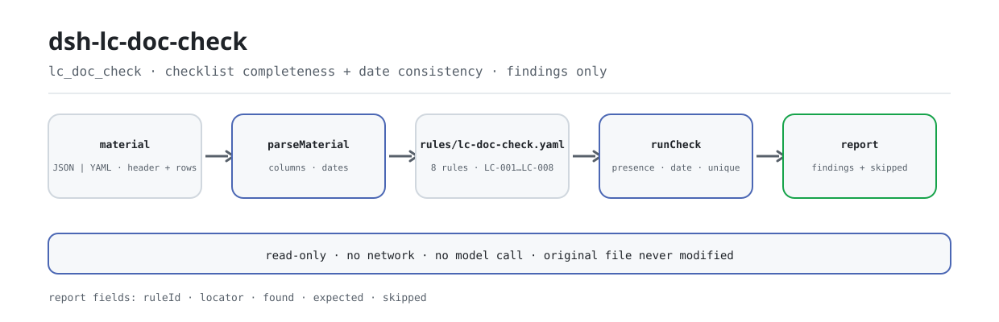

<div align="center">

<picture>
  <source media="(prefers-color-scheme: dark)" srcset="docs/assets/dsh-lc-doc-check-flow-dark.svg">
  
</picture>

# dsh-lc-doc-check

**साख-पत्र की एक प्रस्तुति सूची को पंक्ति-दर-पंक्ति ऐसी सूची में बदलें जिसमें दिखे कि क्या छूटा है, कहाँ छूटा है और क्या ठीक करना है।**

साख-पत्र (letter of credit) के परीक्षकों के लिए शुद्ध होस्ट-पक्ष जाँचकर्ता: क्रेडिट हेडर और प्रत्येक शर्त की एक पंक्ति पढ़ता है, संस्करणित नियम-पैक से उसी सूची की पूर्णता और तिथियों की आंतरिक संगति जाँचता है, और केवल अंतर सूचीबद्ध करता है — अनुपालन का निर्णय नहीं, दायित्व का निर्धारण नहीं।

[इंस्टॉल](#तीन-चरणों-में-शुरुआत) · [कॉन्फ़िगरेशन](#कॉन्फ़िगरेशन) · [FAQ](#faq) · [简体中文](README.md) · [English](README.en.md) · [Español](README.es.md) · [Português](README.pt.md) · [हिन्दी](README.hi.md)

[](LICENSE)
[](#संगतता)
[](https://www.npmjs.com/package/dsh-lc-doc-check)
[](https://github.com/PerryLink/dsh-lc-doc-check/actions/workflows/ci.yml)
[](#संगतता)

[](https://github.com/PerryLink/dsh-lc-doc-check/stargazers)
[](https://www.npmjs.com/package/dsh-lc-doc-check)
[](https://dshfind.com/plugins/PerryLink/dsh-lc-doc-check?ref=badge)
[](https://securityscorecards.dev/viewer/?uri=github.com/PerryLink/dsh-lc-doc-check)
[](https://dsh.market/)
[](https://gitee.com/perrylink/dsh-lc-doc-check)

```sh
dsh plugin --profile <name> add dsh-lc-doc-check
```

</div>

<sub>समुदाय प्लगइन, DeepSeek से संबद्ध नहीं। आधिकारिक रेपो: <https://github.com/PerryLink/dsh-lc-doc-check> (Gitee प्रतिबिंब है)।</sub>

## यह क्या है

`dsh-lc-doc-check` साख-पत्र (letter of credit) की एक प्रस्तुति सूची पढ़ता है — क्रेडिट हेडर और प्रत्येक शर्त की एक पंक्ति — और उसी सूची की पूर्णता तथा आंतरिक संगति जाँचता है: क्या प्रत्येक शर्त में दस्तावेज़ का प्रकार और क्रेडिट की अपेक्षा दर्ज है, क्या प्रस्तुति दर्ज है, क्या प्रस्तुति की तिथि समाप्ति से बाद की नहीं है, क्या अंतिम नौभरण तिथि समाप्ति से बाद की नहीं है, क्या असंगति का चिह्न आपकी निर्धारित शब्दावली से लिया गया है, क्या क्रेडिट क्रमांक और लाभार्थी घोषित हैं, क्या मुद्रा तीन अक्षरों के कोड में लिखी है, और क्या कोई दस्तावेज़ प्रकार दोहराया नहीं गया।

यह केवल यांत्रिक पक्ष देखता है: क्रेडिट की शर्तें नहीं पढ़ता, अपेक्षा वाले कॉलम की तुलना प्रस्तुति वाले कॉलम से नहीं करता, यह भी तय नहीं करता कि कोई प्रस्तुति असंगत है या बैंक को भुगतान करना चाहिए, और समीक्षक का विकल्प नहीं है। जो जाँच नहीं चल सकी, वह `skipped` में एक-एक करके दर्ज होती है; खाली समस्या-सूची को «कुछ भी गलत नहीं» नहीं पढ़ा जाता।

इंस्टॉल के बाद चैट से `lc_doc_check` कॉल करें; जाँच के लिए स्वयं कमांड लिखने की आवश्यकता नहीं है।

## तीन चरणों में शुरुआत

1. **इंस्टॉल** (एक चैनल चुनें):

   ```sh
   # npm चैनल (प्रकाशित संस्करण)
   dsh plugin --profile web add dsh-lc-doc-check
   # git चैनल (नवीनतम main; इंस्टॉल पर prepare चलकर lib/ बनाता है)
   dsh plugin --profile web add github:PerryLink/dsh-lc-doc-check
   # tarball चैनल: इस रेपो में pnpm pack के बाद
   dsh plugin --profile web add ./dsh-lc-doc-check-<version>.tgz
   ```

2. **न्यूनतम कॉन्फ़िगरेशन** (सभी कुंजियों का डिफ़ॉल्ट है; आवश्यकता अनुसार नियम-पैक बदलें या नियम बंद करें):

   ```yaml
   - insert:
       - id: dsh-lc-doc-check
         name: dsh-lc-doc-check
         config:
           rulesFile: rules/lc-doc-check.yaml
           disabledRules: []
   ```

3. **जाँचें कि माउंट हुआ**:

   ```sh
   dsh --profile web --dump-config | grep -A2 'id: dsh-lc-doc-check'
   ```

   रेपो के भीतर एक मिनट का परीक्षण (पहले `lib/` बनाएँ; npm पैकेज में यह पहले से है):

   ```sh
   pnpm install && pnpm run build
   node samples/quickstart/run.mjs --json
   ```

   ```json
   {
     "tool": "lc_doc_check",
     "issueCount": 1,
     "summary": { "error": 0, "warn": 1, "info": 0 },
     "skippedCount": 2
   }
   ```

   अपेक्षित सारांश `samples/quickstart/expected/result.json` से मेल खाता है; नमूना इनपुट `samples/quickstart/input/` में है और चलाने का स्क्रीनशॉट `docs/assets/quickstart.png` में है।

**अनइंस्टॉल**: `dsh plugin --profile web remove dsh-lc-doc-check` (या प्रोफ़ाइल पैच से पंक्ति हटाएँ)।

<details>
<summary>WorkBuddy / Coze से शुरू करें</summary>

WorkBuddy / Coze में «Customs Compliance Suite» खोजें (यह जाँच उसका एक भाग है; उपलब्धता स्टोर के अनुसार)।

</details>

## मुख्य क्षमताएँ

- **एक उपकरण, आठ नियम** — `lc_doc_check` `file` या `material` (JSON/YAML) लेता है, `rules/lc-doc-check.yaml` लोड करता है और `ruleId`, `locator`, `found`, `expected` वाला रिपोर्ट लौटाता है।
- **देखता है कि कुछ लिखा है या नहीं, अर्थ नहीं** — जिस शर्त में कोई कॉलम है, उसे भरना आवश्यक है; गलत लिखी अपेक्षा भी पास हो जाती है। यह अपेक्षा वाले कॉलम की तुलना प्रस्तुति वाले कॉलम से नहीं करता।
- **केवल दो तिथि तुलनाएँ** — प्रस्तुति ≤ समाप्ति और अंतिम नौभरण ≤ समाप्ति; समाप्ति हेडर में भी हो सकती है (पढ़ने वाला पहले पंक्ति में, फिर हेडर में देखता है), एक ही दिन «बाद का नहीं» माना जाता है, और जो तिथि पढ़ी न जाए वह छोड़े जाने के बजाय उसकी पंक्ति के साथ दर्ज होती है।
- **अनकॉन्फ़िगर जाँचें कभी चुप नहीं रहतीं** — `LC-005` की शब्दावली खाली आती है, इसलिए वह नियम चुपचाप पास होने के बजाय `skipped` में अपना कारण बताता है; `disabledRules` से बंद नियम भी एक-एक करके `skipped` में दिखते हैं।
- **नियम-पैक डेटा है** — `rules/*.yaml` बदलने से कोड छुए बिना नियम-समुच्चय बदल जाता है; लोडर `document` / `number` / `clause` / `excerpt` / `source` जाँचता है, केवल-सिद्धांत आधार (`derived-from-principle`) को `warn` पर और संस्थागत कॉन्फ़िगरेशन (`institutional-configuration`) को `info` पर सीमित रखता है, और कोई नियम उद्धरण नहीं गढ़ सकता।
- **केवल पढ़ता है, ऑफ़लाइन** — शुद्ध ESM, कोई नेटवर्क अनुरोध नहीं, कोई मॉडल कॉल नहीं, कोई फ़ाइल लेखन नहीं; मूल सामग्री कभी नहीं बदलती और तिथि-गणना इनपुट स्ट्रिंग पर वॉल-क्लॉक है।

### उपकरण सतह

| पैरामीटर | अर्थ |
|---|---|
| `file` | सामग्री फ़ाइल का निरपेक्ष पथ (JSON या YAML); `material` में से एक चुनें |
| `material` | इनलाइन सामग्री पाठ; `file` में से एक चुनें |
| `rulesFile` | कॉन्फ़िगर किया गया नियम-पैक पथ बदलें (पैकेज-सापेक्ष या निरपेक्ष) |
| `only` | केवल ये नियम चलाएँ; खाली होने पर सभी |

### नियम-पैक

| नियम | जाँच | गंभीरता | आधार प्रकार |
|---|---|---|---|
| `LC-001` | प्रत्येक शर्त में दस्तावेज़ प्रकार और क्रेडिट की अपेक्षा दर्ज है | warn | derived-from-principle |
| `LC-002` | प्रत्येक शर्त में प्रस्तुति दर्ज है | warn | derived-from-principle |
| `LC-003` | प्रस्तुति तिथि समाप्ति से बाद की नहीं है | warn | derived-from-principle |
| `LC-004` | अंतिम नौभरण तिथि समाप्ति से बाद की नहीं है | warn | derived-from-principle |
| `LC-005` | असंगति चिह्न आपकी कॉन्फ़िगर शब्दावली से है (डिफ़ॉल्ट रूप से अनकॉन्फ़िगर) | info | institutional-configuration |
| `LC-006` | हेडर में क्रेडिट क्रमांक और लाभार्थी घोषित हैं | warn | derived-from-principle |
| `LC-007` | मुद्रा तीन अक्षरों का कोड है | warn | derived-from-principle |
| `LC-008` | दस्तावेज़ प्रकार अद्वितीय हैं | warn | derived-from-principle |

### उदाहरण

नीचे दी तालिका सामान्य प्रश्नों को कवर करती है; विस्तृत आउटपुट उसके बाद है।

| आपका सवाल | इसका जवाब |
|---|---|
| एक शर्त में दस्तावेज़ का प्रकार और क्रेडिट की अपेक्षा दोनों खाली हैं। क्या यह दर्ज होता है? | हाँ। `LC-001` उस शर्त को दर्ज करता है, क्योंकि जिस शर्त में `docType` या `requirement` कॉलम में से कोई एक भी हो, उसमें दोनों में से कम से कम एक भरा होना चाहिए। यह देखता है कि कुछ लिखा है या नहीं, यह नहीं कि शर्त का अर्थ क्या है: यह क्रेडिट की शर्तें नहीं पढ़ता, इसलिए गलत लिखी अपेक्षा भी पास हो जाती है। |
| अपेक्षा लिखी है, पर प्रस्तुति का कॉलम खाली है। | `LC-002` हर उस शर्त में `presented` भरा होने की अपेक्षा करता है जिसमें यह कॉलम है, और खाली होने पर उस पंक्ति को दर्ज करता है। यह देखता है कि प्रस्तुति दर्ज है या नहीं, यह नहीं कि उसमें क्या लिखा है: यह उस सेल की तुलना अपेक्षा वाले सेल से नहीं करता, क्योंकि तुलना के लिए शर्तें और दस्तावेज़ दोनों पढ़ने पड़ते हैं। |
| यह वास्तव में कौन-सी तिथियाँ तुलना करता है, और जो तिथि पढ़ी न जाए उसका क्या होता है? | केवल दो जोड़े: `LC-003` `presentedAt` की तुलना `expiryAt` से करता है, और `LC-004` `latestShipment` की तुलना `expiryAt` से; समाप्ति तिथि हेडर में भी हो सकती है, क्योंकि पढ़ने वाला पहले पंक्ति में और फिर हेडर में देखता है, और एक ही दिन «बाद का नहीं» माना जाता है। जो तिथि नियम पढ़ नहीं सकता, वह छोड़े जाने के बजाय उसकी पंक्ति के साथ दर्ज होती है। `LC-004` वास्तविक नौभरण तिथि नहीं पढ़ता, और नौभरण के बाद कुछ दिनों के भीतर प्रस्तुति की अपेक्षा करने वाला नियम जाँचा नहीं जाता: पैक स्वयं कहता है कि उसे वह पाठ नहीं मिला। |
| `LC-005` कभी कुछ दर्ज ही नहीं करता। क्या यह खराब है? | `LC-005` खराब नहीं है: उसकी `values` सूची खाली आती है, यानी अनकॉन्फ़िगर, और तब यह नियम चुपचाप पास होने के बजाय `skipped` में अपना कारण बताता है। `values` में अपनी संस्था की असंगति-शब्दावली भरें, तो यह हर उस पंक्ति को दर्ज करेगा जिसका `discrepancy` मान सूची में न हो। यह केवल देखता है कि चिह्न आपकी पहचान वाला है; वास्तव में असंगति है या नहीं, यह कभी नहीं तय करता। |
| हेडर में क्रेडिट क्रमांक नहीं है, या मुद्रा `usd` लिखी है। | `LC-006` हेडर को तब दर्ज करता है जब `lcNo` या `beneficiary` घोषित न हों, ताकि प्रस्तुति किसी एक क्रेडिट से जोड़ी जा सके। `LC-007` हर ऐसे `currency` मान को दर्ज करता है जो तीन बड़े अक्षरों (पैक का मूल pattern) के अनुरूप न हो, चाहे मुद्रा हेडर में हो या पंक्ति में; यह केवल रूप देखता है, यह नहीं कि वह मुद्रा इस क्रेडिट के लिए सही है। |
| एक ही दस्तावेज़ प्रकार दो पंक्तियों में आया है। | `LC-008` बाद वाली पंक्ति को पहली की दोहराई हुई बताता है, और तुलना करते समय खाली जगह नज़रअंदाज़ करता है। यह हिट मानवीय पुष्टि माँगती है: एक ही दस्तावेज़ प्रकार पर क्रेडिट की कई अपेक्षाएँ होना सामान्य है, इसलिए एक पंक्ति हटाने के बजाय शर्त-क्रमांक कॉलम में उन्हें अलग दिखाएँ — या इस नियम को बंद कर दें। |

**विस्तृत आउटपुट** — उपकरण `lc_doc_check`, इनपुट:

~~~json
{"lcNo":"LC2026-0018","rows":[{"单据种类":"","信用证要求":"","提交情况":"已提交一式三份，已注明信用证号与合同号"}]}
~~~

आउटपुट:

~~~json
{
  "id": "dsh-lc-doc-check.LC-001.de09b5a6",
  "ruleId": "LC-001",
  "severity": "warn",
  "locator": {
    "row": 1,
    "field": "docType"
  },
  "found": "第 1 行 docType、requirement 都为空",
  "expected": "docType、requirement 至少应填写一项"
}
~~~

*Observed from `dsh-lc-doc-check/tests/fixtures/LC-001/LC-001-unsafe.json`*

### यह किन मानकों पर आधारित है

| दस्तावेज़ | संख्यांक | इन्हें उद्धृत करने वाले नियम |
|---|---|---|
| वाणिज्यिक दस्तावेज़ी साख पर अंतर्राष्ट्रीय वाणिज्य मंडल का सम्मेलन (UCP 600) | ICC प्रकाशन संख्या 600 (इस बार धारा का पाठ प्राप्त नहीं हुआ) | LC-001, LC-002, LC-003, LC-004, LC-005, LC-006, LC-008 |
| मुद्राओं के निरूपण के लिए कोड | GB/T 12406—2022 (2022-12-30 को जारी और प्रभावी; GB/T 12406—2008 का पूर्ण प्रतिस्थापन, जिसका शीर्षक «मुद्राओं और निधियों के निरूपण के लिए कोड» था; ISO 4217:2015 का संशोधित अंगीकरण, समरूप नहीं; धारा संख्या प्राप्त नहीं हुई) | LC-007 |

## कॉन्फ़िगरेशन

सभी समायोज्य पैरामीटर `src/config.ts` की Schemastery स्कीमा में हैं, इसलिए कोड बदले बिना `cordis.yml` से बदले जा सकते हैं; प्रति-नियम सीमाएँ `rules/` के नियम-पैक में हैं।

| कुंजी | प्रकार | डिफ़ॉल्ट | विवरण |
|---|---|---|---|
| `rulesFile` | string | `rules/lc-doc-check.yaml` | नियम-पैक का पथ, पैकेज रूट के सापेक्ष |
| `disabledRules` | string[] | `[]` | बंद करने वाले नियम id; प्रत्येक `skipped` में दिखता है |
| `onlyRules` | string[] | `[]` | केवल ये नियम चलाएँ; खाली होने पर सभी नियम चलते हैं |
| `skipNotes` | string | `""` | हर `skipped` कारण के आगे जोड़ी जाने वाली टिप्पणी |
| `timeoutMs` | number | `120000` | उपकरण का सहकारी समय-सीमा बजट (मिलीसेकंड) |

<details>
<summary>पूरी कॉन्फ़िगरेशन तालिका (5 कुंजियाँ)</summary>

| कुंजी | प्रकार | डिफ़ॉल्ट | विवरण |
|---|---|---|---|
| `rulesFile` | string | `rules/lc-doc-check.yaml` | नियम-पैक का पथ, पैकेज रूट के सापेक्ष |
| `disabledRules` | string[] | `[]` | बंद करने वाले नियम id; प्रत्येक `skipped` में दिखता है |
| `onlyRules` | string[] | `[]` | केवल ये नियम चलाएँ; खाली होने पर सभी नियम चलते हैं |
| `skipNotes` | string | `""` | हर `skipped` कारण के आगे जोड़ी जाने वाली टिप्पणी |
| `timeoutMs` | number | `120000` | उपकरण का सहकारी समय-सीमा बजट (मिलीसेकंड) |

</details>

प्रति-नियम जानने योग्य पैरामीटर:

- `LC-003` / `LC-004` के `field` / `notAfterField` — तुलना करने वाली तिथि-जोड़ी। समाप्ति हेडर में भी हो सकती है; पढ़ने वाला पहले पंक्ति में, फिर हेडर में देखता है, इसलिए पूरे क्रेडिट की समाप्ति भी मिल जाती है।
- `LC-005` के `values` — आपकी असंगति-शब्दावली, जैसे `[कोई असंगति नहीं, असंगति है, स्वीकृत, अस्वीकृत]`; खाली का अर्थ है कोई जाँच नहीं।
- `LC-007` का `pattern` — मुद्रा का रूप; डिफ़ॉल्ट रूप से तीन बड़े अक्षर।
- `LC-008` — दस्तावेज़ प्रकार अद्वितीय होने चाहिए। यदि आपका क्रेडिट एक ही दस्तावेज़ प्रकार पर कई अपेक्षाएँ रखता है, तो शर्त-क्रमांक कॉलम में पंक्तियाँ अलग करें या नियम बंद करें।
- `LC-004` — यदि आपके रजिस्टर में वास्तविक नौभरण का अलग कॉलम है, तो एक नियम जोड़ें: `field` उस कॉलम पर और `notAfterField` `latestShipment` पर रखें।

प्रोफ़ाइल पैच में बदलाव का उदाहरण:

```yaml
- insert:
    - id: dsh-lc-doc-check
      name: dsh-lc-doc-check
      config:
        rulesFile: rules/lc-doc-check.yaml
        disabledRules: [LC-008]
        timeoutMs: 120000
```

### सामग्री प्रारूप

उपकरण JSON या YAML स्वीकार करता है:

```yaml
lcNo: LC2026-0018
lcType: 不可撤销即期信用证
applicant: 某某进口商
beneficiary: 某某出口有限公司
issuingBank: 某某银行
currency: USD
expiryAt: 2026-04-10
rows:
  - { 序号: '1', 单据种类: 商业发票,
      信用证要求: 商业发票一式三份，注明信用证号与合同号,
      提交情况: 已提交一式三份，已注明信用证号与合同号, 份数: '3',
      交单日期: 2026-03-20, 最迟装运日: 2026-03-15, 有效期: 2026-04-10,
      不符点: 无不符点, 处理状态: 已审单 }
```

कॉलम नाम बड़े/छोटे अक्षरों में अंतर नहीं करते और खाली जगह, अंडरस्कोर तथा हाइफ़न नज़रअंदाज़ करते हैं; सूची के अपने कॉलम नाम सुरक्षित रहते हैं, इसलिए निष्कर्ष उसी कॉलम का नाम लेता है जिसे पढ़ा गया। तिथियाँ `2026-03-20` या `2026-03-20 14:00` रूप में हो सकती हैं। पढ़ने की परत में फ़ील्ड वैकल्पिक हैं और जाँच इंजन उन्हें सत्यापित करता है, इसलिए आंशिक निर्यात पर क्रैश के बजाय «अनुपस्थित» श्रेणी के निष्कर्ष मिलते हैं; Excel को पहले JSON/YAML में बदला जा सकता है, चैट में भी यदि प्लेटफ़ॉर्म सक्षम हो।

### नियमों का स्रोत

नियम-डेटा कोड से अलग, `rules/lc-doc-check.yaml` में है। पैक का हेडर बताता है कि प्लगइन क्या जाँचता है और क्या बैंक के लिए छोड़ता है, और प्रत्येक नियम की `note` उससे जुड़ा हिस्सा दोहराती है। लोडर अब भी प्रत्येक नियम में दस्तावेज़, धारा, उद्धरण (कम से कम आठ अक्षर) और स्रोत माँगता है, और स्थानीय रूप से कॉन्फ़िगर की गई जाँच को `error` बनाने से रोकता है; अपने आधार को बढ़ा-चढ़ाकर बताने वाला नियम-पैक लोड पर विफल होता है, विश्वसनीय दिखने वाली रिपोर्ट नहीं बनाता। `scripts/check-citations.mjs` उद्धरण-सतह को `rules/citations-baseline.json` के सामने रखता है।

## FAQ

<details>
<summary>इसने एक ऐसी प्रस्तुति पास कर दी जिसे मैं असंगत जानता हूँ। क्या यह चूक है?</summary>

यह चूक नहीं, डिज़ाइन की सीमा है। प्लगइन केवल देखता है कि अपेक्षा वाला कॉलम और प्रस्तुति वाला कॉलम दोनों भरे हैं; वह उनकी तुलना नहीं करता, इसलिए भरा हुआ पर गलत लिखा नियम भी पास हो जाता है। असंगति है या नहीं और बैंक को भुगतान करना है या नहीं, यह UCP 600 और ISBP के अंतर्गत बैंक की जाँच है।

</details>

<details>
<summary>क्या सामग्री मेरी मशीन से बाहर जाती है? क्या प्लगइन फ़ाइल लिखता है?</summary>

नहीं। यह शुद्ध ESM है, कोई नेटवर्क अनुरोध नहीं और कोई मॉडल कॉल नहीं; यह केवल आपके दिए `file` पथ या `material` पाठ को पढ़ता है, अपनी कोई फ़ाइल नहीं लिखता और मूल सामग्री कभी नहीं बदलता। रिपोर्ट उपकरण परिणाम के रूप में होस्ट को लौटती है; उसका `target` फ़ील्ड केवल यह दर्ज करता है कि सामग्री कहाँ से आई।

</details>

<details>
<summary>उपकरण दिखता नहीं, या इंस्टॉल अस्वीकार हो जाता है। पहले क्या देखें?</summary>

उपकरण गायब: पुष्टि करें कि `main` `lib/index.mjs` पर जाता है और `pnpm run build` ने उसे बनाया है; गलत `main` से लोडर प्रविष्टि चुपचाप छोड़ देता है। इंस्टॉल अस्वीकार: peer रेंज `0.1.x` और `0.2.x` को कवर करती है; यदि आपका रनटाइम उससे बाहर है, तो स्पष्ट छूट दें: `dsh plugin --profile <name> allow-version dsh-lc-doc-check@<version> --dsh-version <runtime> --accept-risk`। इसके अलावा, `dsh-plugin-dev` के स्थिर जाँचकर्ता का `manifest-peers` को विफल बताना ज्ञात अपस्ट्रीम समस्या है; इंस्टॉल के समय रनटाइम की peer जाँच ही मान्य है।

</details>

<details>
<summary>कोई नियम नहीं चला, या रिपोर्ट खाली है। अब क्या?</summary>

पहले `skipped` सरणी देखें: हर वह जाँच जो नहीं चल सकी, अपना नियम id और कारण बताती है (जैसे `LC-005` की शब्दावली खाली है, कोई नियम `disabledRules` से बंद है, या सामग्री में उस नियम का आवश्यक कॉलम नहीं है)। खाली समस्या-सूची का अर्थ «कुछ भी गलत नहीं» नहीं है; यदि उपकरण ने कुछ भी नहीं लौटाया, तो ऊपर के अनुसार इंस्टॉल और `main` जाँचें।

</details>

<details>
<summary>प्रदर्शन पर कितना भार है?</summary>

नियम शुद्ध तालिका-स्कैन हैं: आठ नियम, कोई नेटवर्क नहीं, कोई मॉडल कॉल नहीं; `timeoutMs` का डिफ़ॉल्ट `120000` है और यह सहकारी रद्दीकरण बजट है। पूरे फ़ोल्डर के लिए `ptc` उपकरण मोड चुनें, जिससे schema लागत एक ही बार लगे।

</details>

## सुरक्षा सीमाएँ

**सीमा:** यह प्लगइन एक **साख-पत्र प्रस्तुति सूची** के दस्तावेज़ी अनुपालन के यांत्रिक पक्ष की जाँच करता है — कि प्रत्येक शर्त में दस्तावेज़ प्रकार और क्रेडिट की अपेक्षा दर्ज है, प्रस्तुति दर्ज है, प्रस्तुति तिथि समाप्ति से बाद की नहीं है, अंतिम नौभरण तिथि समाप्ति से बाद की नहीं है, असंगति चिह्न आपकी शब्दावली से है, क्रेडिट क्रमांक और लाभार्थी घोषित हैं, मुद्रा अपने प्रारूप का पालन करती है, और दस्तावेज़ प्रकार अद्वितीय हैं। यह **नहीं** तय करता कि कोई प्रस्तुति असंगत है, बैंक को भुगतान करना चाहिए, या दस्तावेज़ क्रेडिट की शर्तें पूरी करते हैं।

> ### ⚠️ यह एक जाँच-सूची पढ़ता है, क्रेडिट नहीं और दस्तावेज़ नहीं
>
> **प्लगइन क्रेडिट की शर्तें नहीं पढ़ता।** यह देखता है कि अपेक्षा वाला कॉलम और प्रस्तुति वाला कॉलम दोनों भरे हैं — वह उनकी **तुलना नहीं** करता, क्योंकि तुलना का अर्थ शर्तें और दस्तावेज़ पढ़ना है, जो UCP 600 और ISBP के अंतर्गत बैंक की जाँच है। इसलिए जिस शर्त का दस्तावेज़ स्पष्ट रूप से उल्लंघन करते हैं, वह भी तब तक इस प्लगइन से पास हो जाती है जब तक दोनों कॉलम में पाठ हो।
>
> **असंगति वाला कॉलम आपकी घोषणा है।** प्लगइन केवल देखता है कि उसका मान आपकी पहचान वाला है; यह **कभी नहीं तय करता कि असंगति है या नहीं**। वह निर्णय बैंक का है।
>
> तिथि की केवल दो जाँचें शामिल हैं: प्रस्तुति ≤ समाप्ति और अंतिम नौभरण ≤ समाप्ति। **UCP 600 का नौभरण के बाद कुछ दिनों के भीतर प्रस्तुति वाला नियम जाँचा नहीं जाता**, क्योंकि नियम-पैक को वह पाठ नहीं मिला और रजिस्टर में सामान्यतः वास्तविक नौभरण का अलग कॉलम नहीं होता। उस नियम की टिप्पणी यह बताती है और समझाती है कि यदि आपके रजिस्टर में वह कॉलम है तो जाँच कैसे जोड़ें।
>
> **नियम-पैक का हर `excerpt` स्पष्ट शब्दों में कहता है कि धारा का पाठ इस बार प्राप्त नहीं हुआ** — ICC के UCP 600 और ISBP ऐसे प्रकाशन हैं जिन्हें सत्यापन दौर शब्दशः प्राप्त नहीं कर सका। पैक यह कमी `excerpt` फ़ील्ड में ही बताता है और हर नियम को `warn` या `info` पर रखता है। **पाठ मिलने पर हर `excerpt` को वास्तविक धारा से बदलें और `kind` को `direct` तक बढ़ाएँ।**

## अनुमतियाँ और डेटा

- **अनुमतियाँ**: `package.json#dsh.capabilities` केवल `tools:register` घोषित करता है; प्लगइन आपके बताए सामग्री फ़ाइल और अपने साथ आए नियम-पैक को पढ़ता है, और न फ़ाइल लिखता है, न नेटवर्क या क्रेडेंशियल का उपयोग करता है।
- **डेटा**: मूल सामग्री कभी नहीं बदलती; रिपोर्ट उपकरण परिणाम के रूप में होस्ट को लौटती है और प्लगइन कुछ भी सहेजता नहीं। `reportJson` वही रिपोर्ट JSON स्ट्रिंग के रूप में है; उसे सहेजना या नहीं, यह कॉल करने वाले का निर्णय है।
- **सत्र लॉग**: उपकरण परिणाम होस्ट अपनी सत्र नीति के अनुसार संभालता है; यह प्लगइन अतिरिक्त ऑडिट ईवेंट नहीं लिखता और सामग्री से अधिक व्यावसायिक डेटा रिपोर्ट में नहीं जोड़ता।

## ज्ञात सीमाएँ

- **केवल जाँच-सूची की जाँच।** यह क्रेडिट की शर्तें, दस्तावेज़ों की सामग्री या बैंक की जाँच को कवर नहीं करता; केवल वही कवर करता है जो सूची के भीतर इंगित किया जा सकता है: लिखे गए फ़ील्ड और आंतरिक संगति।
- **तिथि की दो जाँचें, और केवल दो।** प्रस्तुति ≤ समाप्ति और अंतिम नौभरण ≤ समाप्ति; UCP 600 का नौभरण के बाद कुछ दिनों में प्रस्तुति वाला नियम जाँचा नहीं जाता और वास्तविक नौभरण तिथि नहीं पढ़ी जाती।
- **उद्धरण की कमी।** पैक का हर `excerpt` कहता है कि धारा का पाठ प्राप्त नहीं हुआ, इसलिए आधार केवल सिद्धांत हो सकता है और गंभीरता `warn` तक सीमित रहती है (`LC-005` संस्थागत कॉन्फ़िगरेशन है, `info` तक सीमित)। पाठ मिलने पर `excerpt` बदलें और `kind` को `direct` तक बढ़ाएँ।
- **`LC-005` बिना कॉन्फ़िगर आता है।** खाली `values` सूची के साथ नियम चुपचाप पास होने के बजाय `skipped` में जाता है; हर संस्था को अपनी शब्दावली देनी होती है।
- **`LC-008` को मानवीय पुष्टि चाहिए।** एक ही दस्तावेज़ प्रकार के लिए कई पंक्तियाँ केवल एक दस्तावेज़ की अपेक्षाओं का विभाजन भी हो सकती हैं; पंक्ति हटाने के बजाय शर्त-क्रमांक कॉलम में उन्हें अलग दिखाएँ।
- **तिथियाँ वॉल-क्लॉक हैं।** हर तिथि तुलना इनपुट स्ट्रिंग पर वॉल-क्लॉक गणना है, बिना समय-क्षेत्र रूपांतरण के; इसलिए दूसरे समय-क्षेत्र का «आज» परिणाम नहीं बदलता।
- **`manifest-peers` स्थिर जाँच का झूठा अलार्म है।** `dsh-plugin-dev` का स्थिर जाँचकर्ता 0.2 पंक्ति से पहले के कठोर कोडित peer रेंज से तुलना करता है; रनटाइम इंस्टॉल के समय peer संगतता लागू करता है, इसलिए घोषित रेंज ही सही है। यह ज्ञात अपस्ट्रीम समस्या है।

## अन्य DSH प्लगइनों के साथ इंटरऑपरेबिलिटी

यह प्लगइन एक उपकरण और कोई साझा ईवेंट श्रोता पंजीकृत नहीं करता, इसलिए यह अन्य प्लगइनों से कमांड, ईवेंट या slot पर नहीं टकरा सकता:

- **उपकरण नाम का टकराव नहीं।** एकमात्र नाम `lc_doc_check` इस प्लगइन का अपना है; यह किसी अंतर्निहित उपकरण या अन्य प्लगइन के खुले नाम पर कब्ज़ा नहीं करता।
- **सेवा कुंजी का टकराव नहीं।** यह कोई सेवा कुंजी नहीं देता।
- **slot टकराव नहीं।** यह कोई क्लाइंट slot कुंजी पंजीकृत नहीं करता, इसलिए `shadows-shipped-ui` सीट के लिए नहीं लड़ता।
- **HTTP रूट टकराव नहीं।** यह कोई `webServer` उपसर्ग पंजीकृत नहीं करता।
- **वैश्विक परिवर्तन नहीं।** यह prototype नहीं बदलता, `process.env` नहीं लिखता और वैश्विक fetch dispatcher नहीं बदलता।
- **साझा ईवेंट नहीं।** इसमें `agent/pre-step` या `tools/post-execute` श्रोता नहीं हैं, इसलिए waterfall शॉर्ट-सर्किट नहीं होता और कोई श्रोता दूसरे को भूखा नहीं छोड़ता।
- **साझा किट प्रतिलिपि है।** `src/shared/` परिवार के `_shared` से कॉपी किया गया है, रनटाइम निर्भरता के रूप में आयात नहीं होता, इसलिए साथ स्थापित प्लगइनों तक संस्करण टकराव नहीं ले जाता।

## संगतता

| सतह | स्थिति |
|---|---|
| Harness | peer रेंज `>=0.1.2-rc.1 <0.2.0 \|\| >=0.2.0-0 <0.3.0` — `0.2.0-rc.2` और `0.2.1-rc.2` दोनों को स्वीकार करने के लिए सत्यापित। `engines.dsh` `>=0.2.1-0 <0.3.0` के रूप में घोषित है और 0.2.1 से होस्ट इसे लागू करता है |
| Node | `^22.19.0 \|\| >=24.0.0` |
| प्लेटफ़ॉर्म | सभी (शुद्ध ESM; कोई नेटिव कोड नहीं, कोई नेटवर्क नहीं, कोई मॉडल कॉल नहीं) |
| टूल मोड | `native` और `ptc` में काम करता है; पूरे फ़ोल्डर के लिए `ptc` चुनें ताकि schema लागत एक ही बार लगे |

## इकोसिस्टम और गुणवत्ता

- [Gitee प्रतिबिंब](https://gitee.com/perrylink/dsh-lc-doc-check) (समन्वित प्रतिबिंब; GitHub आधिकारिक है)
- [dshfind प्लगइन पृष्ठ](https://dshfind.com/plugins/PerryLink/dsh-lc-doc-check) (इंस्टॉल और रैंकिंग)
- [OpenSSF Scorecard रिपोर्ट](https://securityscorecards.dev/viewer/?uri=github.com/PerryLink/dsh-lc-doc-check) ([.github/workflows/scorecard.yml](.github/workflows/scorecard.yml) द्वारा संचालित)
- [DSH Market](https://dsh.market/) (सूचीबद्ध)
- [सामग्री के अनुसार जाँचकर्ता चुनें](https://perrylink.github.io/zh/checkers/choose/): परिवार के जाँचकर्ता-चयन और मापे गए डेटा का ज्ञान-आधार
- **WorkBuddy / Coze**: «Customs Compliance Suite» खोजें (यह जाँच उसका एक भाग है; उपलब्धता स्टोर के अनुसार)

## डेवलपमेंट

```sh
pnpm install
pnpm run typecheck          # tsc --noEmit
pnpm test                   # vitest; 33 मामले (ACCEPTANCE.csv में 33/33 दर्ज)
pnpm run build              # tsdown -> lib/index.mjs + lib/index.d.mts
pnpm run verify:self-contained   # निर्भरताएँ registry से हल होती हैं
pnpm run check:lockfile          # लॉकफ़ाइल विचलन
pnpm run check:readmes           # पाँच भाषाओं के README की संगति
pnpm run check:citations         # नियम-पैक उद्धरण जाँच
node ../scripts/sync-shared.mjs dsh-lc-doc-check   # ../_shared से src/shared ताज़ा करें
pnpm pack                        # प्रकाशित tarball
```

`lib/` बिल्ड आर्टिफ़ैक्ट है (gitignored) और npm पैकेज के भीतर जाता है; रेपो के `samples/quickstart` से पहले `pnpm run build` चलाएँ। README की छवियाँ [`scripts/gen-readme-assets.py`](scripts/gen-readme-assets.py) बनाता है (Python + Pillow, CJK फ़ॉन्ट जाँच के साथ, फ़ॉन्ट न मिलने पर त्रुटि); यह हल्के और गहरे रंग के फ़्लो SVG देता है और दोबारा चलाया जा सकता है:

```sh
python scripts/gen-readme-assets.py
```

| पथ | उद्देश्य |
|---|---|
| `src/index.ts` | फ़ंक्शन-प्लगइन अनुबंध (`name` / `inject` / `Config` / `apply`); `lc_doc_check` पंजीकृत करता और नियम-पैक हल करता है |
| `src/config.ts` | Schemastery स्कीमा; हर समायोज्य यहाँ, कोई कठोर सीमा नहीं |
| `src/model.ts` | तालिका आकार और सामग्री अनुबंध; कॉलम alias और हेडर फ़ील्ड यहाँ घोषित |
| `src/view.ts` | मॉडल के लिए रिपोर्ट प्रक्षेपण; `output.schema` इसका प्रतिबिंब है |
| `src/shared/` | परिवार की साझा किट (नियम लोडर, रिपोर्ट आकार, YAML उपसमुच्चय, तिथि गणना, शब्द-रक्षक) — पैकेज को आत्म-निर्भर रखने के लिए कॉपी |
| `rules/lc-doc-check.yaml` | नियम-पैक, आठ नियम |
| `rules/citations-baseline.json` | उद्धरण आधार-रेखा, `check:citations` के लिए |
| `tests/` | Vitest; प्रति नियम एक अनुरूप/उल्लंघन fixture जोड़ी, साथ में सीमा-अर्थ परीक्षण |
| `samples/quickstart/` | एक मिनट के परीक्षण का इनपुट, अपेक्षित सारांश और चलाने वाला |
| `scripts/` | बिल्ड, आत्म-निर्भरता, लॉकफ़ाइल, उद्धरण और README-सिंक गेट, साथ में छवि जनरेटर |

Topics: `deepseek-harness`, `dsh`, `dsh-plugin`, `cordis`, `doc`

## परिवार और आभार

यह परियोजना [PerryLink](https://github.com/PerryLink) के DeepSeek Harness प्लगइन परिवार का हिस्सा है (सभी Apache-2.0)। यदि यह उपयोगी हो, तो **एक star अगले व्यक्ति को इसे खोजने में मदद करता है** — इससे कोई सुविधा नहीं खुलती।

- [@PerryLink](https://github.com/PerryLink) — निर्माता और अनुरक्षक: नियम-पैक, साझा जाँच इंजन और पाँच भाषाओं का दस्तावेज़ीकरण।
- परिवार की साझा किट (`src/shared/`) — `_shared` से कॉपी की गई ताकि यह पैकेज आत्म-निर्भर रहे; उद्धरण-सत्यापन रिकॉर्ड और उद्धरण अनुशासन परिवार के लिए एक ही जगह रखे जाते हैं।

<details>
<summary>सभी प्लगइन खोलें</summary>

| प्लगइन | स्थिति |
|---|---|
| **[dsh-aqua-input-check](https://github.com/PerryLink/dsh-aqua-input-check)** |  |
| **[dsh-archive-check](https://github.com/PerryLink/dsh-archive-check)** |  |
| **[dsh-auto-review](https://github.com/PerryLink/dsh-auto-review)** |  |
| **[dsh-autotier](https://github.com/PerryLink/dsh-autotier)** | 🧊 फ़्रोज़न — रेपो README देखें |
| **[dsh-bid-ca-precheck](https://github.com/PerryLink/dsh-bid-ca-precheck)** |  |
| **[dsh-bid-qual-check](https://github.com/PerryLink/dsh-bid-qual-check)** |  |
| **[dsh-cert-mcp](https://github.com/PerryLink/dsh-cert-mcp)** | 🧊 फ़्रोज़न — रेपो README देखें |
| **[dsh-checkpoint-rewind](https://github.com/PerryLink/dsh-checkpoint-rewind)** |  |
| **[dsh-click](https://github.com/PerryLink/dsh-click)** |  |
| **[dsh-composer-history](https://github.com/PerryLink/dsh-composer-history)** |  |
| **[dsh-contract-stance](https://github.com/PerryLink/dsh-contract-stance)** |  |
| **[dsh-customs-doc-check](https://github.com/PerryLink/dsh-customs-doc-check)** |  |
| **[dsh-data-quality](https://github.com/PerryLink/dsh-data-quality)** | 🧊 फ़्रोज़न — रेपो README देखें |
| **[dsh-demurrage-ledger](https://github.com/PerryLink/dsh-demurrage-ledger)** |  |
| **[dsh-doublecheck](https://github.com/PerryLink/dsh-doublecheck)** |  |
| **[dsh-drill-script-check](https://github.com/PerryLink/dsh-drill-script-check)** |  |
| **[dsh-eia-guide-check](https://github.com/PerryLink/dsh-eia-guide-check)** |  |
| **[dsh-emergency-plan](https://github.com/PerryLink/dsh-emergency-plan)** |  |
| **[dsh-essay-rubric-check](https://github.com/PerryLink/dsh-essay-rubric-check)** |  |
| **[dsh-evidence-check](https://github.com/PerryLink/dsh-evidence-check)** |  |
| **[dsh-export-ctl-check](https://github.com/PerryLink/dsh-export-ctl-check)** |  |
| **[dsh-fast](https://github.com/PerryLink/dsh-fast)** |  |
| **[dsh-fmea-table-check](https://github.com/PerryLink/dsh-fmea-table-check)** |  |
| **[dsh-forecast-penalty](https://github.com/PerryLink/dsh-forecast-penalty)** |  |
| **[dsh-fund-research](https://github.com/PerryLink/dsh-fund-research)** |  |
| **[dsh-github](https://github.com/PerryLink/dsh-github)** |  |
| **[dsh-gongwen-flow-check](https://github.com/PerryLink/dsh-gongwen-flow-check)** |  |
| **[dsh-gongwen-word-check](https://github.com/PerryLink/dsh-gongwen-word-check)** |  |
| **[dsh-guard-plan-qc](https://github.com/PerryLink/dsh-guard-plan-qc)** |  |
| **[dsh-hazchem-check](https://github.com/PerryLink/dsh-hazchem-check)** |  |
| **[dsh-hazplan-check](https://github.com/PerryLink/dsh-hazplan-check)** |  |
| **[dsh-hidden-risk-map](https://github.com/PerryLink/dsh-hidden-risk-map)** |  |
| **[dsh-hs-classify](https://github.com/PerryLink/dsh-hs-classify)** |  |
| **[dsh-icd-rule-check](https://github.com/PerryLink/dsh-icd-rule-check)** |  |
| **[dsh-industry-research](https://github.com/PerryLink/dsh-industry-research)** |  |
| **[dsh-lawcite-adapter](https://github.com/PerryLink/dsh-lawcite-adapter)** |  |
| **[dsh-laya](https://github.com/PerryLink/dsh-laya)** |  |
| **[dsh-lc-doc-check](https://github.com/PerryLink/dsh-lc-doc-check)** |  |
| **[dsh-learning-gap-check](https://github.com/PerryLink/dsh-learning-gap-check)** |  |
| **[dsh-library](https://github.com/PerryLink/dsh-library)** |  |
| **[dsh-local-ai](https://github.com/PerryLink/dsh-local-ai)** |  |
| **[dsh-lsp-actions](https://github.com/PerryLink/dsh-lsp-actions)** |  |
| **[dsh-mask](https://github.com/PerryLink/dsh-mask)** |  |
| **[dsh-mcp-panel](https://github.com/PerryLink/dsh-mcp-panel)** |  |
| **[dsh-medrec-qc](https://github.com/PerryLink/dsh-medrec-qc)** |  |
| **[dsh-memento](https://github.com/PerryLink/dsh-memento)** | 🧊 फ़्रोज़न — रेपो README देखें |
| **[dsh-nsfc-form-check](https://github.com/PerryLink/dsh-nsfc-form-check)** |  |
| **[dsh-nurse-record-check](https://github.com/PerryLink/dsh-nurse-record-check)** |  |
| **[dsh-observe](https://github.com/PerryLink/dsh-observe)** |  |
| **[dsh-origin-rvc-check](https://github.com/PerryLink/dsh-origin-rvc-check)** |  |
| **[dsh-ota-review-check](https://github.com/PerryLink/dsh-ota-review-check)** |  |
| **[dsh-output-styles](https://github.com/PerryLink/dsh-output-styles)** |  |
| **[dsh-paper-doc-adapter](https://github.com/PerryLink/dsh-paper-doc-adapter)** |  |
| **[dsh-permission-rules](https://github.com/PerryLink/dsh-permission-rules)** |  |
| **[dsh-permit-report-check](https://github.com/PerryLink/dsh-permit-report-check)** |  |
| **[dsh-pipeline-check](https://github.com/PerryLink/dsh-pipeline-check)** |  |
| **[dsh-pleading-draft](https://github.com/PerryLink/dsh-pleading-draft)** |  |
| **[dsh-plugin-doctor](https://github.com/PerryLink/dsh-plugin-doctor)** | 🚫 रिटायर्ड (रेपो संग्रहीत) |
| **[dsh-plugin-guide](https://github.com/PerryLink/dsh-plugin-guide)** |  |
| **[dsh-plugin-kit](https://github.com/PerryLink/dsh-plugin-kit)** | 🚫 रिटायर्ड (रेपो संग्रहीत) |
| **[dsh-plugin-upgrade](https://github.com/PerryLink/dsh-plugin-upgrade)** | 🚫 रिटायर्ड (रेपो संग्रहीत) |
| **[dsh-policy-brief-draft](https://github.com/PerryLink/dsh-policy-brief-draft)** |  |
| **[dsh-power-loss-split](https://github.com/PerryLink/dsh-power-loss-split)** |  |
| **[dsh-power-ticket-check](https://github.com/PerryLink/dsh-power-ticket-check)** |  |
| **[dsh-ppap-check](https://github.com/PerryLink/dsh-ppap-check)** |  |
| **[dsh-protest-deadline](https://github.com/PerryLink/dsh-protest-deadline)** |  |
| **[dsh-railway-window](https://github.com/PerryLink/dsh-railway-window)** |  |
| **[dsh-repair-order-qc](https://github.com/PerryLink/dsh-repair-order-qc)** |  |
| **[dsh-research-report](https://github.com/PerryLink/dsh-research-report)** |  |
| **[dsh-review-reply-check](https://github.com/PerryLink/dsh-review-reply-check)** |  |
| **[dsh-rulefile-check](https://github.com/PerryLink/dsh-rulefile-check)** |  |
| **[dsh-safety-brief-check](https://github.com/PerryLink/dsh-safety-brief-check)** |  |
| **[dsh-score](https://github.com/PerryLink/dsh-score)** | 🧊 फ़्रोज़न — रेपो README देखें |
| **[dsh-session-sync](https://github.com/PerryLink/dsh-session-sync)** |  |
| **[dsh-site-log-check](https://github.com/PerryLink/dsh-site-log-check)** |  |
| **[dsh-skill-pack-security](https://github.com/PerryLink/dsh-skill-pack-security)** |  |
| **[dsh-soe-decision-check](https://github.com/PerryLink/dsh-soe-decision-check)** |  |
| **[dsh-soilwater-check](https://github.com/PerryLink/dsh-soilwater-check)** |  |
| **[dsh-sop-sync-check](https://github.com/PerryLink/dsh-sop-sync-check)** |  |
| **[dsh-spc-gbt-adapter](https://github.com/PerryLink/dsh-spc-gbt-adapter)** |  |
| **[dsh-talk](https://github.com/PerryLink/dsh-talk)** |  |
| **[dsh-tender-extract](https://github.com/PerryLink/dsh-tender-extract)** |  |
| **[dsh-tender-matrix](https://github.com/PerryLink/dsh-tender-matrix)** |  |
| **[dsh-test-drive](https://github.com/PerryLink/dsh-test-drive)** |  |
| **[dsh-ticktick](https://github.com/PerryLink/dsh-ticktick)** | 🚫 रिटायर्ड (रेपो संग्रहीत) |
| **[dsh-translate](https://github.com/PerryLink/dsh-translate)** |  |
| **[dsh-warranty-calc](https://github.com/PerryLink/dsh-warranty-calc)** |  |
| **[dsh-budget](https://github.com/PerryLink/dsh-budget)** | 🧊 फ़्रोज़न — रेपो README देखें |
| **[dsh-claude-move](https://github.com/PerryLink/dsh-claude-move)** | 🧊 फ़्रोज़न — रेपो README देखें |
| **[dsh-defend](https://github.com/PerryLink/dsh-defend)** | 🧊 फ़्रोज़न — रेपो README देखें |
| **[dsh-draw](https://github.com/PerryLink/dsh-draw)** | 🧊 फ़्रोज़न — रेपो README देखें |
| **[dsh-reach](https://github.com/PerryLink/dsh-reach)** | 🧊 फ़्रोज़न — रेपो README देखें |
| **[dsh-background-agents](https://github.com/PerryLink/dsh-background-agents)** | 🚫 रिटायर्ड (रेपो संग्रहीत) |
| **[dsh-session-pin](https://github.com/PerryLink/dsh-session-pin)** | 🚫 रिटायर्ड (रेपो संग्रहीत) |
| **[dsh-team-rooms](https://github.com/PerryLink/dsh-team-rooms)** | 🚫 रिटायर्ड (रेपो संग्रहीत) |

</details>

## लाइसेंस

[LICENSE](LICENSE) (Apache License 2.0) © 2026 dsh-lc-doc-check contributors

<p align="center"><sub>Apache-2.0 · समुदाय प्लगइन, DeepSeek से संबद्ध नहीं।</sub></p>
