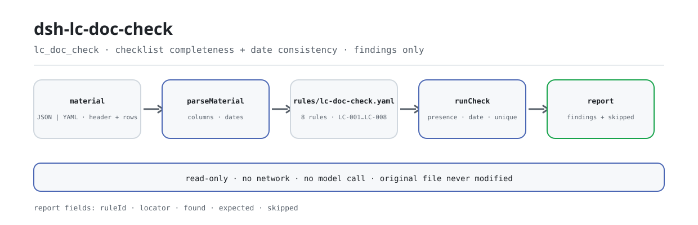

<div align="center">

<picture>
  <source media="(prefers-color-scheme: dark)" srcset="docs/assets/dsh-lc-doc-check-flow-dark.svg">
  
</picture>

# dsh-lc-doc-check

**把一份信用证交单核对表逐条过筛，指出哪一行、哪一栏缺什么、哪两个日期对不上。**

面向信用证审单岗的纯主机端核查器：读入信用证表头与逐条条款，用版本化规则包核对这份核对表自身的齐备性与内部日期一致性，只列差异，不判合规、不认定责任。

[安装](#三步上手) · [配置](#配置) · [FAQ](#faq) · [简体中文](README.md) · [English](README.en.md) · [Español](README.es.md) · [Português](README.pt.md) · [हिन्दी](README.hi.md)

[](LICENSE)
[](#兼容性)
[](https://www.npmjs.com/package/dsh-lc-doc-check)
[](https://github.com/PerryLink/dsh-lc-doc-check/actions/workflows/ci.yml)
[](#兼容性)

[](https://github.com/PerryLink/dsh-lc-doc-check/stargazers)
[](https://www.npmjs.com/package/dsh-lc-doc-check)
[](https://dshfind.com/plugins/PerryLink/dsh-lc-doc-check?ref=badge)
[](https://securityscorecards.dev/viewer/?uri=github.com/PerryLink/dsh-lc-doc-check)
[](https://dsh.market/)
[](https://gitee.com/perrylink/dsh-lc-doc-check)

```sh
dsh plugin --profile <name> add dsh-lc-doc-check
```

</div>

<sub>社区插件，与 DeepSeek 官方无关。唯一仓库：<https://github.com/PerryLink/dsh-lc-doc-check>（Gitee 为镜像）。</sub>

## 它是什么

`dsh-lc-doc-check` 读取一份信用证交单核对表——信用证表头加每条条款一行——核对这份核对表自身的齐备与内部一致：每条条款是否写明单据种类与信用证要求、是否记录了提交情况、交单日期是否不晚于有效期、最迟装运日是否不晚于有效期、不符点标记是否取自你配置的取值清单、表头是否声明信用证号与受益人、币制是否写成三位字母代码、单据种类是否重复。

它只做机械核对：不解读信用证条款，不把「信用证要求」栏与「提交情况」栏做实质比对，也不判定交单是否构成不符点、银行是否应当付款，也不替代审核人。无法执行的检查会逐项列进 `skipped`，空的问题列表不会被读成「没问题」。

装好后在对话里调用 `lc_doc_check`，不用自己写命令行。

## 三步上手

1. **安装**（三选一）：

   ```sh
   # npm 通道（已发布版本）
   dsh plugin --profile web add dsh-lc-doc-check
   # git 通道（最新 main；安装时执行 prepare 构建 lib/）
   dsh plugin --profile web add github:PerryLink/dsh-lc-doc-check
   # tarball 通道：本仓库 pnpm pack 后
   dsh plugin --profile web add ./dsh-lc-doc-check-<version>.tgz
   ```

2. **最小配置**（全部有默认值；按需调整规则库或停用规则）：

   ```yaml
   - insert:
       - id: dsh-lc-doc-check
         name: dsh-lc-doc-check
         config:
           rulesFile: rules/lc-doc-check.yaml
           disabledRules: []
   ```

3. **验证已生效**：

   ```sh
   dsh --profile web --dump-config | grep -A2 'id: dsh-lc-doc-check'
   ```

   仓库内一分钟试跑（需要先构建 `lib/`；npm 包内已包含构建产物）：

   ```sh
   pnpm install && pnpm run build
   node samples/quickstart/run.mjs --json
   ```

   ```json
   {
     "tool": "lc_doc_check",
     "issueCount": 1,
     "summary": { "error": 0, "warn": 1, "info": 0 },
     "skippedCount": 2
   }
   ```

   预期摘要与 `samples/quickstart/expected/result.json` 一致；样例输入在 `samples/quickstart/input/`，运行截图见 `docs/assets/quickstart.png`。

**卸载**：`dsh plugin --profile web remove dsh-lc-doc-check`（或从 profile patch 删掉该行）。

<details>
<summary>从 WorkBuddy / 扣子进入</summary>

在 WorkBuddy / 扣子搜「关务合规核对包」（本检查是其中一项；上架以商城为准）。

</details>

## 核心能力

- **一个工具，八条规则** —— `lc_doc_check` 接收 `file` 或 `material`（JSON/YAML），加载 `rules/lc-doc-check.yaml`，逐条核对后返回带 `ruleId`、`locator`、`found`、`expected` 的报告。
- **只核对「写了没有」，不解读条款** —— 凡是带某栏的条款，就要求该栏有内容；填了但填错的照样通过。它不做「信用证要求」与「提交情况」的实质比对。
- **两项日期检查，且只有两项** —— 交单日 ≤ 到期日、最迟装运日 ≤ 到期日；到期日可以在表头（先查行、再查表头），同一天视为不晚于；解析不出的日期随该行报出，而不是略过。
- **未配置不静默** —— `LC-005` 的取值清单出厂为空，此时本条把自己写进 `skipped` 并写明原因，而不是静默通过；`disabledRules` 停用的规则同样逐条出现在 `skipped`。
- **规则包是数据** —— 替换 `rules/*.yaml` 即可切换规则集版本，不必改代码；加载期校验 `document` / `number` / `clause` / `excerpt` / `source`，且原则性依据（`derived-from-principle`）封顶 `warn`、本机构配置（`institutional-configuration`）封顶 `info`，规则库不得伪造引文。
- **只读、离线、可复核** —— 纯 ESM，无网络请求、不调用模型、不写文件；原始材料不被修改，日期比较是对输入字符串做墙上时钟运算。

### 工具面

| 参数 | 说明 |
|---|---|
| `file` | 材料文件绝对路径（JSON 或 YAML）；与 `material` 二选一 |
| `material` | 内联材料文本；与 `file` 二选一 |
| `rulesFile` | 覆盖配置中的规则库路径（相对包根或绝对路径） |
| `only` | 只执行这些规则 id；留空表示执行全部规则 |

### 规则表

| 规则 | 检查 | 级别 | 依据类型 |
|---|---|---|---|
| `LC-001` | 每条条款写明单据种类与信用证要求 | warn | derived-from-principle |
| `LC-002` | 每条条款记录提交情况 | warn | derived-from-principle |
| `LC-003` | 交单日期不晚于有效期 | warn | derived-from-principle |
| `LC-004` | 最迟装运日不晚于有效期 | warn | derived-from-principle |
| `LC-005` | 不符点标记取自你配置的取值清单（默认未配置） | info | institutional-configuration |
| `LC-006` | 表头声明信用证号与受益人 | warn | derived-from-principle |
| `LC-007` | 币制为三位字母代码 | warn | derived-from-principle |
| `LC-008` | 单据种类唯一 | warn | derived-from-principle |

### 示例

下表是常见问法；详细输出在表后。

| 你会问 | 它怎么答 |
|---|---|
| 某条条款的单据种类与信用证要求都没填，会被报出吗？ | 会。`LC-001` 会报出该条：凡是带了 `docType` 或 `requirement` 栏的条款，都要求两栏至少填了一栏。它只核对是否写了内容，不解读条款含义——所以填了但填错的照样通过。 |
| 信用证要求写了，提交情况栏空着。 | `LC-002` 要求凡是带了 `presented` 栏的条款都必须填写，空着即报出该行。它只核对提交情况是否记录在册，不核对写了什么——它不把这一栏与信用证要求栏做比对，因为比对需要读懂条款与单据内容。 |
| 它实际比对的是哪几个日期？解析不出来的日期怎么办？ | 只有两对：`LC-003` 比较 `presentedAt` 与 `expiryAt`，`LC-004` 比较 `latestShipment` 与 `expiryAt`；有效期可以在表头，因为引擎先查行、再查表头，同一天视为不晚于。两条规则解析不出的日期都随该行报出，而不是略过。`LC-004` 不读实际装运日期；装运日后若干天内交单的要求也不核对，规则库写明本次未取得该条文。 |
| `LC-005` 从来不报任何东西，是坏了吗？ | `LC-005` 没有坏：它的 `values` 出厂为空，表示未配置，于是本条在 `skipped` 里报出自己并说明原因，而不是静默通过。把 `values` 填上本机构的「不符点」口径，它就会报出 `discrepancy` 值不在册的行。它只核对标记是否在册，绝不判断是否真的构成不符点。 |
| 表头没写信用证号，或者币制写成了 `usd`。 | `LC-006` 在表头缺少 `lcNo` 或 `beneficiary` 时报出表头，交单情况才能对应到具体的信用证。`LC-007` 会报出任何不符合三位大写字母（规则库默认 pattern）的 `currency` 值，币制写在表头还是写在行上都一样；它只核对书写形式，不判断该币别对这份信用证是否选得对。 |
| 同一单据种类在两行里各出现一次。 | `LC-008` 会把后一行作为与前一行重复报出，比对时忽略空格。命中需要人工确认：一份信用证对同一单据提出多项要求是常见的，应在条款号栏把两行区分开，而不是删掉一行——或者停用本条。 |

**详细输出** —— 工具 `lc_doc_check`，输入：

~~~json
{"lcNo":"LC2026-0018","rows":[{"单据种类":"","信用证要求":"","提交情况":"已提交一式三份，已注明信用证号与合同号"}]}
~~~

输出：

~~~json
{
  "id": "dsh-lc-doc-check.LC-001.de09b5a6",
  "ruleId": "LC-001",
  "severity": "warn",
  "locator": {
    "row": 1,
    "field": "docType"
  },
  "found": "第 1 行 docType、requirement 都为空",
  "expected": "docType、requirement 至少应填写一项"
}
~~~

*Observed from `dsh-lc-doc-check/tests/fixtures/LC-001/LC-001-unsafe.json`*

### 依据的标准

| 文件 | 文号 | 引用它的规则 |
|---|---|---|
| 《跟单信用证统一惯例》（UCP600） | 国际商会第 600 号出版物（本次未取得条文） | LC-001, LC-002, LC-003, LC-004, LC-005, LC-006, LC-008 |
| 《表示货币的代码》 | GB/T 12406—2022（表示货币的代码；2022-12-30 发布并实施；全部代替 GB/T 12406—2008（该版名称为「表示货币和资金的代码」）——注意旧版名称含"资金"；修改采用 ISO 4217:2015，非等同采用；条号本次未取得） | LC-007 |

## 配置

全部可调参数都在 `src/config.ts` 的 Schemastery schema 中，只改 `cordis.yml` 即可生效，无需改代码；逐条阈值在 `rules/` 下的规则包里。

| 键 | 类型 | 默认值 | 说明 |
|---|---|---|---|
| `rulesFile` | string | `rules/lc-doc-check.yaml` | 规则库文件路径，相对插件包根目录 |
| `disabledRules` | string[] | `[]` | 要停用的规则 id 列表；每条都会出现在 `skipped` 中 |
| `onlyRules` | string[] | `[]` | 只执行这些规则 id；留空表示执行全部规则 |
| `skipNotes` | string | `""` | 附加到每条 `skipped` 说明后的备注 |
| `timeoutMs` | number | `120000` | 工具协作式超时预算（毫秒） |

<details>
<summary>完整配置表（5 个键）</summary>

| 键 | 类型 | 默认值 | 说明 |
|---|---|---|---|
| `rulesFile` | string | `rules/lc-doc-check.yaml` | 规则库文件路径，相对插件包根目录 |
| `disabledRules` | string[] | `[]` | 要停用的规则 id 列表；每条都会出现在 `skipped` 中 |
| `onlyRules` | string[] | `[]` | 只执行这些规则 id；留空表示执行全部规则 |
| `skipNotes` | string | `""` | 附加到每条 `skipped` 说明后的备注 |
| `timeoutMs` | number | `120000` | 工具协作式超时预算（毫秒） |

</details>

规则级参数值得知道的几个：

- `LC-003` / `LC-004` 的 `field` / `notAfterField` —— 要比对的日期对。有效期可以在表头；读取时先查行、再查表头，因此整份信用证共用的到期日也能被找到。
- `LC-005` 的 `values` —— 你的不符点口径，例如 `[无不符点, 有不符点, 已接受, 已拒付]`；为空表示不检查。
- `LC-007` 的 `pattern` —— 币制形式，默认三位大写字母。
- `LC-008` —— 单据种类必须唯一。一份信用证对同一单据提出多项要求时，在条款号栏区分各行，或停用本条。
- `LC-004` 若台账有单独的实际装运日栏，可另加一条规则：`field` 指向该栏、`notAfterField` 设为 `latestShipment`。

profile patch 覆盖示例：

```yaml
- insert:
    - id: dsh-lc-doc-check
      name: dsh-lc-doc-check
      config:
        rulesFile: rules/lc-doc-check.yaml
        disabledRules: [LC-008]
        timeoutMs: 120000
```

### 材料格式

工具接受 JSON 或 YAML：

```yaml
lcNo: LC2026-0018
lcType: 不可撤销即期信用证
applicant: 某某进口商
beneficiary: 某某出口有限公司
issuingBank: 某某银行
currency: USD
expiryAt: 2026-04-10
rows:
  - { 序号: '1', 单据种类: 商业发票,
      信用证要求: 商业发票一式三份，注明信用证号与合同号,
      提交情况: 已提交一式三份，已注明信用证号与合同号, 份数: '3',
      交单日期: 2026-03-20, 最迟装运日: 2026-03-15, 有效期: 2026-04-10,
      不符点: 无不符点, 处理状态: 已审单 }
```

列名匹配不区分大小写，并忽略空格、下划线与连字符；核对表自己的列名会被保留，因此发现里写的就是你读的那一栏。日期可以写成 `2026-03-20` 或 `2026-03-20 14:00`。字段在读取层是可选的，由检查引擎校验，因此部分导出的材料会产生「缺项」类差异，而不是让程序崩溃；Excel 可先转成 JSON/YAML，对话里也能代转。

### 规则来源

规则数据与代码分离，放在 `rules/lc-doc-check.yaml`。规则库表头写明本插件核对什么、把什么留给银行，每条规则的 `note` 重复其中与本条相关的部分。加载期仍强制每条规则都有文件名、文号、条款号、逐字摘录（不少于八个字符）与来源地址，并禁止把本机构配置的检查标为 `error`；夸大依据的规则库会在加载期失败，而不会产出一份看起来很有底气的报告。`scripts/check-citations.mjs` 对照 `rules/citations-baseline.json` 守住引用面。

## FAQ

<details>
<summary>它通过了一份我知道有问题的交单，是漏检吗？</summary>

不是漏检，是设计边界。它只核对「信用证要求」栏与「提交情况」栏都写了，不做两栏的实质比对；填了但填错的条款照样通过。是否构成不符点、银行是否必须付款，属于银行按 UCP 600 与 ISBP 进行的审单判断。

</details>

<details>
<summary>材料会离开本机吗？插件会写文件吗？</summary>

不会。纯 ESM，无网络请求、不调用模型；只读取你传入的 `file` 路径或 `material` 文本，插件自身不写任何文件，原始材料不被修改。报告作为工具返回值交给宿主，报告的 `target` 字段只记录材料来自哪里。

</details>

<details>
<summary>工具不出现、安装被拒，先查什么？</summary>

工具不出现：确认 `main` 指向 `lib/index.mjs` 且 `pnpm run build` 已生成该文件；`main` 写错会让加载器静默跳过该条目。安装被拒：peer 范围覆盖 `0.1.x` 与 `0.2.x`；若运行时在范围之外，可显式豁免：`dsh plugin --profile <name> allow-version dsh-lc-doc-check@<version> --dsh-version <runtime> --accept-risk`。另外，`dsh-plugin-dev` 的静态检查器把 `manifest-peers` 判为失败是已知上游问题，安装期以运行时 peer 校验为准。

</details>

<details>
<summary>某条规则没执行，或报告是空的，怎么办？</summary>

先看 `skipped` 数组：每条未执行的规则都会写明规则 id 与原因（例如 `LC-005` 的取值清单为空、规则被 `disabledRules` 停用、材料缺少该规则需要的列）。空的问题列表不等于「没问题」；如果工具根本没有返回结果，请按上一条检查安装与 `main`。

</details>

<details>
<summary>性能开销多大？</summary>

规则是纯表扫描：8 条规则、无网络、无模型调用；`timeoutMs` 默认 `120000`，是可协作取消的超时预算。批量核对整个目录时建议用 `ptc` 工具模式，schema 成本只付一次。

</details>

## 安全边界

**边界：** 本插件核对一份**信用证交单核对表**所涉及单据合规的机械层面——每条条款是否记录单据种类与信用证要求，提交情况是否记录，交单日期是否不晚于有效期，最迟装运日期是否不晚于有效期，不符点标记是否取自你配置的取值口径，信用证号与受益人是否声明，币制是否符合其形式，以及单据种类是否唯一。它**不**判定交单是否构成不符点、银行是否必须付款，也不判定单据是否符合信用证条款。

> ### ⚠️ 它读的是一份核对表，不是信用证，也不是单据
>
> **本插件不解释信用证条款。** 它核对「信用证要求」列与「提交情况」列都已填写——它**不**比较这两列，因为比较它们意味着阅读条款和单据，而那是银行依据 UCP 600 和 ISBP 进行的审单。因此，只要两列都有文字，一项单据明显不符合的条款也能通过本插件。
>
> **不符点列是你的声明。** 本插件只核对其取值是否在你认可的词表内；它**从不判断是否存在不符点**。那项判断属于银行。
>
> 包含的日期检查只有两项：交单日 ≤ 到期日，以及最迟装运日 ≤ 到期日。**UCP 600 中要求在装运后若干天内交单的规则不在核对之列**，因为规则库未能取得该条文原文，而且台账通常没有单独的实际装运日期列。该规则的说明写明了这一点，并解释了如果你的台账有这一列，应如何加入该项检查。
>
> **规则库中的每一个 `excerpt` 都明文写着：条款原文本次未取得**——ICC 的 UCP 600 与 ISBP 是核验环节无法逐字取得的出版物。规则库在 `excerpt` 字段本身写明这一缺口，并把每条规则保持在 `warn` 或 `info`。**待取得原文后，请把每个 `excerpt` 换成真实条款，并把 `kind` 提到 `direct`。**

## 权限与数据

- **权限**：`package.json#dsh.capabilities` 只声明 `tools:register`；插件只读取你指定的材料文件与随包规则库，不写文件、不联网、不读取凭据。
- **数据**：原始材料不被修改；报告作为工具返回值交给宿主，插件自身不落盘。`reportJson` 是同一份报告的 JSON 字符串，是否保存由调用方决定。
- **会话日志**：工具结果由宿主按会话策略处理；本插件不写额外的审计事件，也不在报告里附加材料原文之外的业务数据。

## 已知限制

- **只核对核对表自身。** 它不覆盖信用证条款、单据内容与银行审单结论，只覆盖核对表里能逐条指认的书写与内部一致性问题。
- **两项日期检查，且只有两项。** 交单日 ≤ 到期日、最迟装运日 ≤ 到期日；UCP 600 关于装运后若干天内交单的规则不检查，实际装运日期也不读。
- **引文缺口。** 规则库的每条 `excerpt` 都写明本次未取得条文原文，因此依据只能是原则性条款，严重级封顶 `warn`（`LC-005` 为本机构配置，封顶 `info`）；取得原文后应替换 `excerpt` 并把 `kind` 提到 `direct`。
- **`LC-005` 出厂未配置。** `values` 为空时本条进 `skipped`，不会静默通过；需要本机构自己填口径。
- **`LC-008` 命中需人工确认。** 同一单据种类出现多次可能只是信用证把同一单据的多项要求拆开登记，应在条款号栏区分而不是直接删行。
- **日期按墙上时钟。** 全部日期比较对输入字符串做墙上时钟运算，不做时区换算，因此同一份材料在不同时区读到的「今天」不影响结果。
- **`manifest-peers` 静态检查误报。** `dsh-plugin-dev` 的静态检查器比对一份早于 0.2 世代的硬编码 peer 范围；运行时在安装期做 peer 校验，声明的范围才是准绳。这是已知上游问题。

## 与其他 DSH 插件的互操作性

本插件只注册一个工具，不注册共享事件监听，因此不会与其他插件争抢命令、事件或 slot：

- **工具名不冲突。** 唯一工具名 `lc_doc_check` 为本插件专属，不占用任何内置工具或其他插件的裸名。
- **无服务键冲突。** 不提供任何服务键。
- **无 slot 冲突。** 不注册客户端 slot key，因此不参与 `shadows-shipped-ui` 座位争抢。
- **无 HTTP 路由冲突。** 不注册任何 `webServer` 前缀。
- **无全局改写。** 不改原型、不改写 `process.env`、不替换全局 fetch dispatcher。
- **无共享事件。** 没有 `agent/pre-step`、`tools/post-execute` 等监听器，因此不存在 waterfall 短路或监听器互相饿死的问题。
- **共享套件是复制件。** `src/shared/` 从家族 `_shared` 复制进来，不构成运行时依赖，不会把版本冲突带给同装的其他插件。

## 兼容性

| 维度 | 状态 |
|---|---|
| Harness | peer 范围 `>=0.1.2-rc.1 <0.2.0 \|\| >=0.2.0-0 <0.3.0`——已实测同时接受 `0.2.0-rc.2` 与 `0.2.1-rc.2`；`engines.dsh` 声明为 `>=0.2.1-0 <0.3.0`，0.2.1 起由宿主单独裁决 |
| Node | `^22.19.0 \|\| >=24.0.0` |
| 平台 | 全平台（纯 ESM；无原生代码、无联网、不调用模型） |
| 工具模式 | `native` / `ptc` 均可；批量核对整个目录时建议 `ptc`，schema 成本只付一次 |

## 生态与质量

- [Gitee 镜像](https://gitee.com/perrylink/dsh-lc-doc-check)（同步镜像，以 GitHub 为准）
- [dshfind 插件页](https://dshfind.com/plugins/PerryLink/dsh-lc-doc-check)（安装量与排名）
- [OpenSSF Scorecard 报告](https://securityscorecards.dev/viewer/?uri=github.com/PerryLink/dsh-lc-doc-check)（由 [.github/workflows/scorecard.yml](.github/workflows/scorecard.yml) 驱动）
- [DSH Market](https://dsh.market/)（已上架）
- [按材料选核查器](https://perrylink.github.io/zh/checkers/choose/)：家族核查器选型与实测知识库
- **WorkBuddy / 扣子**：搜「关务合规核对包」（本检查是其中一项；上架以商城为准）

## 开发

```sh
pnpm install
pnpm run typecheck          # tsc --noEmit
pnpm test                   # vitest；33 个用例（ACCEPTANCE.csv 记录 33/33）
pnpm run build              # tsdown -> lib/index.mjs + lib/index.d.mts
pnpm run verify:self-contained   # 依赖 spec 均来自 registry
pnpm run check:lockfile          # 锁文件漂移
pnpm run check:readmes           # 五语 README 一致性
pnpm run check:citations         # 规则库引用核验
node ../scripts/sync-shared.mjs dsh-lc-doc-check   # 从 ../_shared 刷新 src/shared
pnpm pack                        # 发布 tarball
```

`lib/` 是构建产物（gitignored），npm 包内已包含；仓库内跑 `samples/quickstart` 前先 `pnpm run build`。配图由 [`scripts/gen-readme-assets.py`](scripts/gen-readme-assets.py) 程序化生成（Python + Pillow，CJK 字体探测缺失即报错），只产出深浅两版流程图 SVG，可重复执行：

```sh
python scripts/gen-readme-assets.py
```

| 路径 | 作用 |
|---|---|
| `src/index.ts` | function-plugin 契约：`name` / `inject` / `Config` / `apply`，注册 `lc_doc_check` 并解析规则包 |
| `src/config.ts` | Schemastery schema；全部可调项在此，无硬编码阈值 |
| `src/model.ts` | 表结构与材料契约；列别名与表头字段在此声明 |
| `src/view.ts` | 模型可见的报告投影；`output.schema` 与之对应 |
| `src/shared/` | 家族共享套件（规则加载、报告形状、YAML 子集、日期运算、措辞守卫）——复制进来，保证包自包含 |
| `rules/lc-doc-check.yaml` | 规则包，8 条规则 |
| `rules/citations-baseline.json` | 引用核验基线，供 `check:citations` 使用 |
| `tests/` | vitest；每条规则一对合规/违规夹具，另有边界语义测试 |
| `samples/quickstart/` | 一分钟试跑输入、期望摘要与运行脚本 |
| `scripts/` | 构建、自包含、锁文件、引用与 README 同步门禁，以及配图脚本 |

Topics：`deepseek-harness`、`dsh`、`dsh-plugin`、`cordis`、`doc`

## 家族与致谢

本项目是 [PerryLink](https://github.com/PerryLink) 维护的 DeepSeek Harness 插件家族成员（全部 Apache-2.0）。如果这个插件帮到了你，**给个 star**——它不解锁任何功能，但会让下一个人更容易找到它。

- [@PerryLink](https://github.com/PerryLink) —— 创建者与维护者：规则包、共享检查内核、五语文档。
- 家族共享件（`src/shared/`）—— 从 `_shared` 复制进来，保证本包自包含；规则库条款核验记录与引用纪律由家族统一维护。

<details>
<summary>展开全部插件</summary>

| 插件 | 状态 |
|---|---|
| **[dsh-aqua-input-check](https://github.com/PerryLink/dsh-aqua-input-check)** |  |
| **[dsh-archive-check](https://github.com/PerryLink/dsh-archive-check)** |  |
| **[dsh-auto-review](https://github.com/PerryLink/dsh-auto-review)** |  |
| **[dsh-autotier](https://github.com/PerryLink/dsh-autotier)** | 🧊 已冻结 — 见仓库 README |
| **[dsh-bid-ca-precheck](https://github.com/PerryLink/dsh-bid-ca-precheck)** |  |
| **[dsh-bid-qual-check](https://github.com/PerryLink/dsh-bid-qual-check)** |  |
| **[dsh-cert-mcp](https://github.com/PerryLink/dsh-cert-mcp)** | 🧊 已冻结 — 见仓库 README |
| **[dsh-checkpoint-rewind](https://github.com/PerryLink/dsh-checkpoint-rewind)** |  |
| **[dsh-click](https://github.com/PerryLink/dsh-click)** |  |
| **[dsh-composer-history](https://github.com/PerryLink/dsh-composer-history)** |  |
| **[dsh-contract-stance](https://github.com/PerryLink/dsh-contract-stance)** |  |
| **[dsh-customs-doc-check](https://github.com/PerryLink/dsh-customs-doc-check)** |  |
| **[dsh-data-quality](https://github.com/PerryLink/dsh-data-quality)** | 🧊 已冻结 — 见仓库 README |
| **[dsh-demurrage-ledger](https://github.com/PerryLink/dsh-demurrage-ledger)** |  |
| **[dsh-doublecheck](https://github.com/PerryLink/dsh-doublecheck)** |  |
| **[dsh-drill-script-check](https://github.com/PerryLink/dsh-drill-script-check)** |  |
| **[dsh-eia-guide-check](https://github.com/PerryLink/dsh-eia-guide-check)** |  |
| **[dsh-emergency-plan](https://github.com/PerryLink/dsh-emergency-plan)** |  |
| **[dsh-essay-rubric-check](https://github.com/PerryLink/dsh-essay-rubric-check)** |  |
| **[dsh-evidence-check](https://github.com/PerryLink/dsh-evidence-check)** |  |
| **[dsh-export-ctl-check](https://github.com/PerryLink/dsh-export-ctl-check)** |  |
| **[dsh-fast](https://github.com/PerryLink/dsh-fast)** |  |
| **[dsh-fmea-table-check](https://github.com/PerryLink/dsh-fmea-table-check)** |  |
| **[dsh-forecast-penalty](https://github.com/PerryLink/dsh-forecast-penalty)** |  |
| **[dsh-fund-research](https://github.com/PerryLink/dsh-fund-research)** |  |
| **[dsh-github](https://github.com/PerryLink/dsh-github)** |  |
| **[dsh-gongwen-flow-check](https://github.com/PerryLink/dsh-gongwen-flow-check)** |  |
| **[dsh-gongwen-word-check](https://github.com/PerryLink/dsh-gongwen-word-check)** |  |
| **[dsh-guard-plan-qc](https://github.com/PerryLink/dsh-guard-plan-qc)** |  |
| **[dsh-hazchem-check](https://github.com/PerryLink/dsh-hazchem-check)** |  |
| **[dsh-hazplan-check](https://github.com/PerryLink/dsh-hazplan-check)** |  |
| **[dsh-hidden-risk-map](https://github.com/PerryLink/dsh-hidden-risk-map)** |  |
| **[dsh-hs-classify](https://github.com/PerryLink/dsh-hs-classify)** |  |
| **[dsh-icd-rule-check](https://github.com/PerryLink/dsh-icd-rule-check)** |  |
| **[dsh-industry-research](https://github.com/PerryLink/dsh-industry-research)** |  |
| **[dsh-lawcite-adapter](https://github.com/PerryLink/dsh-lawcite-adapter)** |  |
| **[dsh-laya](https://github.com/PerryLink/dsh-laya)** |  |
| **[dsh-lc-doc-check](https://github.com/PerryLink/dsh-lc-doc-check)** |  |
| **[dsh-learning-gap-check](https://github.com/PerryLink/dsh-learning-gap-check)** |  |
| **[dsh-library](https://github.com/PerryLink/dsh-library)** |  |
| **[dsh-local-ai](https://github.com/PerryLink/dsh-local-ai)** |  |
| **[dsh-lsp-actions](https://github.com/PerryLink/dsh-lsp-actions)** |  |
| **[dsh-mask](https://github.com/PerryLink/dsh-mask)** |  |
| **[dsh-mcp-panel](https://github.com/PerryLink/dsh-mcp-panel)** |  |
| **[dsh-medrec-qc](https://github.com/PerryLink/dsh-medrec-qc)** |  |
| **[dsh-memento](https://github.com/PerryLink/dsh-memento)** | 🧊 已冻结 — 见仓库 README |
| **[dsh-nsfc-form-check](https://github.com/PerryLink/dsh-nsfc-form-check)** |  |
| **[dsh-nurse-record-check](https://github.com/PerryLink/dsh-nurse-record-check)** |  |
| **[dsh-observe](https://github.com/PerryLink/dsh-observe)** |  |
| **[dsh-origin-rvc-check](https://github.com/PerryLink/dsh-origin-rvc-check)** |  |
| **[dsh-ota-review-check](https://github.com/PerryLink/dsh-ota-review-check)** |  |
| **[dsh-output-styles](https://github.com/PerryLink/dsh-output-styles)** |  |
| **[dsh-paper-doc-adapter](https://github.com/PerryLink/dsh-paper-doc-adapter)** |  |
| **[dsh-permission-rules](https://github.com/PerryLink/dsh-permission-rules)** |  |
| **[dsh-permit-report-check](https://github.com/PerryLink/dsh-permit-report-check)** |  |
| **[dsh-pipeline-check](https://github.com/PerryLink/dsh-pipeline-check)** |  |
| **[dsh-pleading-draft](https://github.com/PerryLink/dsh-pleading-draft)** |  |
| **[dsh-plugin-doctor](https://github.com/PerryLink/dsh-plugin-doctor)** | 🚫 已退役（仓库已归档） |
| **[dsh-plugin-guide](https://github.com/PerryLink/dsh-plugin-guide)** |  |
| **[dsh-plugin-kit](https://github.com/PerryLink/dsh-plugin-kit)** | 🚫 已退役（仓库已归档） |
| **[dsh-plugin-upgrade](https://github.com/PerryLink/dsh-plugin-upgrade)** | 🚫 已退役（仓库已归档） |
| **[dsh-policy-brief-draft](https://github.com/PerryLink/dsh-policy-brief-draft)** |  |
| **[dsh-power-loss-split](https://github.com/PerryLink/dsh-power-loss-split)** |  |
| **[dsh-power-ticket-check](https://github.com/PerryLink/dsh-power-ticket-check)** |  |
| **[dsh-ppap-check](https://github.com/PerryLink/dsh-ppap-check)** |  |
| **[dsh-protest-deadline](https://github.com/PerryLink/dsh-protest-deadline)** |  |
| **[dsh-railway-window](https://github.com/PerryLink/dsh-railway-window)** |  |
| **[dsh-repair-order-qc](https://github.com/PerryLink/dsh-repair-order-qc)** |  |
| **[dsh-research-report](https://github.com/PerryLink/dsh-research-report)** |  |
| **[dsh-review-reply-check](https://github.com/PerryLink/dsh-review-reply-check)** |  |
| **[dsh-rulefile-check](https://github.com/PerryLink/dsh-rulefile-check)** |  |
| **[dsh-safety-brief-check](https://github.com/PerryLink/dsh-safety-brief-check)** |  |
| **[dsh-score](https://github.com/PerryLink/dsh-score)** | 🧊 已冻结 — 见仓库 README |
| **[dsh-session-sync](https://github.com/PerryLink/dsh-session-sync)** |  |
| **[dsh-site-log-check](https://github.com/PerryLink/dsh-site-log-check)** |  |
| **[dsh-skill-pack-security](https://github.com/PerryLink/dsh-skill-pack-security)** |  |
| **[dsh-soe-decision-check](https://github.com/PerryLink/dsh-soe-decision-check)** |  |
| **[dsh-soilwater-check](https://github.com/PerryLink/dsh-soilwater-check)** |  |
| **[dsh-sop-sync-check](https://github.com/PerryLink/dsh-sop-sync-check)** |  |
| **[dsh-spc-gbt-adapter](https://github.com/PerryLink/dsh-spc-gbt-adapter)** |  |
| **[dsh-talk](https://github.com/PerryLink/dsh-talk)** |  |
| **[dsh-tender-extract](https://github.com/PerryLink/dsh-tender-extract)** |  |
| **[dsh-tender-matrix](https://github.com/PerryLink/dsh-tender-matrix)** |  |
| **[dsh-test-drive](https://github.com/PerryLink/dsh-test-drive)** |  |
| **[dsh-ticktick](https://github.com/PerryLink/dsh-ticktick)** | 🚫 已退役（仓库已归档） |
| **[dsh-translate](https://github.com/PerryLink/dsh-translate)** |  |
| **[dsh-warranty-calc](https://github.com/PerryLink/dsh-warranty-calc)** |  |
| **[dsh-budget](https://github.com/PerryLink/dsh-budget)** | 🧊 已冻结 — 见仓库 README |
| **[dsh-claude-move](https://github.com/PerryLink/dsh-claude-move)** | 🧊 已冻结 — 见仓库 README |
| **[dsh-defend](https://github.com/PerryLink/dsh-defend)** | 🧊 已冻结 — 见仓库 README |
| **[dsh-draw](https://github.com/PerryLink/dsh-draw)** | 🧊 已冻结 — 见仓库 README |
| **[dsh-reach](https://github.com/PerryLink/dsh-reach)** | 🧊 已冻结 — 见仓库 README |
| **[dsh-background-agents](https://github.com/PerryLink/dsh-background-agents)** | 🚫 已退役（仓库已归档） |
| **[dsh-session-pin](https://github.com/PerryLink/dsh-session-pin)** | 🚫 已退役（仓库已归档） |
| **[dsh-team-rooms](https://github.com/PerryLink/dsh-team-rooms)** | 🚫 已退役（仓库已归档） |

</details>

## License

[LICENSE](LICENSE)（Apache License 2.0）© 2026 dsh-lc-doc-check contributors

<p align="center"><sub>Apache-2.0 · 社区插件，与 DeepSeek 无关。</sub></p>
