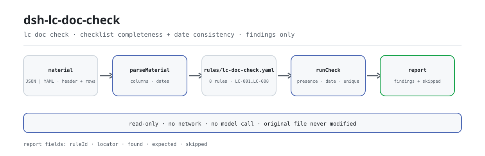

<div align="center">

<picture>
  <source media="(prefers-color-scheme: dark)" srcset="docs/assets/dsh-lc-doc-check-flow-dark.svg">
  
</picture>

# dsh-lc-doc-check

**Transforme uma lista de apresentação de um crédito documentário numa lista, linha a linha, do que falta, onde e o que corrigir.**

Um verificador de host puro para examinadores de créditos documentários: lê o cabeçalho do crédito mais uma linha por cláusula, aplica um pacote de regras versionado à completude e à coerência interna de datas dessa lista e apenas enumera diferenças — sem parecer de conformidade nem atribuição de responsabilidade.

[Instalar](#instalação-em-três-passos) · [Configuração](#configuração) · [FAQ](#faq) · [简体中文](README.md) · [English](README.en.md) · [Español](README.es.md) · [Português](README.pt.md) · [हिन्दी](README.hi.md)

[](LICENSE)
[](#compatibilidade)
[](https://www.npmjs.com/package/dsh-lc-doc-check)
[](https://github.com/PerryLink/dsh-lc-doc-check/actions/workflows/ci.yml)
[](#compatibilidade)

[](https://github.com/PerryLink/dsh-lc-doc-check/stargazers)
[](https://www.npmjs.com/package/dsh-lc-doc-check)
[](https://dshfind.com/plugins/PerryLink/dsh-lc-doc-check?ref=badge)
[](https://securityscorecards.dev/viewer/?uri=github.com/PerryLink/dsh-lc-doc-check)
[](https://dsh.market/)
[](https://gitee.com/perrylink/dsh-lc-doc-check)

```sh
dsh plugin --profile <name> add dsh-lc-doc-check
```

</div>

<sub>Plugin da comunidade, sem vínculo com a DeepSeek. Repositório canônico: <https://github.com/PerryLink/dsh-lc-doc-check> (o Gitee é um espelho).</sub>

## O que é

`dsh-lc-doc-check` lê uma lista de apresentação de documentos de um crédito documentário —o cabeçalho do crédito mais uma linha por cláusula— e verifica a completude e a coerência interna dessa lista: se cada cláusula regista o tipo de documento e a exigência do crédito, se a apresentação está registada, se a data de apresentação não é posterior ao vencimento, se a data-limite de embarque não é posterior ao vencimento, se a marca de discrepância vem do vocabulário que você configura, se o número do crédito e o beneficiário são declarados, se a moeda está escrita como código de três letras e se não há tipos de documento repetidos.

Cobre apenas o lado mecânico: não interpreta as cláusulas do crédito, não compara a coluna da exigência com a da apresentação, não decide se uma apresentação é discrepante nem se um banco deve pagar, e não substitui o revisor. Toda verificação que não pôde ser executada é listada em `skipped`; uma lista de problemas vazia nunca é lida como «não há nada errado».

Depois de instalado, chame `lc_doc_check` pelo chat; para a verificação em si não é preciso escrever comandos.

## Instalação em três passos

1. **Instalar** (escolha um canal):

   ```sh
   # canal npm (versões publicadas)
   dsh plugin --profile web add dsh-lc-doc-check
   # canal git (último main; a instalação executa prepare para construir lib/)
   dsh plugin --profile web add github:PerryLink/dsh-lc-doc-check
   # canal tarball: após pnpm pack neste repositório
   dsh plugin --profile web add ./dsh-lc-doc-check-<version>.tgz
   ```

2. **Configuração mínima** (todas as chaves têm padrão; ajuste o pacote de regras ou desative regras conforme necessário):

   ```yaml
   - insert:
       - id: dsh-lc-doc-check
         name: dsh-lc-doc-check
         config:
           rulesFile: rules/lc-doc-check.yaml
           disabledRules: []
   ```

3. **Verificar que monta**:

   ```sh
   dsh --profile web --dump-config | grep -A2 'id: dsh-lc-doc-check'
   ```

   Teste de um minuto dentro do repositório (construa `lib/` antes; o pacote npm já o inclui):

   ```sh
   pnpm install && pnpm run build
   node samples/quickstart/run.mjs --json
   ```

   ```json
   {
     "tool": "lc_doc_check",
     "issueCount": 1,
     "summary": { "error": 0, "warn": 1, "info": 0 },
     "skippedCount": 2
   }
   ```

   O resumo esperado coincide com `samples/quickstart/expected/result.json`; a entrada do exemplo está em `samples/quickstart/input/` e a captura de execução em `docs/assets/quickstart.png`.

**Desinstalar**: `dsh plugin --profile web remove dsh-lc-doc-check` (ou remova a linha do patch do perfil).

<details>
<summary>Entrar pelo WorkBuddy / Coze</summary>

Pesquise «Customs Compliance Suite» no WorkBuddy / Coze (esta verificação é uma parte; disponibilidade conforme a loja).

</details>

## Capacidades principais

- **Uma ferramenta, oito regras** — `lc_doc_check` recebe `file` ou `material` (JSON/YAML), carrega `rules/lc-doc-check.yaml` e devolve um relatório com `ruleId`, `locator`, `found` e `expected`.
- **Verifica que algo está escrito, não o que significa** — toda cláusula que traga uma coluna deve preenchê-la; uma exigência mal escrita passa. Não compara a coluna da exigência com a da apresentação.
- **Duas comparações de datas, e só duas** — apresentação ≤ vencimento e último embarque ≤ vencimento; o vencimento pode estar no cabeçalho (o leitor procura primeiro na linha e depois no cabeçalho), o mesmo dia conta como não posterior e uma data que não se consegue analisar é reportada com a sua linha em vez de omitida.
- **Verificações por configurar nunca calam** — `LC-005` vem com o vocabulário vazio, então a regra reporta-se a si mesma em `skipped` com esse motivo em vez de passar em silêncio; regras desativadas com `disabledRules` também aparecem uma a uma em `skipped`.
- **O pacote de regras é dados** — substituir `rules/*.yaml` troca o conjunto de regras sem tocar em código; o carregador valida `document` / `number` / `clause` / `excerpt` / `source`, limita a `warn` uma base apenas de princípio (`derived-from-principle`) e a `info` uma configuração institucional (`institutional-configuration`), e nenhuma regra pode inventar uma citação.
- **Somente leitura e sem rede** — ESM puro, sem pedidos de rede, sem chamadas ao modelo, sem escrita de arquivos; o material original nunca é alterado e a aritmética de datas é de hora local sobre as strings de entrada.

### Superfície da ferramenta

| Parâmetro | Significado |
|---|---|
| `file` | Caminho absoluto do arquivo de material (JSON ou YAML); use-o ou `material` |
| `material` | Texto de material inline; use-o ou `file` |
| `rulesFile` | Substitui o caminho configurado do pacote de regras (relativo ao pacote ou absoluto) |
| `only` | Executar apenas estas regras; vazio executa todas |

### Pacote de regras

| Regra | Verificação | Gravidade | Tipo de base |
|---|---|---|---|
| `LC-001` | Cada cláusula regista o tipo de documento e a exigência do crédito | warn | derived-from-principle |
| `LC-002` | Cada cláusula regista a apresentação | warn | derived-from-principle |
| `LC-003` | A data de apresentação não é posterior ao vencimento | warn | derived-from-principle |
| `LC-004` | A data-limite de embarque não é posterior ao vencimento | warn | derived-from-principle |
| `LC-005` | A marca de discrepância vem do vocabulário configurado (por configurar por padrão) | info | institutional-configuration |
| `LC-006` | O cabeçalho declara o número do crédito e o beneficiário | warn | derived-from-principle |
| `LC-007` | A moeda é um código de três letras | warn | derived-from-principle |
| `LC-008` | Os tipos de documento são únicos | warn | derived-from-principle |

### Exemplos

A tabela abaixo cobre as perguntas habituais; a saída detalhada vem depois.

| Você pergunta | O que ele responde |
|---|---|
| Uma cláusula deixa vazios o tipo de documento e a exigência do crédito. Isso é reportado? | Sim. `LC-001` reporta essa cláusula, porque toda cláusula que traga a coluna `docType` ou `requirement` tem de ter pelo menos uma das duas preenchida. Verifica que haja texto, não o que a cláusula significa: não interpreta as condições do crédito, por isso uma exigência mal escrita passa. |
| A exigência está escrita, mas a coluna da apresentação está vazia. | `LC-002` exige `presented` em toda cláusula que traga a coluna e reporta a linha em que está vazia. Verifica que a apresentação fique registada, não o que diz: não compara essa célula com a célula da exigência, porque compará-las obriga a ler as cláusulas e os documentos. |
| Que datas compara realmente e o que acontece a uma data que não é analisável? | Dois pares, e só dois: `LC-003` compara `presentedAt` com `expiryAt`, e `LC-004` compara `latestShipment` com `expiryAt`; o vencimento pode estar no cabeçalho, porque o leitor procura primeiro na linha e depois no cabeçalho, e o mesmo dia conta como não posterior. Uma data que a regra não consegue analisar é reportada com a sua linha em vez de ser omitida. `LC-004` não lê nenhuma data real de embarque, e a exigência de apresentar dentro de um certo número de dias após o embarque não é verificada: o pacote declara que não obteve esse texto. |
| `LC-005` nunca reporta nada. Está avariado? | `LC-005` não está avariado: a sua lista `values` vem vazia, ou seja, por configurar, e a regra reporta-se então a si mesma em `skipped` com esse motivo, em vez de passar em silêncio. Preencha `values` com a terminologia da sua instituição e ela assinalará toda a linha cujo valor de `discrepancy` não conste da lista. Verifica apenas que a marca seja uma que você reconheça; nunca julga se existe realmente uma discrepância. |
| O cabeçalho não traz número do crédito, ou a moeda está escrita como `usd`. | `LC-006` reporta o cabeçalho quando `lcNo` ou `beneficiary` não são declarados, para que a apresentação possa ser ligada a um crédito concreto. `LC-007` reporta qualquer valor de `currency` que não sejam três letras maiúsculas (o padrão de origem do pacote), esteja a moeda no cabeçalho ou na linha; verifica apenas a forma, não se essa moeda é a correta para o crédito. |
| O mesmo tipo de documento aparece em duas linhas. | `LC-008` reporta a linha posterior como duplicada da anterior, ignorando os espaços do valor. O achado precisa de confirmação humana: é comum um crédito levantar várias exigências sobre um mesmo tipo de documento, por isso distinga as linhas na coluna do número da cláusula em vez de apagar uma — ou desative a regra. |

**Saída detalhada** — ferramenta `lc_doc_check`, entrada:

~~~json
{"lcNo":"LC2026-0018","rows":[{"单据种类":"","信用证要求":"","提交情况":"已提交一式三份，已注明信用证号与合同号"}]}
~~~

Saída:

~~~json
{
  "id": "dsh-lc-doc-check.LC-001.de09b5a6",
  "ruleId": "LC-001",
  "severity": "warn",
  "locator": {
    "row": 1,
    "field": "docType"
  },
  "found": "第 1 行 docType、requirement 都为空",
  "expected": "docType、requirement 至少应填写一项"
}
~~~

*Observed from `dsh-lc-doc-check/tests/fixtures/LC-001/LC-001-unsafe.json`*

### Normas que segue

| Documento | Número | Regras que o citam |
|---|---|---|
| Convenção da Câmara de Comércio Internacional sobre créditos documentários (UCP 600) | Publicação n.º 600 da ICC (texto da cláusula não obtido nesta passagem) | LC-001, LC-002, LC-003, LC-004, LC-005, LC-006, LC-008 |
| Códigos para a representação de moedas | GB/T 12406—2022 (publicada e em vigor em 2022-12-30; substitui integralmente a GB/T 12406—2008, cujo título era «Códigos para a representação de moedas e fundos»; adoção modificada da ISO 4217:2015, não idêntica; número da cláusula não obtido) | LC-007 |

## Configuração

Todos os parâmetros ajustáveis ficam no esquema Schemastery de `src/config.ts`, portanto mudam pelo `cordis.yml` sem editar código; os limites por regra ficam no pacote de regras sob `rules/`.

| Chave | Tipo | Padrão | Descrição |
|---|---|---|---|
| `rulesFile` | string | `rules/lc-doc-check.yaml` | Caminho do pacote de regras, relativo à raiz do pacote |
| `disabledRules` | string[] | `[]` | Ids de regras a desativar; cada uma aparece em `skipped` |
| `onlyRules` | string[] | `[]` | Executar apenas estas regras; vazio executa todas |
| `skipNotes` | string | `""` | Nota acrescentada a cada motivo de `skipped` |
| `timeoutMs` | number | `120000` | Orçamento de tempo limite cooperativo da ferramenta (milissegundos) |

<details>
<summary>Tabela de configuração completa (5 chaves)</summary>

| Chave | Tipo | Padrão | Descrição |
|---|---|---|---|
| `rulesFile` | string | `rules/lc-doc-check.yaml` | Caminho do pacote de regras, relativo à raiz do pacote |
| `disabledRules` | string[] | `[]` | Ids de regras a desativar; cada uma aparece em `skipped` |
| `onlyRules` | string[] | `[]` | Executar apenas estas regras; vazio executa todas |
| `skipNotes` | string | `""` | Nota acrescentada a cada motivo de `skipped` |
| `timeoutMs` | number | `120000` | Orçamento de tempo limite cooperativo da ferramenta (milissegundos) |

</details>

Parâmetros por regra que vale conhecer:

- `LC-003` / `LC-004` `field` / `notAfterField` — o par de datas a comparar. O vencimento pode estar no cabeçalho; o leitor procura primeiro na linha e depois no cabeçalho, por isso encontra um vencimento comum a todo o crédito.
- `LC-005` `values` — o seu vocabulário de discrepâncias, p. ex. `[sem discrepância, com discrepância, aceito, recusado]`; vazio significa que não se verifica.
- `LC-007` `pattern` — a forma da moeda; por padrão, três letras maiúsculas.
- `LC-008` — os tipos de documento devem ser únicos. Se o seu crédito levanta várias exigências sobre um mesmo tipo, distinga as linhas na coluna do número da cláusula ou desative a regra.
- `LC-004` — se o seu registo tiver uma coluna separada de embarque real, acrescente uma regra com `field` apontando para essa coluna e `notAfterField` em `latestShipment`.

Exemplo de substituição no patch do perfil:

```yaml
- insert:
    - id: dsh-lc-doc-check
      name: dsh-lc-doc-check
      config:
        rulesFile: rules/lc-doc-check.yaml
        disabledRules: [LC-008]
        timeoutMs: 120000
```

### Formato do material

A ferramenta aceita JSON ou YAML:

```yaml
lcNo: LC2026-0018
lcType: 不可撤销即期信用证
applicant: 某某进口商
beneficiary: 某某出口有限公司
issuingBank: 某某银行
currency: USD
expiryAt: 2026-04-10
rows:
  - { 序号: '1', 单据种类: 商业发票,
      信用证要求: 商业发票一式三份，注明信用证号与合同号,
      提交情况: 已提交一式三份，已注明信用证号与合同号, 份数: '3',
      交单日期: 2026-03-20, 最迟装运日: 2026-03-15, 有效期: 2026-04-10,
      不符点: 无不符点, 处理状态: 已审单 }
```

Os nomes de coluna são comparados sem distinguir maiúsculas e ignorando espaços, sublinhados e hífenes; os nomes próprios da lista são preservados, por isso o achado nomeia a coluna que leu. As datas podem ser `2026-03-20` ou `2026-03-20 14:00`. Os campos são opcionais na camada de leitura e validados pelo motor, de modo que uma exportação parcial gera achados de «falta» em vez de falhar; o Excel pode ser convertido antes para JSON/YAML, no chat se a plataforma permitir.

### Origem das regras

Os dados das regras ficam em `rules/lc-doc-check.yaml`, separados do código. O cabeçalho do pacote declara o que o plugin verifica e o que deixa ao banco, e a `note` de cada regra repete a parte que lhe cabe. O carregador continua a exigir documento, cláusula, trecho (com pelo menos oito caracteres) e fonte por regra e continua a proibir que uma verificação configurada localmente seja `error`; um pacote de regras que exagera a sua base falha ao carregar em vez de produzir um relatório que parece sólido. `scripts/check-citations.mjs` mantém a superfície de citações contra `rules/citations-baseline.json`.

## FAQ

<details>
<summary>Ele aprovou uma apresentação que sei ser discrepante. É uma falha de deteção?</summary>

É um limite de desenho, não uma falha. O plugin apenas verifica que a coluna da exigência e a da apresentação estão preenchidas; não as compara, por isso uma cláusula preenchida mas errada passa. Se existe uma discrepância e se um banco deve pagar é o exame do banco conforme a UCP 600 e a ISBP.

</details>

<details>
<summary>O material sai da minha máquina? O plugin escreve arquivos?</summary>

Não. É ESM puro, sem pedidos de rede e sem chamadas ao modelo; lê apenas o caminho `file` ou o texto `material` que você passa, não escreve arquivos próprios e nunca altera o original. O relatório é devolvido ao host como resultado de ferramenta; o seu campo `target` regista apenas de onde veio o material.

</details>

<details>
<summary>A ferramenta não aparece ou a instalação é recusada. O que verifico primeiro?</summary>

Ferramenta ausente: confirme que `main` resolve para `lib/index.mjs` e que `pnpm run build` o gerou; um `main` errado faz o carregador saltar a entrada em silêncio. Instalação recusada: a faixa de peers cobre `0.1.x` e `0.2.x`; se o seu runtime ficar fora dela, conceda uma isenção explícita: `dsh plugin --profile <name> allow-version dsh-lc-doc-check@<version> --dsh-version <runtime> --accept-risk`. Além disso, o verificador estático do `dsh-plugin-dev` marcar `manifest-peers` como falha é um problema conhecido a montante; a verificação de peers na instalação é a que vale.

</details>

<details>
<summary>Uma regra não executou ou o relatório está vazio. E agora?</summary>

Leia primeiro o arranjo `skipped`: cada verificação que não pôde executar indica o id da regra e o motivo (por exemplo, `LC-005` tem o vocabulário vazio, uma regra foi desativada com `disabledRules` ou falta ao material uma coluna de que a regra precisa). Uma lista de problemas vazia não significa «não há nada errado»; se a ferramenta não devolveu nada, verifique a instalação e o `main` como acima.

</details>

<details>
<summary>Qual é a sobrecarga de desempenho?</summary>

As regras são uma varredura de tabela pura: oito regras, sem rede, sem chamada ao modelo; `timeoutMs` vale `120000` por padrão e é um orçamento de cancelamento cooperativo. Para um diretório inteiro use o modo de ferramenta `ptc`, assim o custo do esquema é pago uma só vez.

</details>

## Limites de segurança

**Limite:** este plugin verifica uma **lista de apresentação de um crédito documentário** no lado mecânico da conformidade documental — que cada cláusula registe o tipo de documento e a exigência do crédito, que a apresentação esteja registada, que a data de apresentação não seja posterior ao vencimento, que a data-limite de embarque não seja posterior ao vencimento, que a marca de discrepância venha do seu vocabulário, que o número do crédito e o beneficiário sejam declarados, que a moeda siga o seu formato e que os tipos de documento sejam únicos. **Não** decide se uma apresentação é discrepante, se um banco deve pagar nem se os documentos cumprem as condições do crédito.

> ### ⚠️ Ele lê uma lista de verificação, não o crédito nem os documentos
>
> **O plugin não interpreta as cláusulas do crédito.** Verifica que a coluna da exigência e a da apresentação estão ambas preenchidas — **não** as compara, porque compará-las obriga a ler as cláusulas e os documentos, que é o exame do banco conforme a UCP 600 e a ISBP. Por isso uma cláusula que os documentos claramente incumprem passa neste plugin desde que ambas as colunas tenham texto.
>
> **A coluna de discrepância é a sua declaração.** O plugin apenas verifica que o seu valor seja um que você reconheça; **nunca julga se existe uma discrepância**. Esse juízo pertence ao banco.
>
> Incluem-se duas verificações de datas, e só duas: apresentação ≤ vencimento e último embarque ≤ vencimento. **A regra da UCP 600 que exige apresentar dentro de um número de dias após o embarque não é verificada**, porque o pacote de regras não conseguiu obter o texto e o registo normalmente não tem uma coluna separada de embarque real. A nota dessa regra diz isso e explica como acrescentar a verificação se o seu registo tiver a coluna.
>
> **Cada `excerpt` do pacote de regras diz, por palavras, que o texto da cláusula não foi obtido** — a UCP 600 e a ISBP da ICC são publicações que a passagem de verificação não conseguiu recuperar literalmente. O pacote declara a lacuna no próprio campo `excerpt` e mantém cada regra em `warn` ou `info`. **Quando tiver os textos, substitua cada `excerpt` pela cláusula real e eleve `kind` para `direct`.**

## Permissões e dados

- **Permissões**: `package.json#dsh.capabilities` declara apenas `tools:register`; o plugin lê o arquivo de material que você indica e o próprio pacote de regras, e não escreve arquivos, não usa a rede nem lê credenciais.
- **Dados**: o material original nunca é alterado; o relatório é devolvido ao host como resultado de ferramenta e o plugin não persiste nada. `reportJson` é o mesmo relatório como string JSON; guardá-lo ou não é decisão de quem chama.
- **Registo de sessão**: o host trata os resultados de ferramenta conforme a sua política de sessão; este plugin não escreve eventos de auditoria adicionais nem acrescenta dados de negócio além do material.

## Limitações conhecidas

- **Verifica apenas a lista de verificação.** Não cobre as cláusulas do crédito, o conteúdo dos documentos nem o exame do banco; cobre apenas o que se pode apontar dentro da lista: campos escritos e coerência interna.
- **Duas verificações de datas, e só duas.** Apresentação ≤ vencimento e último embarque ≤ vencimento; a regra da UCP 600 sobre apresentar em um número de dias após o embarque não é verificada e não se lê nenhuma data real de embarque.
- **Lacuna de citações.** Cada `excerpt` do pacote declara que o texto da cláusula não foi obtido, por isso a base só pode ser um princípio e a gravidade fica limitada a `warn` (`LC-005` é configuração institucional, limitada a `info`). Quando tiver os textos, substitua o `excerpt` e eleve `kind` para `direct`.
- **`LC-005` vem por configurar.** Com a lista `values` vazia, a regra vai para `skipped` em vez de passar em silêncio; cada instituição deve fornecer o seu próprio vocabulário.
- **`LC-008` precisa de confirmação humana.** Várias linhas para um mesmo tipo de documento podem ser apenas um crédito que divide as exigências de um documento; distinga-as na coluna do número da cláusula em vez de apagar uma linha.
- **As datas são de hora local.** Toda comparação de datas é aritmética de hora local sobre as strings de entrada, sem conversão de fuso horário; por isso «hoje» noutro fuso não altera o resultado.
- **`manifest-peers` é um falso alarme do verificador estático.** O verificador estático do `dsh-plugin-dev` compara com uma faixa de peers codificada anterior à linha 0.2; o runtime aplica a compatibilidade de peers na instalação, por isso a faixa declarada é a correta. É um problema conhecido a montante.

## Interoperabilidade com outros plugins DSH

Este plugin registra uma ferramenta e nenhum ouvinte de eventos compartilhados, por isso não pode competir com outros plugins por comandos, eventos ou slots:

- **Sem colisão de nome de ferramenta.** O único nome, `lc_doc_check`, é próprio deste plugin; não ocupa nenhum nome nu de uma ferramenta integrada ou de outro plugin.
- **Sem colisão de chave de serviço.** Não fornece nenhuma chave de serviço.
- **Sem colisão de slot.** Não registra nenhuma chave de slot de cliente, por isso não disputa um assento de `shadows-shipped-ui`.
- **Sem colisão de rota HTTP.** Não registra nenhum prefixo `webServer`.
- **Sem mutação global.** Não corrige protótipos, não reescreve `process.env` nem substitui o despachante global de fetch.
- **Sem eventos compartilhados.** Não instala ouvintes de `agent/pre-step` nem `tools/post-execute`, por isso não há curto-circuito de waterfall nem um ouvinte pode deixar outro sem execução.
- **O kit compartilhado é uma cópia.** `src/shared/` é copiado do `_shared` da família e não é importado como dependência de execução, por isso não pode levar um conflito de versões a plugins coinstalados.

## Compatibilidade

| Superfície | Estado |
|---|---|
| Harness | Faixa de peers `>=0.1.2-rc.1 <0.2.0 \|\| >=0.2.0-0 <0.3.0` — verificada para aceitar tanto `0.2.0-rc.2` quanto `0.2.1-rc.2`; `engines.dsh` é declarado como `>=0.2.1-0 <0.3.0` e o host o aplica desde 0.2.1 |
| Node | `^22.19.0 \|\| >=24.0.0` |
| Plataformas | Todas (ESM puro; sem código nativo, sem rede, sem chamada ao modelo) |
| Modo de ferramenta | Funciona em `native` e `ptc`; para um diretório inteiro use `ptc` para pagar o custo do esquema uma só vez |

## Ecossistema e qualidade

- [Espelho no Gitee](https://gitee.com/perrylink/dsh-lc-doc-check) (espelho sincronizado; o GitHub é canônico)
- [Página no dshfind](https://dshfind.com/plugins/PerryLink/dsh-lc-doc-check) (instalações e ranking)
- [Relatório OpenSSF Scorecard](https://securityscorecards.dev/viewer/?uri=github.com/PerryLink/dsh-lc-doc-check) (impulsionado por [.github/workflows/scorecard.yml](.github/workflows/scorecard.yml))
- [DSH Market](https://dsh.market/) (publicado)
- [Escolher um verificador por material](https://perrylink.github.io/zh/checkers/choose/): base de conhecimento de seleção e dados medidos da família
- **WorkBuddy / Coze**: pesquise «Customs Compliance Suite» (esta verificação é uma parte; disponibilidade conforme a loja)

## Desenvolvimento

```sh
pnpm install
pnpm run typecheck          # tsc --noEmit
pnpm test                   # vitest; 33 casos (ACCEPTANCE.csv regista 33/33)
pnpm run build              # tsdown -> lib/index.mjs + lib/index.d.mts
pnpm run verify:self-contained   # as dependências resolvem-se a partir do registro
pnpm run check:lockfile          # deriva do lockfile
pnpm run check:readmes           # consistência dos cinco README
pnpm run check:citations         # verificação de citações do pacote de regras
node ../scripts/sync-shared.mjs dsh-lc-doc-check   # atualizar src/shared a partir de ../_shared
pnpm pack                        # o tarball publicado
```

`lib/` é um artefato de compilação (gitignored) e viaja dentro do pacote npm; execute `pnpm run build` antes do `samples/quickstart` do repositório. As imagens do README são geradas por [`scripts/gen-readme-assets.py`](scripts/gen-readme-assets.py) (Python + Pillow, com uma sonda de fontes CJK que aborta se não encontrar nenhuma); emite os SVG de fluxo claro e escuro e pode ser executado de novo:

```sh
python scripts/gen-readme-assets.py
```

| Caminho | Propósito |
|---|---|
| `src/index.ts` | Contrato de plugin de função (`name` / `inject` / `Config` / `apply`); registra `lc_doc_check` e resolve o pacote de regras |
| `src/config.ts` | Esquema Schemastery; todo o ajustável vive aqui, sem limites codificados |
| `src/model.ts` | Forma da tabela e contrato do material; aqui se declaram aliases de colunas e campos de cabeçalho |
| `src/view.ts` | Projeção do relatório para o modelo; `output.schema` reflete-a |
| `src/shared/` | Kit compartilhado da família (carregador de regras, forma do relatório, subconjunto YAML, aritmética de datas, guarda de redação) — copiado para o pacote ficar autocontido |
| `rules/lc-doc-check.yaml` | O pacote de regras, oito regras |
| `rules/citations-baseline.json` | Linha de base de citações usada por `check:citations` |
| `tests/` | Vitest; um par de fixtures conforme/infrator por regra, mais testes de semântica de limites |
| `samples/quickstart/` | Entrada do teste de um minuto, resumo esperado e executor |
| `scripts/` | Portões de compilação, autocontenção, lockfile, citações e sincronização de README, além do gerador de imagens |

Topics: `deepseek-harness`, `dsh`, `dsh-plugin`, `cordis`, `doc`

## Família e agradecimentos

Este projeto faz parte da família de plugins de DeepSeek Harness da [PerryLink](https://github.com/PerryLink) (todos Apache-2.0). Se for útil, **uma estrela ajuda a próxima pessoa a encontrá-lo** — nada é desbloqueado por isso.

- [@PerryLink](https://github.com/PerryLink) — criador e mantenedor: o pacote de regras, o motor de verificação compartilhado e a documentação em cinco idiomas.
- O kit compartilhado da família (`src/shared/`) — copiado de `_shared` para este pacote ficar autocontido; o registo de verificação de citações e a disciplina de citações são mantidos uma só vez para a família.

<details>
<summary>Expandir todos os plugins</summary>

| Plugin | Estado |
|---|---|
| **[dsh-aqua-input-check](https://github.com/PerryLink/dsh-aqua-input-check)** |  |
| **[dsh-archive-check](https://github.com/PerryLink/dsh-archive-check)** |  |
| **[dsh-auto-review](https://github.com/PerryLink/dsh-auto-review)** |  |
| **[dsh-autotier](https://github.com/PerryLink/dsh-autotier)** | 🧊 CONGELADO — ver o README do repo |
| **[dsh-bid-ca-precheck](https://github.com/PerryLink/dsh-bid-ca-precheck)** |  |
| **[dsh-bid-qual-check](https://github.com/PerryLink/dsh-bid-qual-check)** |  |
| **[dsh-cert-mcp](https://github.com/PerryLink/dsh-cert-mcp)** | 🧊 CONGELADO — ver o README do repo |
| **[dsh-checkpoint-rewind](https://github.com/PerryLink/dsh-checkpoint-rewind)** |  |
| **[dsh-click](https://github.com/PerryLink/dsh-click)** |  |
| **[dsh-composer-history](https://github.com/PerryLink/dsh-composer-history)** |  |
| **[dsh-contract-stance](https://github.com/PerryLink/dsh-contract-stance)** |  |
| **[dsh-customs-doc-check](https://github.com/PerryLink/dsh-customs-doc-check)** |  |
| **[dsh-data-quality](https://github.com/PerryLink/dsh-data-quality)** | 🧊 CONGELADO — ver o README do repo |
| **[dsh-demurrage-ledger](https://github.com/PerryLink/dsh-demurrage-ledger)** |  |
| **[dsh-doublecheck](https://github.com/PerryLink/dsh-doublecheck)** |  |
| **[dsh-drill-script-check](https://github.com/PerryLink/dsh-drill-script-check)** |  |
| **[dsh-eia-guide-check](https://github.com/PerryLink/dsh-eia-guide-check)** |  |
| **[dsh-emergency-plan](https://github.com/PerryLink/dsh-emergency-plan)** |  |
| **[dsh-essay-rubric-check](https://github.com/PerryLink/dsh-essay-rubric-check)** |  |
| **[dsh-evidence-check](https://github.com/PerryLink/dsh-evidence-check)** |  |
| **[dsh-export-ctl-check](https://github.com/PerryLink/dsh-export-ctl-check)** |  |
| **[dsh-fast](https://github.com/PerryLink/dsh-fast)** |  |
| **[dsh-fmea-table-check](https://github.com/PerryLink/dsh-fmea-table-check)** |  |
| **[dsh-forecast-penalty](https://github.com/PerryLink/dsh-forecast-penalty)** |  |
| **[dsh-fund-research](https://github.com/PerryLink/dsh-fund-research)** |  |
| **[dsh-github](https://github.com/PerryLink/dsh-github)** |  |
| **[dsh-gongwen-flow-check](https://github.com/PerryLink/dsh-gongwen-flow-check)** |  |
| **[dsh-gongwen-word-check](https://github.com/PerryLink/dsh-gongwen-word-check)** |  |
| **[dsh-guard-plan-qc](https://github.com/PerryLink/dsh-guard-plan-qc)** |  |
| **[dsh-hazchem-check](https://github.com/PerryLink/dsh-hazchem-check)** |  |
| **[dsh-hazplan-check](https://github.com/PerryLink/dsh-hazplan-check)** |  |
| **[dsh-hidden-risk-map](https://github.com/PerryLink/dsh-hidden-risk-map)** |  |
| **[dsh-hs-classify](https://github.com/PerryLink/dsh-hs-classify)** |  |
| **[dsh-icd-rule-check](https://github.com/PerryLink/dsh-icd-rule-check)** |  |
| **[dsh-industry-research](https://github.com/PerryLink/dsh-industry-research)** |  |
| **[dsh-lawcite-adapter](https://github.com/PerryLink/dsh-lawcite-adapter)** |  |
| **[dsh-laya](https://github.com/PerryLink/dsh-laya)** |  |
| **[dsh-lc-doc-check](https://github.com/PerryLink/dsh-lc-doc-check)** |  |
| **[dsh-learning-gap-check](https://github.com/PerryLink/dsh-learning-gap-check)** |  |
| **[dsh-library](https://github.com/PerryLink/dsh-library)** |  |
| **[dsh-local-ai](https://github.com/PerryLink/dsh-local-ai)** |  |
| **[dsh-lsp-actions](https://github.com/PerryLink/dsh-lsp-actions)** |  |
| **[dsh-mask](https://github.com/PerryLink/dsh-mask)** |  |
| **[dsh-mcp-panel](https://github.com/PerryLink/dsh-mcp-panel)** |  |
| **[dsh-medrec-qc](https://github.com/PerryLink/dsh-medrec-qc)** |  |
| **[dsh-memento](https://github.com/PerryLink/dsh-memento)** | 🧊 CONGELADO — ver o README do repo |
| **[dsh-nsfc-form-check](https://github.com/PerryLink/dsh-nsfc-form-check)** |  |
| **[dsh-nurse-record-check](https://github.com/PerryLink/dsh-nurse-record-check)** |  |
| **[dsh-observe](https://github.com/PerryLink/dsh-observe)** |  |
| **[dsh-origin-rvc-check](https://github.com/PerryLink/dsh-origin-rvc-check)** |  |
| **[dsh-ota-review-check](https://github.com/PerryLink/dsh-ota-review-check)** |  |
| **[dsh-output-styles](https://github.com/PerryLink/dsh-output-styles)** |  |
| **[dsh-paper-doc-adapter](https://github.com/PerryLink/dsh-paper-doc-adapter)** |  |
| **[dsh-permission-rules](https://github.com/PerryLink/dsh-permission-rules)** |  |
| **[dsh-permit-report-check](https://github.com/PerryLink/dsh-permit-report-check)** |  |
| **[dsh-pipeline-check](https://github.com/PerryLink/dsh-pipeline-check)** |  |
| **[dsh-pleading-draft](https://github.com/PerryLink/dsh-pleading-draft)** |  |
| **[dsh-plugin-doctor](https://github.com/PerryLink/dsh-plugin-doctor)** | 🚫 APOSENTADO (repo arquivado) |
| **[dsh-plugin-guide](https://github.com/PerryLink/dsh-plugin-guide)** |  |
| **[dsh-plugin-kit](https://github.com/PerryLink/dsh-plugin-kit)** | 🚫 APOSENTADO (repo arquivado) |
| **[dsh-plugin-upgrade](https://github.com/PerryLink/dsh-plugin-upgrade)** | 🚫 APOSENTADO (repo arquivado) |
| **[dsh-policy-brief-draft](https://github.com/PerryLink/dsh-policy-brief-draft)** |  |
| **[dsh-power-loss-split](https://github.com/PerryLink/dsh-power-loss-split)** |  |
| **[dsh-power-ticket-check](https://github.com/PerryLink/dsh-power-ticket-check)** |  |
| **[dsh-ppap-check](https://github.com/PerryLink/dsh-ppap-check)** |  |
| **[dsh-protest-deadline](https://github.com/PerryLink/dsh-protest-deadline)** |  |
| **[dsh-railway-window](https://github.com/PerryLink/dsh-railway-window)** |  |
| **[dsh-repair-order-qc](https://github.com/PerryLink/dsh-repair-order-qc)** |  |
| **[dsh-research-report](https://github.com/PerryLink/dsh-research-report)** |  |
| **[dsh-review-reply-check](https://github.com/PerryLink/dsh-review-reply-check)** |  |
| **[dsh-rulefile-check](https://github.com/PerryLink/dsh-rulefile-check)** |  |
| **[dsh-safety-brief-check](https://github.com/PerryLink/dsh-safety-brief-check)** |  |
| **[dsh-score](https://github.com/PerryLink/dsh-score)** | 🧊 CONGELADO — ver o README do repo |
| **[dsh-session-sync](https://github.com/PerryLink/dsh-session-sync)** |  |
| **[dsh-site-log-check](https://github.com/PerryLink/dsh-site-log-check)** |  |
| **[dsh-skill-pack-security](https://github.com/PerryLink/dsh-skill-pack-security)** |  |
| **[dsh-soe-decision-check](https://github.com/PerryLink/dsh-soe-decision-check)** |  |
| **[dsh-soilwater-check](https://github.com/PerryLink/dsh-soilwater-check)** |  |
| **[dsh-sop-sync-check](https://github.com/PerryLink/dsh-sop-sync-check)** |  |
| **[dsh-spc-gbt-adapter](https://github.com/PerryLink/dsh-spc-gbt-adapter)** |  |
| **[dsh-talk](https://github.com/PerryLink/dsh-talk)** |  |
| **[dsh-tender-extract](https://github.com/PerryLink/dsh-tender-extract)** |  |
| **[dsh-tender-matrix](https://github.com/PerryLink/dsh-tender-matrix)** |  |
| **[dsh-test-drive](https://github.com/PerryLink/dsh-test-drive)** |  |
| **[dsh-ticktick](https://github.com/PerryLink/dsh-ticktick)** | 🚫 APOSENTADO (repo arquivado) |
| **[dsh-translate](https://github.com/PerryLink/dsh-translate)** |  |
| **[dsh-warranty-calc](https://github.com/PerryLink/dsh-warranty-calc)** |  |
| **[dsh-budget](https://github.com/PerryLink/dsh-budget)** | 🧊 CONGELADO — ver o README do repo |
| **[dsh-claude-move](https://github.com/PerryLink/dsh-claude-move)** | 🧊 CONGELADO — ver o README do repo |
| **[dsh-defend](https://github.com/PerryLink/dsh-defend)** | 🧊 CONGELADO — ver o README do repo |
| **[dsh-draw](https://github.com/PerryLink/dsh-draw)** | 🧊 CONGELADO — ver o README do repo |
| **[dsh-reach](https://github.com/PerryLink/dsh-reach)** | 🧊 CONGELADO — ver o README do repo |
| **[dsh-background-agents](https://github.com/PerryLink/dsh-background-agents)** | 🚫 APOSENTADO (repo arquivado) |
| **[dsh-session-pin](https://github.com/PerryLink/dsh-session-pin)** | 🚫 APOSENTADO (repo arquivado) |
| **[dsh-team-rooms](https://github.com/PerryLink/dsh-team-rooms)** | 🚫 APOSENTADO (repo arquivado) |

</details>

## Licença

[LICENSE](LICENSE) (Apache License 2.0) © 2026 dsh-lc-doc-check contributors

<p align="center"><sub>Apache-2.0 · Plugin da comunidade, sem vínculo com a DeepSeek.</sub></p>
